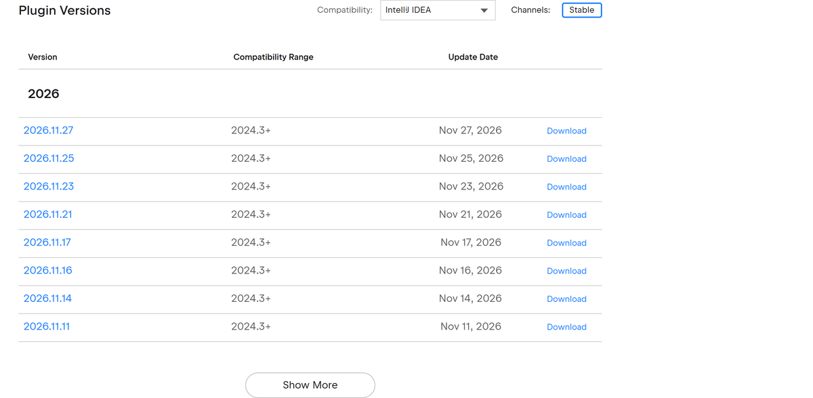
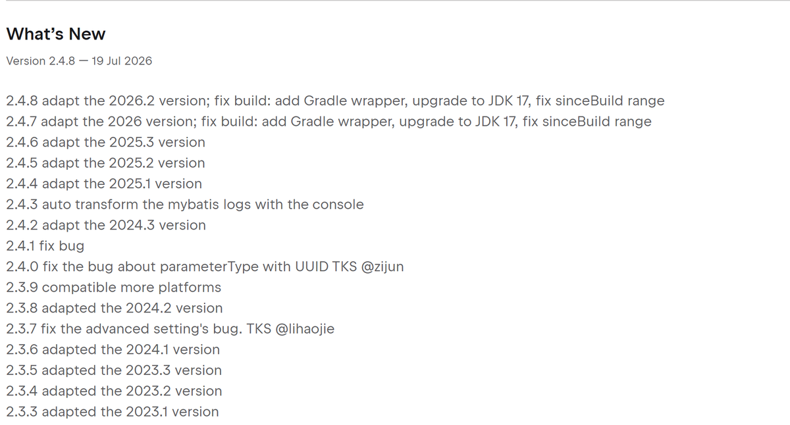
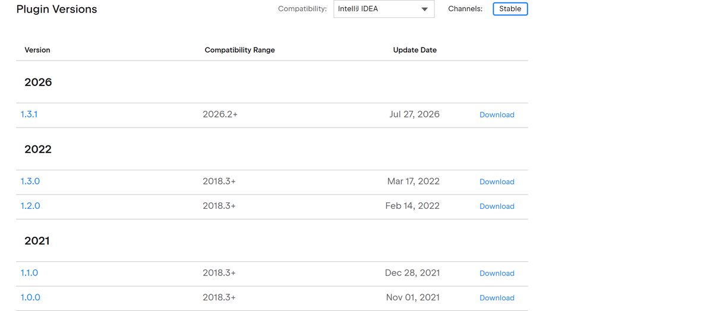
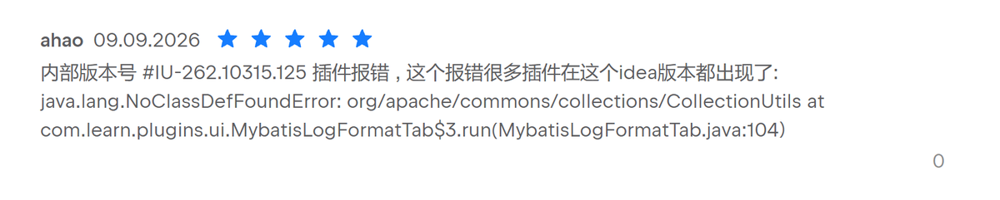
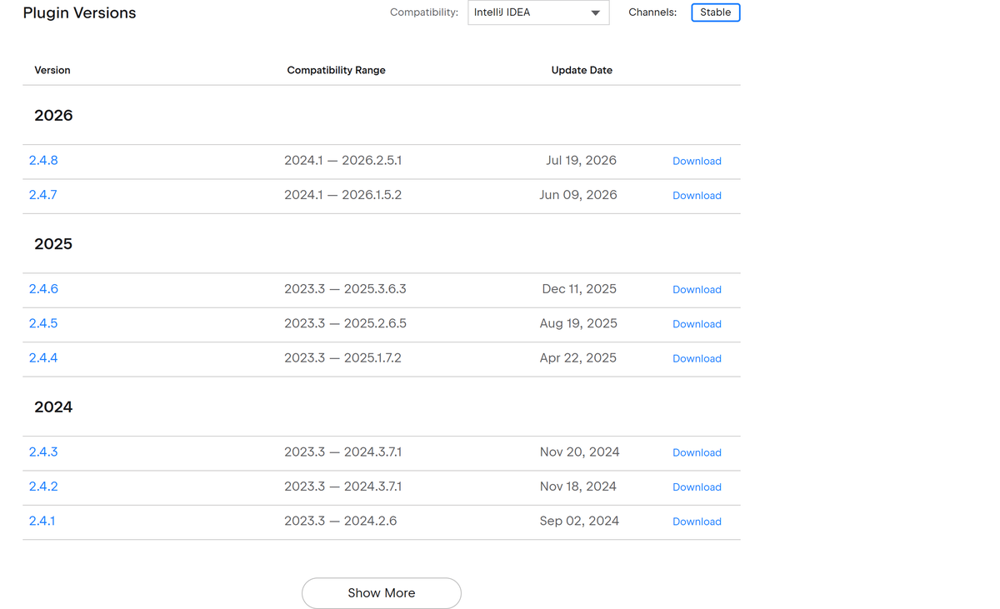

# CSDN 版

> 拆稿说明：CSDN 走教程向——开头明说「适合谁」，结尾给可执行检查清单。表格 4 列。
> 发布设置：原创、公开、分类「后端」、标签 `MyBatis` / `IntelliJ IDEA` / `SQL` / `插件`，封面用 `封面-csdn-16x9.png`（1800×1012）。
> 摘要（见下「摘要」段）：不写方案对比，写「区间怎么读 + 装不上怎么退」。
> 图用 `../img-20261127/upload/` 的 1200px 版。

**摘要**：IDEA 2026.3 于 11 月 24 日转正式版，MyBatis 系插件当天就有两家装不上。本文讲清插件兼容区间怎么读（build 号与 IDE 版本的对应）、怎么自己查（插件页 / Versions 标签 / 公开接口三条路）、八家实查结果，以及装不上时的四条路——其中「退到旧版插件」是最被低估的一条，配了完整的版本阶梯。

---

## 前言：这篇适合谁

如果你的情况是下面任意一种，这篇能省你半天：

- IDE 刚升到 2026.3，发现某个 MyBatis 插件装不上或一用就报错；
- 公司项目把 IDE 锁在 2024.3 / 2025.x，新插件页直接写不支持；
- 想给团队定「装哪个插件」，但不知道它跟哪几版 IDE 兼容。

## 一、三个数字：build 号与 IDE 版本

插件页写 `2024.3 — 2026.3`，插件描述文件里存的却是 build 号 `243.*`、`263.*`。服务端负责翻译。规则：前两位年份，第三位大版本号。

| build 前缀 | IDE 版本 |
|---|---|
| 243 | 2024.3 |
| 251 / 252 / 253 | 2025.1 / 2025.2 / 2025.3 |
| 261 / 262 | 2026.1 / 2026.2 |
| 263 | 2026.3（2026-11-24 转正式版） |

区间由两个字段决定：

- `since-build`：最低能装的 IDE 版本。写 251，2025.1 以下装不上。
- `until-build`：最高能装。**留空 = 无上限**，页面渲染成 `2024.3+` 这种加号形态：



另外，区间按产品线分开声明：Ultimate、Community、Android Studio 各一份。MyBatis Log Ultra 现在 Ultimate 面到 2026.3，Community 面只到 2025.3。

### 上限为什么会被写死

作者逐个大版本适配，不是自动跟随。MybatisLogFormat 的更新说明就是证据：



写死是「验证到这一版为止」的诚实声明；留空是愿意让未验证版本先装着试。两种都合理，但对常年不升级 IDE 的团队，后果完全不同。

## 二、三条查询路径

### 路径一：插件页

安装按钮旁的「Compatible with JetBrains IDEA, Android Studio and 14 more」只告诉产品线与覆盖家数，精确上下限要点进 Versions。

### 路径二：Versions 标签页

这里能看到每个历史版本自己的区间，也是「退版」的入口。



注意这张图的两端：最新版只给 2026.2 及以上，而 2022 年 3 月的 1.3.0 是 `2018.3+`。IDE 停在 2024.x 的话，新版装不上，旧版反而能装。

### 路径三：公开接口

```bash
curl -s "https://plugins.jetbrains.com/api/plugins/14292/updates?size=5" \
  | jq '.[] | {version, since, until, idea: .compatibleVersions.IDEA}'
```

`since`/`until` 是原始 build 号；`compatibleVersions` 是按产品线翻译后的区间（本文表格用这个，与页面一致）。

## 三、八家实查结果（2026-11-27）

| 插件 | IDEA 区间 | 2026.3 | 2024.3~2025.x |
|---|---|---|---|
| MyBatisX | 2025.1 — 2026.3.1 | 能 | 2025.1 起能 |
| MyBatis Log Free | 2026.2+ | 能 | 不能 |
| MybatisLogFormat | 2024.1 — 2026.2 | **不能** | 能 |
| MyBatis Log Ultra | 2022.2 — 2026.3.1 | 能 | 能 |
| Mybatis-Flex-Helper | 2026.1 — 2026.2 | **不能** | 不能 |
| Jtools-Mybatis-Log | 2017.1 — 2026.3.1 | 能 | 能 |
| MybatisLogFree（fork） | 2025.1+ | 能 | 2025.1 起能 |
| MyBatis SQL Visualizer | 2024.3+ | 能 | 能 |

各家最新版本与发布日期：MyBatisX 1.7.9（11-18）、MyBatis Log Free 1.3.1（07-27）、MybatisLogFormat 2.4.8（07-19）、MyBatis Log Ultra 4.0.20（05-25）、Mybatis-Flex-Helper 1.8（04-11）、Jtools-Mybatis-Log 1.1.3（09-24）、MybatisLogFree 2.0.6（09-17）、本插件 2026.11.27。累计下载从 566 万到 390 不等。

两种「不能」的分布值得单独看：

- **跟不上新版本**：MybatisLogFormat 上限 2026.2，2026.3 装不上，但 2024.1 以后都能装；Mybatis-Flex-Helper 只剩 2026.1—2026.2。
- **不给老版本**：MyBatis Log Free 下限 2026.2，2026.1 及以下全装不上。

## 四、区间写着支持，也可能崩



2026-09-09 有用户在 MybatisLogFormat 打 5 星却写着报错：`IU-262.10315.125` 上抛

```
java.lang.NoClassDefFoundError: org/apache/commons/collections/CollectionUtils
    at com.learn.plugins.ui.MybatisLogFormatTab$3.run(MybatisLogFormatTab.java:104)
```

该插件当时标注支持 2026.2。跨大版本时类被移除、包被改名、可选依赖不再打包，都会让「区间内」变成「装得上但用不了」。

另一侧证据：MybatisLogFree（fork）承接被 2026.2 下限挡住的用户，最新版 2.0.6 从 2025.1 起，390 下载，两个月涨 48%。

也补一个反向事实：免费线里区间最宽的是 Jtools-Mybatis-Log，2017.1 到 2026.3.1。

## 五、装不上时的四条路

### 路线一：升级 IDE

最彻底，也最常不由自己定。若 IDE 是自己装的，升到 2026.3 就没有兼容问题。

### 路线二：退到旧版插件

最被低估。同一个插件的历史版本往往是一条连续阶梯：



这样基本总能找到覆盖你手上 IDE 的版本。代价是功能冻结，后续修复拿不到——作为过渡可以，长期停在这里要接受它不再维护。

### 路线三：换插件

代价是重新适配工作流：快捷键、面板位置、日志格式、跟已有配置的配合。功能相似不等于可以无痛替换。

### 路线四：选一个区间写宽的

只看一个字段——`until-build` 是不是空的。

## 六、可执行检查清单

1. 查自己的 IDE 大版本（Help → About 里那串 build 号的前三位）；
2. 打开目标插件的 Versions 标签，找区间覆盖你这一版的最新一条；
3. 若最新版不覆盖，按阶梯往后退，记下第一个覆盖你版本的版本号；
4. 退版后留意：功能停在该版本，之后的修复不会进来；
5. 若某个插件长期不更新，优先选 `until-build` 留空的替代品，跨大版本时少一次折腾。

## 七、关于本文作者维护的插件

表格最后一行是本文作者的插件（MyBatis SQL Visualizer）：`since-build 243` + `until-build` 留空，页面显示 `2024.3+`，2024.3~2026.3 全线可装；每次发行在 243/253/262 三个目标跑兼容校验；免费开源；MCP 工具面需要 IDEA 2025.2+，SQL 执行是 Ultimate 专属，Community 版优雅降级。门槛如实写，不夸大。

## 数据说明

区间、版本、发布日期、下载量均于 2026-11-27 读取 JetBrains Marketplace 公开接口，区间取 `compatibleVersions.IDEA`，并与插件页渲染逐条回核。IDEA 2026.3 正式版信息取自官方 releases 接口（263.7307.353，2026-11-24）。评论原文照录，未做改写。竞品数据会随版本变化，引用请保留日期口径。
