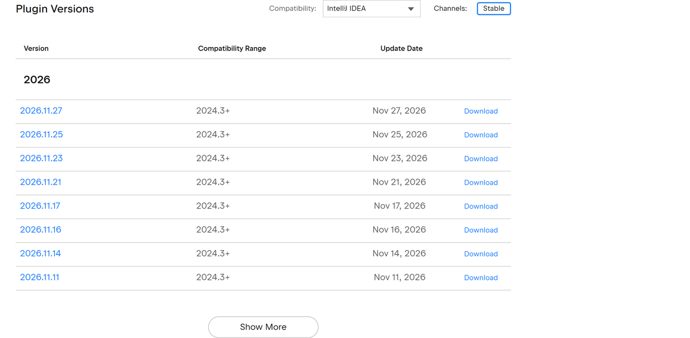
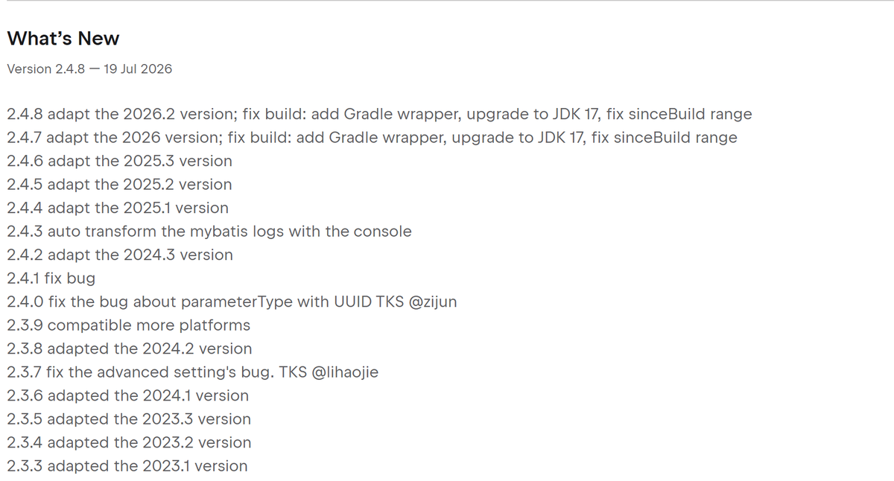
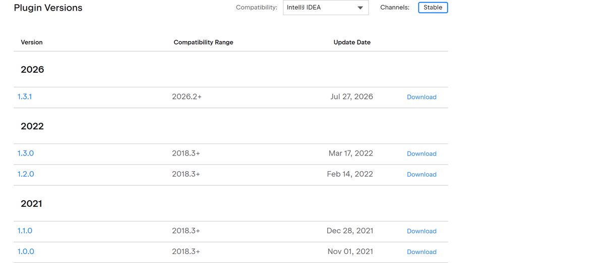
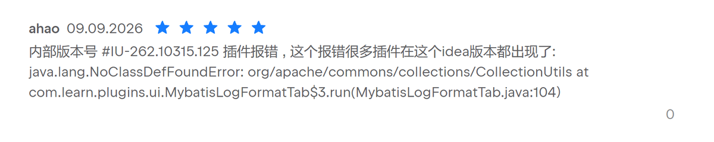
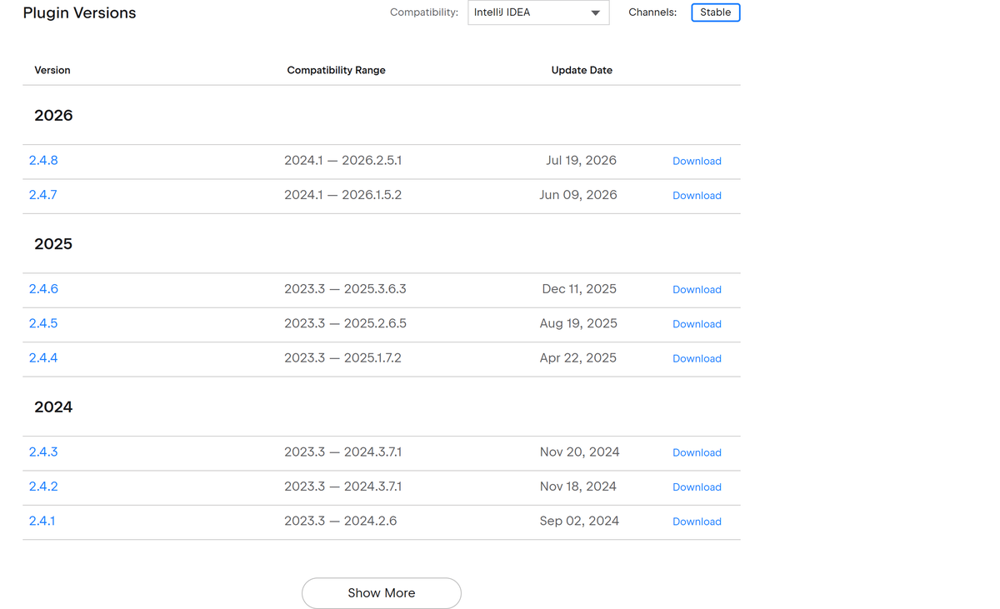

# 掘金版

> 拆稿说明：掘金读者偏实操，开头改成「体检」动作视角，多一个可复制的 curl 例子；表格 4 列。
> 发布设置：分类「后端」、标签 `MyBatis`（掘金标签必填，空标签点发布无任何提示）、封面用 3:2 裁切。
> 图用 `../img-20261127/upload/` 的 1200px 版。

---

## IDEA 2026.3 发了，先给 MyBatis 插件做一次兼容体检

11 月 24 日，IntelliJ IDEA 2026.3 正式版（263.7307.353）落地。每次大版本一过，插件圈都会安静地掉一批可用项——不是坏了，是兼容区间的上限写死在了上一版。

这次我把 MyBatis 系八家的区间逐个查了一遍，顺手把「怎么自己查」和「装不上怎么办」整理出来。

### 一、三个数字：243、262、263 是什么

插件页写 `2024.3 — 2026.3`，但插件描述文件里存的是 build 号 `243.*`、`263.*`，服务端翻成人话再显示。规则：前两位年份，第三位大版本号。

| build 前缀 | IDE 版本 |
|---|---|
| 243 | 2024.3 |
| 251 / 252 / 253 | 2025.1 / 2025.2 / 2025.3 |
| 261 / 262 | 2026.1 / 2026.2 |
| 263 | 2026.3（11-24 转正式版） |

描述文件里就两个字段：`since-build`（最低能装）与 `until-build`（最高能装）。**`until-build` 留空 = 没有上限**，页面渲染成一个加号：



还有一点常被忽略：区间按产品线分开声明。Ultimate、Community、Android Studio 各有上限。MyBatis Log Ultra 现在 Ultimate 面到 2026.3，Community 面只到 2025.3——同一份插件，两个上限。

#### 为什么上限总被写死

因为作者逐个大版本去适配。下面是 MybatisLogFormat 的更新说明，2.3.3 一路 adapt 到 2.4.8：



写死上限是「我验证到这一版为止」的诚实声明；留空则是愿意让未验证的新版本先装着试。两种选择各有代价，没有哪种更高级。

### 二、三条命令查完，不用装任何东西

**插件页**：安装按钮旁那行「Compatible with ... and N more」只给产品线，不给精确版本。

**Versions 标签页**：每个历史版本都带自己的区间，退版走这里。



**公开接口**：想批量核对，直接拉：

```bash
curl -s "https://plugins.jetbrains.com/api/plugins/14292/updates?size=5" \
  | jq '.[] | {version, since, until, idea: .compatibleVersions.IDEA}'
```

`since`/`until` 是原始 build 号，`compatibleVersions` 是按产品线翻译好的版本区间。本文表格用后者，因为那是页面上真正显示的。

### 三、八家实查（2026-11-27）

| 插件 | IDEA 区间 | 2026.3 | 2024.3~2025.x |
|---|---|---|---|
| MyBatisX | 2025.1 — 2026.3.1 | 能 | 2025.1 起能 |
| MyBatis Log Free | 2026.2+ | 能 | 不能 |
| MybatisLogFormat | 2024.1 — 2026.2 | **不能** | 能 |
| MyBatis Log Ultra | 2022.2 — 2026.3.1 | 能 | 能 |
| Mybatis-Flex-Helper | 2026.1 — 2026.2 | **不能** | 不能 |
| Jtools-Mybatis-Log | 2017.1 — 2026.3.1 | 能 | 能 |
| MybatisLogFree（fork） | 2025.1+ | 能 | 2025.1 起能 |
| MyBatis SQL Visualizer | 2024.3+ | 能 | 能 |

版本与发布日期：MyBatisX 1.7.9（11-18）、Log Free 1.3.1（07-27）、LogFormat 2.4.8（07-19）、Ultra 4.0.20（05-25）、Flex-Helper 1.8（04-11）、Jtools 1.1.3（09-24）、fork 2.0.6（09-17）、本插件 2026.11.27。

两种「不能」同时存在，这是最有意思的地方：

- **跟不上新版本**：MybatisLogFormat 上限停在 2026.2，2026.3 装不上，但 2024.1 以后都能装；Flex-Helper 更窄，只剩 2026.1—2026.2 两个版本可用。
- **不给老版本**：MyBatis Log Free 下限提到 2026.2，2026.3 能装，2026.1 及以下全装不上。

所以「哪个插件好用」离开 IDE 版本没有意义。

### 四、区间内也会崩

区间是必要条件，不是充分条件。



2026-09-09，一位用户在 MybatisLogFormat 打了 5 星却写着报错：`IU-262.10315.125` 上抛 `java.lang.NoClassDefFoundError: org/apache/commons/collections/CollectionUtils`。区间标着支持 2026.2，实际类加载失败。同页还有人留言「新的idea 不能用呢，可否兼容下呢」。

跨大版本时类被移除、包被改名、可选依赖不再打包，都会让「区间内」变成「装得上但用不了」。

另一侧的证据是 fork：MybatisLogFree 承接被 2026.2 下限挡在门外的用户，最新版 2.0.6 从 2025.1 起，390 下载（两个月涨 48%）。

反向事实也说一句：免费线里区间最宽的是 Jtools-Mybatis-Log，2017.1 到 2026.3.1。

### 五、装不上时的四条路

1. **升级 IDE**：最彻底，也最不由自己定（公司镜像、团队统一版本、JDK 锁定）。
2. **退到旧版插件**：最被低估。MybatisLogFormat 就是一条连续阶梯——2.4.8 到 2026.2、2.4.7 到 2026.1、2.4.6 到 2025.3、2.4.3 到 2024.3。代价是功能冻结。
3. **换插件**：代价是重新适配工作流，功能相似 ≠ 无痛替换。
4. **选区间写宽的**：只看一个字段，`until-build` 是不是空的。



### 六、关于本文作者维护的那个

最后一行是本文作者的插件（MyBatis SQL Visualizer），说明白：`since-build 243` + `until-build` 留空，页面显示 `2024.3+`，2024.3~2026.3 全线可装，每次发行在 243/253/262 三个目标跑兼容校验；免费开源；MCP 工具面要 IDEA 2025.2+，SQL 执行是 Ultimate 专属，Community 版降级——门槛如实写，不夸大。

### 数据说明

区间与下载量于 2026-11-27 读取 JetBrains Marketplace 公开接口，取 `compatibleVersions.IDEA` 并与页面渲染回核。IDEA 2026.3 版本号取自官方 releases 接口。评论原文照录。数据会随版本变化，引用请保留日期。
