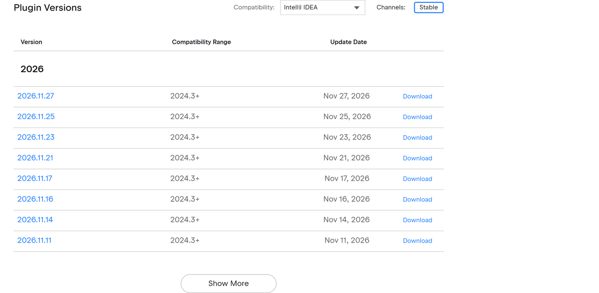
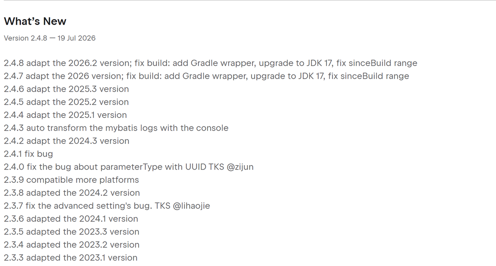
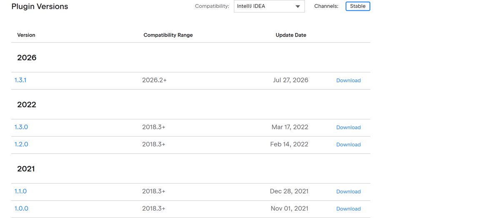
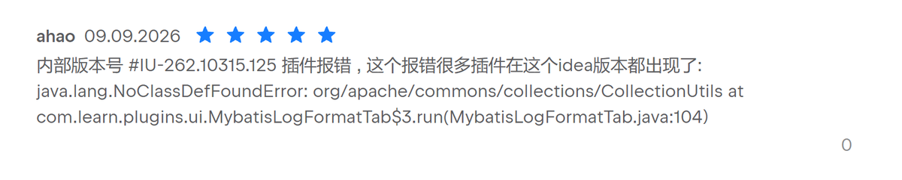
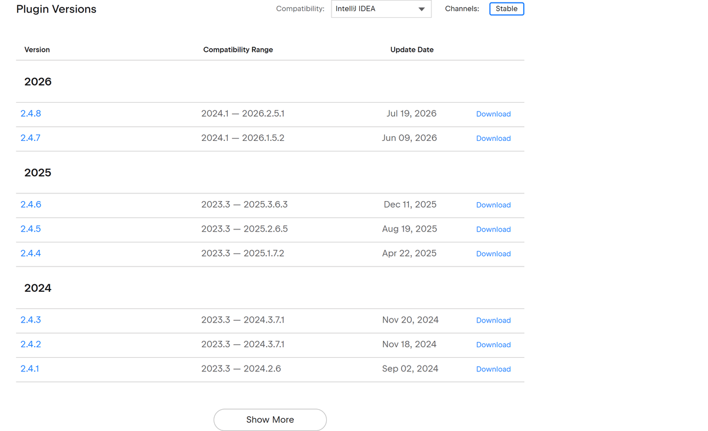

# 知乎专栏版

> 拆稿说明：正文按知乎专栏习惯用 H3 分层，表格压到 4 列（版本号与下载量改写成正文一句）。图用 `../img-20261127/upload/` 的 1200px 版。
> 发布设置：封面 16:9、话题 MyBatis、创作声明「包含 AI 辅助创作」、收录进专栏「MyBatis 与 SQL 调试」。
> 注意：知乎粘贴 Markdown 时会弹「是否转成 Markdown 格式」，必须点确认，图片与表格才会正确渲染。

---

## IDEA 2026.3 刚发，你的 MyBatis 插件还装得上吗

2026 年 11 月 24 日，IntelliJ IDEA 2026.3 正式版发布（build 263.7307.353）。每次大版本落地，兼容问题都会同时出现在两端。

一端是刚升级的人：常用的几个 MyBatis 插件在列表里灰了，或者装上去一用就报错。

另一端是公司项目把 IDE 锁在 2024.3 或 2025.1 的人：去装新插件，插件页直接写不支持。

这两件事是同一个问题的两面——**插件的兼容区间，和你的 IDE 版本对不上**。一头是插件不给老版本，一头是老插件跟不上新版本。中间夹着的，是大量既升不了、也换不掉的人。

这篇文章讲三件事：那串数字怎么读、区间怎么自己查、装不上时有哪几条路。结论都配了 Marketplace 上的原始截图。

### 一、先把那三个数字读懂

插件页上会写 `2024.3 — 2026.3` 这样的区间。但插件描述文件里存的不是 IDE 版本号，是一串 build 号：`243.*`、`263.*`。两者指的是同一件事，服务端负责把 build 号翻成人话再显示。

规则很简单：前两位是年份，第三位是该年的大版本号。`243` 是 2024.3，`251`/`252`/`253` 是 2025.1/2025.2/2025.3，`261`/`262` 是 2026.1/2026.2，`263` 就是刚发的 2026.3。

区间在插件描述文件里由两个字段决定：

- `since-build`：最低能装的 IDE 版本。写 251，2025.1 以下一律装不上。
- `until-build`：最高能装。**留空表示没有上限**，往后的大版本都能装。

留空在页面上长这样——这是我们自己插件的版本页，每个版本都写 `2024.3+`，加号就是「没有上限」：



还有一个容易忽略的点：**区间不是全局一个数，而是按产品线分开声明**。Ultimate、Community、Android Studio 各有各的上限。比如 MyBatis Log Ultra 现在 Ultimate 面到 2026.3，Community 面只到 2025.3——同一份插件，两条产品线，两个上限。

#### 上限为什么经常被写死

因为作者是**逐个 IDE 大版本去适配**的，不是随版本自动跟随。下面是 MybatisLogFormat 的更新说明，从 2023 一路 adapt 到 2026.2，几乎每个大版本一条：



看懂这段就明白了两件事：写死上限不是偷懒，是「我验证到这一版为止」的诚实声明；反过来，`until-build` 留空的插件也不是保证永远能用，是作者愿意让未验证的新版本先装着试。

### 二、查区间不用装任何东西

三个入口，按顺序用。

**第一，插件页。** 每个插件页的安装按钮旁会写一行兼容说明，形如「Compatible with JetBrains IDEA, Android Studio and 14 more」——先告诉你兼容哪些产品、覆盖了多少家。缺点是不点进 Versions 看不到精确的版本上下限。

**第二，Versions 标签页。** 同一个插件页里的版本列表，每个历史版本都带自己的区间。这是「退版」这条路的入口，下文会用到。很多人不知道这个标签的存在，装不上就以为彻底没戏了。



这张图值得多看两眼。同一个插件，最新版只给 2026.2 及以上，但 2022 年 3 月的 1.3.0 写的是 `2018.3+`——如果你的 IDE 停在 2024.x，新版装不上，旧版反而能装。

**第三，公开接口。** 想一次核对多家，直接读接口比翻页面快：

```
https://plugins.jetbrains.com/api/plugins/<插件ID>/updates?size=5
```

返回里每个版本都有 `since` / `until`（原始 build 号）和 `compatibleVersions`（按产品线翻译好的版本区间）。本文表格用的是后者，因为那是读者在页面上真正看到的。

### 三、截至 2026 年 11 月 27 日的实查结果

我按 MyBatis 系常被提到的几家逐家读了最新版本的区间。下表是 Ultimate 面，「2024.3~2025.x」指 2024.3 到 2025.3 这一段。

| 插件 | IDEA 区间 | 2026.3 能装 | 2024.3~2025.x 能装 |
|---|---|---|---|
| MyBatisX | 2025.1 — 2026.3.1 | 能 | 2025.1 起能 |
| MyBatis Log Free | 2026.2+ | 能 | 不能 |
| MybatisLogFormat | 2024.1 — 2026.2 | **不能** | 能 |
| MyBatis Log Ultra | 2022.2 — 2026.3.1 | 能 | 能 |
| Mybatis-Flex-Helper | 2026.1 — 2026.2 | **不能** | 不能 |
| Jtools-Mybatis-Log | 2017.1 — 2026.3.1 | 能 | 能 |
| MybatisLogFree（fork） | 2025.1+ | 能 | 2025.1 起能 |
| MyBatis SQL Visualizer | 2024.3+ | 能 | 能 |

各家的最新版本与发布日期：MyBatisX 1.7.9（11-18）、MyBatis Log Free 1.3.1（07-27）、MybatisLogFormat 2.4.8（07-19）、MyBatis Log Ultra 4.0.20（05-25）、Mybatis-Flex-Helper 1.8（04-11）、Jtools-Mybatis-Log 1.1.3（09-24）、MybatisLogFree 2.0.6（09-17）、本插件 2026.11.27。累计下载量从 566 万到 390 不等。

表格里最值得注意的不是谁家宽，而是**两种「不能」的分布**：

- MybatisLogFormat 的上限停在 2026.2：2026.3 装不上，2024.1 以后的老版本都能装。这类是「跟不上新版本」。
- Mybatis-Flex-Helper 更窄，1.8 只写了 2026.1 — 2026.2：2026.3 装不上，2024.x~2025.x 也装不上，实际只剩两个版本可用。
- MyBatis Log Free 反过来，下限提到了 2026.2：2026.3 上能装，2026.1 及以下全装不上。这类是「不给老版本」。

同一个生态里，两种错配同时存在。所以「哪个插件好用」这个问题，离开 IDE 版本没有意义——先说你装的是哪版 IDEA。

### 四、区间写着支持，也可能崩

区间是必要条件，不是充分条件。两个真实样本。



2026 年 9 月 9 日，一位用户在 MybatisLogFormat 下打了 5 星，内容却是报错反馈：在 `IU-262.10315.125` 上抛 `java.lang.NoClassDefFoundError: org/apache/commons/collections/CollectionUtils`。这个插件当时标注支持 2026.2，实际跑起来仍有类加载失败。同页评论里还有一句更直接的：「新的idea 不能用呢，可否兼容下呢」。

一个 18 万下载量级的老牌插件尚且如此，说明区间标注和实际可用之间是有距离的。跨大版本时，类被移除、包被改名、可选依赖不再打包，都会让「区间内」变成「装得上但用不了」。

第二个样本是 fork。MybatisLogFree 是 MyBatis Log Free 的第三方 fork，原版把下限提到 2026.2 之后，这个 fork 的最新版 2.0.6 从 2025.1 起（更早的 2.0.2 是 2024.1 起），到 11 月 27 日已有 390 下载（9 月底是 263，两个月涨了 48%）。一个只有几百下载的 fork 能持续涨，说明「老版本 IDE 用户没地方去」不是叙事，是需求。

顺带一个反向事实，免得表格显得太挑：免费线里区间最宽的是 Jtools-Mybatis-Log，2017.1 到 2026.3.1——从 2017 年一路能装到今天。

### 五、装不上时的四条路

按代价从高到低排。

**一、升级 IDE。** 最彻底，代价也最大——多数时候不由开发者自己定。公司镜像、团队统一版本、项目锁着的 JDK，任何一条都能让升级排到半年后。如果你的 IDE 是自己装的，这条其实最省事，直接升到 2026.3 就没有兼容问题了。

**二、退到旧版插件。** 被严重低估的一条路。同一个插件的历史版本往往覆盖不同区间，而且是一条连续的阶梯：



从这张表往下退，基本能找到覆盖你手上 IDE 的版本：2.4.8 盖到 2026.2，2.4.7 到 2026.1，2.4.6 到 2025.3，2.4.3 甚至还能盖 2024.3。代价是功能冻结在这个版本，后续修复和新特性都拿不到。作为过渡可以，长期停在这里要接受它不再维护。

**三、换一个区间覆盖你的插件。** 代价最小的是重新适配工作流：快捷键、面板位置、日志格式、跟项目里已有配置的配合，都要重新过一遍。功能相似不等于可以无痛替换，这点用过的人都清楚。

**四、选一个区间写宽的。** 这条放在最后说，因为它容易被写成广告。先看一个字段：`until-build` 是不是空的。空的上限意味着作者不打算每发一版就重新声明一次兼容，往后的大版本默认跟着走。这条对常年不升级 IDE 的团队，比功能表上多两个按钮有用。

### 六、我们在这张表里的位置

上面那张表最后一行是本文作者维护的插件，MyBatis SQL Visualizer，说明白：

- 区间是 `since-build 243`、`until-build` 留空，页面上显示 `2024.3+`，2024.3 到 2026.3 都能装。每次发行会在 243 / 253 / 262 三个目标上跑一遍兼容校验，读数落在仓库的验收文档里。
- 免费开源，没有付费版和功能锁。
- **门槛如实写**：MCP 工具面需要 IDEA 2025.2+（依赖平台自带的 MCP Server 插件），没装这个环境不影响其余功能；SQL 执行这类能力是 Ultimate 专属，Community 版会优雅降级。
- **收益如实限定**：mapper XML 的注入高亮这类功能，在 Ultimate 上会因为平台自带 SQL 注入器在位而让位——能做什么就说什么，不夸大。

这不是「都来装我的」。区间表摆在这里，选择权在读者：如果你的 IDE 已经升到 2026.3，前面八家里有六家能装；如果锁在 2024.3，能装的是 MybatisLogFormat、MyBatis Log Ultra、Jtools-Mybatis-Log 这三家，加上本文这只——这就是现状。

### 数据说明

本文所有区间、最新版本、发布日、累计下载量，均为 2026 年 11 月 27 日通过 JetBrains Marketplace 公开接口读取，区间取 `compatibleVersions.IDEA`，并与插件页实际渲染逐条回核，非估算。IDEA 2026.3 正式版信息取自官方 releases 接口（263.7307.353，2026-11-24）。评论原文照录，未做改写。竞品数据会随版本更新变化，引用时请保留日期口径。

---

本文为原创，首发于知乎（作者 SongRenShuo）。转载请注明作者与出处。
