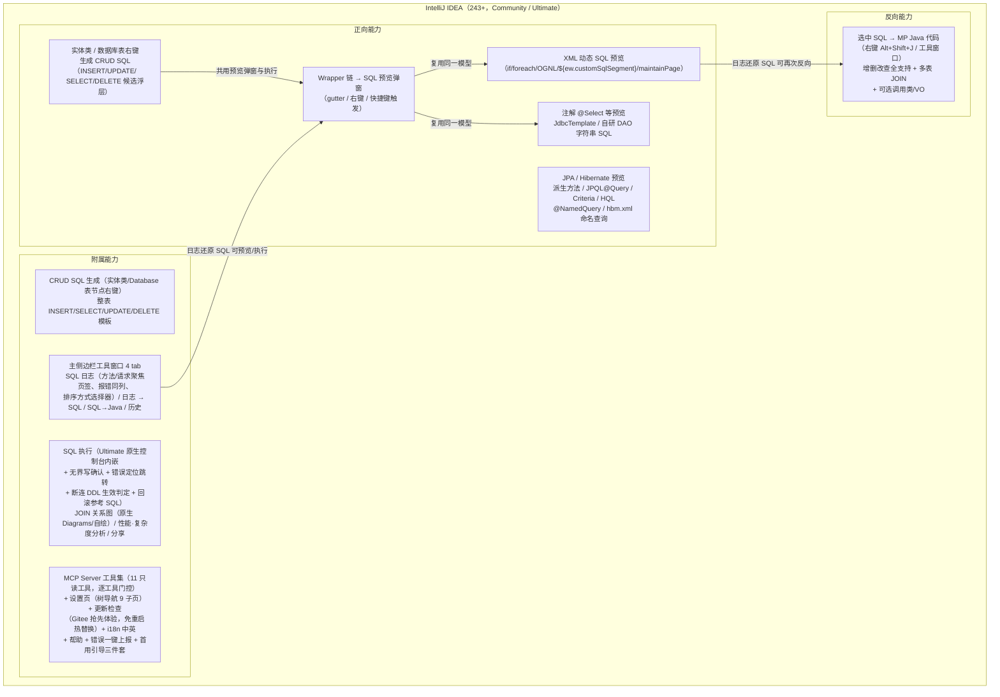
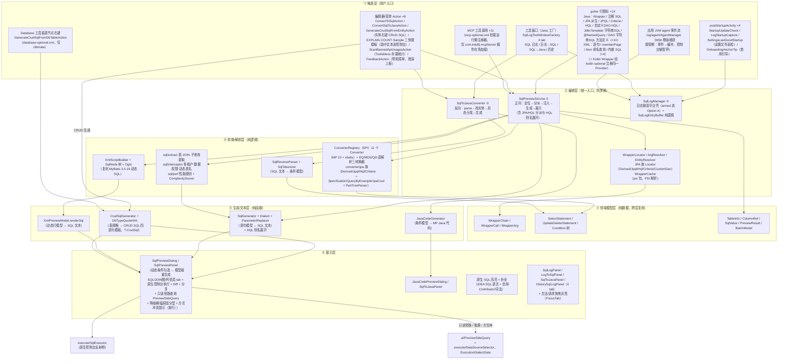
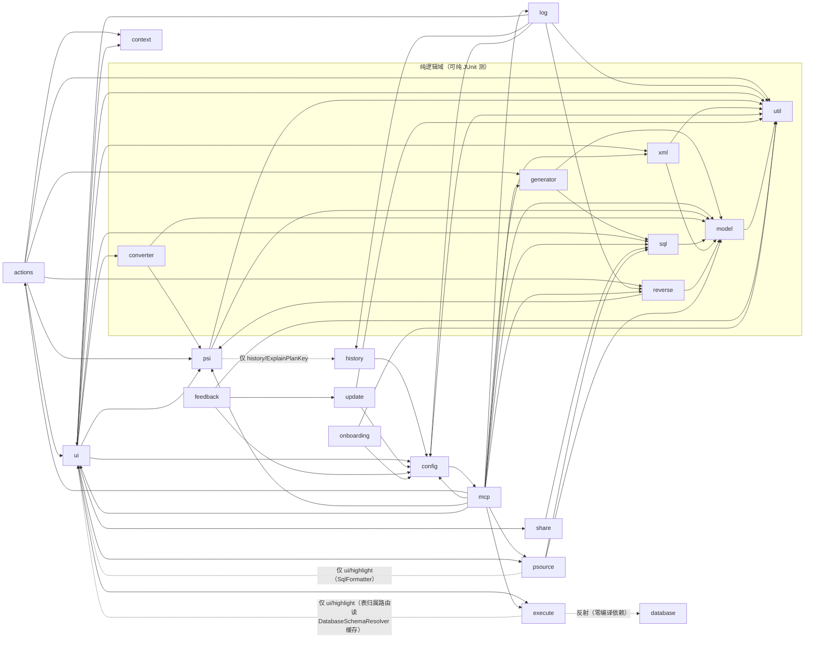
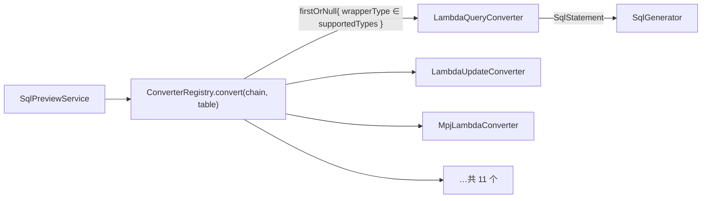

# 01 · 项目架构总览

> 系列文档（docs/架构设计/）：`01` 架构总览（本文）→ `02` 核心流程详解 → `03` 开发与测试指南。
> 本文面向首次接触本仓库的开发者，目标：读完后能回答「项目是什么、代码怎么组织、关键设计为什么这样」。
> 维护约定：随代码演进更新；架构图用 Mermaid，Gitee / Typora 可直接渲染。
> 本文对齐代码：dev@2026-10-31（插件版本 2026.10.31；FR-0045 四项能力目前在 dev，尚未合入 master）。

---

## 1. 产品定位

**SQL Visualizer**（v2026.8.28 前名 MyBatis-Plus SQL Visualizer，插件 ID 不变）是一款 IntelliJ IDEA 插件（Kotlin 为主源码），围绕 MyBatis-Plus / MyBatis-Plus-Join（MPJ）/ Hibernate / JPA 提供双向能力：

- **正向**：把代码里的 `LambdaQueryWrapper` 等 Wrapper 调用链、其他 ORM 链（xbatis / Easy-Query / MyBatis Dynamic SQL / Querydsl，M44）、XML / 注解动态 SQL、Spring Data JPA 派生方法（findByXxx）、JPQL/@Query、CriteriaBuilder、HQL（含自定义 DAO 与 hbm.xml 命名查询）、JdbcTemplate / 自研 DAO 字符串 SQL 实时**转换为可读、可复制的 SQL**，支持参数回填、动态条件勾选、14 种方言（默认**智能推断**：按运行应用 agent 捕获的连接 URL 优先、IDE 数据源 URL 次之，T-DialectAutoInfer）、逻辑删除 / 乐观锁 / 分页注入。
- **反向**：把选中/粘贴的 **SQL 文本转换回 MP Java 代码**（QueryWrapper / LambdaQueryWrapper / Wrappers 工厂 / MPJ 等形态）。
- **CRUD SQL 生成（T-CrudSql）**：实体类（编辑器 / 项目视图右键）与 Database 工具窗表节点一键生成 INSERT / UPDATE / SELECT / DELETE 模板（主键 / 逻辑删除 / `@Version` 感知），候选经原生浮层选择后进统一预览窗口。
- **附属能力**：运行日志捕获还原（控制台解析 + **字节码增强 agent 双通道**，M56——增强捕获默认开启，开关即授权、不再弹注入确认；agent 接管期免注入拦截器即得源码位置/耗时/影响行数/请求标签（采集面按 `java.sql` 接口兜底匹配，不依赖驱动类白名单，见 02 篇 §6.5）；主侧边栏 4 tab，方法级/请求级聚焦页签、SQL 执行报错同列、排序方式选择器，参数随历史条目持久化并支持免占位符字面量恢复，参数预设/参数历史按声明方法隔离）+ SQL 历史、预览面板只读旁路（T-PreviewSideQuery：预估影响行数与回滚快照查询走只读通道，不替换预览编辑器；执行视图带「返回预览」）、执行计划（T-ExplainConsoleFirst：默认回预览窗内嵌原生控制台执行，结构化渲染为实验开关、走非模态对话框）、方言闸门就地修复（T-DialectGateUx/Exit + T-DialectGatePass：两边方言都已知的冲突只提示不阻断，有一边未知的写操作仍拦；重渲染失败回落态给「切换数据源 / 方言设置」两个就地出口）、降级横幅原因分型（T-DegradedPreviewUx：七类原因 + 超时宽限期）、SQL 原生控制台执行（Ultimate，执行前无界写判定升级确认文案（只读豁免词法二级证明 fail-closed，N-21）、执行超时护栏（O-25）、执行错误定位跳转、断连后 DDL「失败不等于未生效」探测、执行后 DDL/事务提交失效元数据缓存（执行前预判 + 收尾兜底双保险），UPDATE/DELETE 可生成回滚参考 SQL）、JOIN 关系图（IDEA 原生 Diagrams 优先、自绘降级，JOIN 表整表列口径上限 50 列）、性能/复杂度分析、SQL 分享（Markdown/HTML 报告）、MCP Server 工具集（IDEA 内置 MCP Server 注册 11 个只读工具，设置页可逐工具门控，explain 输出附驱动 notices 与索引缺失建议、对非关系型数据源早拒 `NOT_A_SQL_DATASOURCE`、达梦 EXPLAIN 走 `EXPLAIN FOR`）、首用引导三件套（首锚点指路通知 / 空态引导 / 首次捕获指路，T-UxOnboard）、内置更新检查（Gitee 抢先体验通道，动态安装免重启热替换）、IDE 内部错误一键上报官网需求池（多选合并上报、失败可见与错峰补发）、设置页（树导航 9 子页，设置项接入 IDE 自带设置搜索索引）、中英双语、**禁用 API 检查（T-BannedApiCheck，插件首个 localInspection + 设置页规则表 + 全项目存量统计）**、**SQL 优化留痕一键导出（T-TraceDocExport，六段式 Markdown + 计划前后对比）**、**外部 SQL 模板渲染器 hook（T-TemplateHook，自研模板交由用户命令渲染）**。

### 1.1 技术栈与基线

| 项 | 值 |
|---|---|
| 语言 | Kotlin（JVM toolchain 17）主源码；`src/main/java` 仅 3 个类（工具窗口工厂 + 工具窗可见性监听 + `ui/search/MinSearchSession`（原生搜索会话最小实现，Java 侧返回 null 不受平台 `@NotNull` 编译约束），前两者同时规避 Kotlin + ToolWindowFactory 的 Verifier Internal API 问题）；子项目 `sub-projects/sql-visualizer-agent` 纯 Java（M56 字节码增强 agent，构建期内嵌进插件 jar）。录制态（`-PgifRecord=true`）另切平台 2026.2.1 + toolchain 24 + JCEF 沙盒 |
| 插件 ID | `cn.song.mybatisplus.visualizer.mybatis-plus-sql-visualizer`（更名后不变，升级兼容） |
| 插件名 | `SQL Visualizer`（v2026.9.2 起，原 MyBatis-Plus SQL Visualizer） |
| 版本 | 日期式 `YYYY.M.D`（gradle.properties），一日一版 |
| 平台基线 | `intellijIdeaUltimate("2024.3.7.1")`（since-build=243，不设 until-build；日常 IDE 为 2026.2.3） |
| 依赖 | `com.intellij.java`、`com.intellij.modules.xml`、可选 `com.intellij.database`（SQL 执行反射隔离 + JOIN 虚拟外键 + Database 表节点 CRUD SQL 入口，database-optional.xml）、可选 `org.jetbrains.kotlin`（Kotlin Wrapper 链 gutter，kotlin-optional.xml）、可选 `com.intellij.diagram`（JOIN 原生图，diagram-optional.xml）、可选 `com.intellij.mcpServer`（MCP 工具集，mcp-optional.xml，编译期类型来自 mcpStub 桩源集不进 jar）、可选 `com.intellij.ml.llm`（ACP 会话 MCP 传输，acp-transport-optional.xml，桩同款不进 jar） |
| 运行时第三方依赖 | **零**（mybatis-plus-core 3.5.17 仅测试 classpath） |
| 测试 | JUnit 4 + Light/Heavy fixture，852 个测试源文件（845 `.kt` + 7 `.java`，2026-10-31 统计；`.kt` 中 18 个是测试辅助类）；全量用例数随每轮新增测试变化，不在本文写死，以最近一次发行说明/`docs/变更记录.md` 的权威读数为准（最近一版：2026.10.31 发行说明记 `testShards` 8532/0/0/10，含 testExternal）；另 7 个 DB 集成类经 `testDb*` 通道不进分片，agent 子项目 `:sql-visualizer-agent:test` 独立 JVM 运行 |

---

## 2. 分层架构

代码分六层，依赖方向自上而下（上层可依赖下层，禁止反向）：

**分层要点**：

- **③④⑤ 三层为纯函数/纯逻辑**（`model` / `converter` / `sql` / `xml` / `reverse` / `util` 及其子包），不依赖 PSI 与 IDE —— 这是大量纯 JUnit 测试类零 IDE fixture 的基础，也是核心算法可独立验证的关键。
- **③ 模型层是正反向共用的桥梁**：反向解析器（SqlReverseParser）产出的 `Condition` 与正向生成器（SqlGenerator）消费的是同一模型（round-trip 自洽），这是「SQL 能转回代码、代码能再转回 SQL」的根基。
- **② 编排层收敛所有入口**：所有 UI 触发（gutter/Action/面板）都汇入 `SqlPreviewService` 与 `SqlToJavaConverter` 两个编排点，避免 Action 与面板行为漂移（详见第 5 节设计决策）。JPA/Hibernate 六种 gutter 也统一进 `SqlPreviewService`（`previewDerivedQuery` / `previewJpql` / `previewCriteriaQuery` / `previewHql` 等方法族），JdbcTemplate / hbm 命名查询 / @NamedQuery 各有对应 `previewXxx` 入口。
- **日志捕捉是双通道汇入同一缓冲**：控制台解析链（consoleFilterProvider EP 主通道 + 反射桥轮询兜底 → 三族 parser 线程分桶 → 还原）与 M56 增强捕获链（`log/agent` 事件 → `AgentEventAdapter` 纯函数适配）都汇入 `SqlLogEntryBuffer`，`dedupeKey` 两通道同口径——接管/回落切换期两通道并存不双记（详见 02 篇 §6 / §6.5）。
- **M44 其他 ORM 双轨接入**：xbatis 以 `XBATIS` 类型走 `ConverterRegistry` SPI；Easy-Query / MyBatis Dynamic SQL / Querydsl 三家不进 SPI，由 `SqlPreviewService` 按 entry + receiver 启发**前置派发**给直解析转换器（见 §5.1），锚点判定分别挂在 `WrapperAnchorDetector`（EQ 入口方法集）与 `WrapperLocator`（xbatis 工厂族）。
- **CRUD SQL 生成是 L5 旁路**：不进 WrapperConverter SPI——`CrudSqlGenerator` 直接消费表规格（实体 PSI 自省或 Database 自省元数据经 `DbTableSpecAdapter` 适配），产出模板 SQL 走既有预览弹窗展示。
- **mcp 包是协议适配层**：十一个 toolset 类不自带业务逻辑，全部委托既有编排/生成/执行层（图中 E5 → S1 一类边），自身只做 MCP 协议适配、SELECT-only 守卫与门控（唯一例外＝外部模板渲染 hook 会起用户配置的命令进程，逻辑收在纯逻辑 `mcp/ExternalTemplateRenderer`，默认关）；宿主插件缺席时整层不加载。

---

## 3. 包模块依赖

源码根：`src/main/kotlin/cn/song/mybatisplus/visualizer/`（下称 `visualizer/`），24 个顶层包（另有 `src/main/java` 下 3 个 Java 类；子项目 `sub-projects/sql-visualizer-agent` 见 §5.5「增强捕获 agent」）。依赖方向（箭头指向被依赖方）：

| 包 | 职责 | 关键类 |
|---|---|---|
| `acp` | ACP 会话 MCP 工具下发（可选依赖 com.intellij.ml.llm，acp-transport-optional.xml） | `AcpTransportRegistrar`（postStartupActivity 入口）+ `AcpTransportEpRegistrar`（全反射 + 动态代理注册 `ideaMcpTransportProvider`，按方法名分发 `getTransport`；仅对 claude-acp 返回 SSE 传输，其余返回 null 让位；AI Assistant 缺席整文件不加载） |
| `actions` | 编辑器/菜单入口 Action 与 CRUD SQL 流程编排 | `ConvertToSqlAction`、`ConvertSqlToJavaAction`、`GenerateCrudSqlFromEntityAction` / `GenerateCrudSqlFromDbTableAction` + `CrudSqlPreviewFlow`（T-CrudSql 候选合并展示）、`SelectedTableSqlTemplateActions`（EXPLAIN/COUNT/Sample 三快捷模板，T-PreviewUx-Pack；T-TemplateKeyDrop 起不设默认键位） |
| `config` | 设置持久化 + 设置页（树导航 1 父 + 9 子页）+ 项目级设置 | `PluginSettings`（@Service APP，`dialectAuto` 方言智能推断默认开、`enhancedCaptureEnabled` 增强捕获默认开）、`PluginSettingsFolderConfigurable` + 9 个子 `SectionConfigurable`（界面与操作 / 快捷键 / SQL 预览 / 表名映射 / SQL 日志 / MCP / 禁用 API / 外部模板 / 关于；后两者为 FR-0045 新增，`BannedApiConfigurable` / `ExternalTemplateConfigurable` 不走 `SectionConfigurable` 基类而是独立 `Configurable`）、`SettingsIO`、`ProjectPluginSettings`（PROJECT 级，`.idea/mp-sql-visualizer-project.xml`；字段可 null=跟随全局 + `effectiveXxx` 族定型，T-TS-13；apply 只写回被用户动过的项）+ `ProjectPluginSettingsConfigurable`（projectConfigurable EP，挂 tools 顶层）、`UpdateSection`、`McpConfigurable`（MCP 门控区）、`PluginSettingsSearchableOptionContributor`（search.optionContributor EP：设置项进 IDE 自带设置搜索索引，清单与设置页内搜索同源，T-SettingsSearchA） |
| `context` | 预览来源上下文与模块归属解析（O-145 方言推断/定位前置件） | `PreviewSourceContext`（一次预览调用内瞬态：宿主 PSI / 实际 SQL PSI 解析结果 / 模块归属 / 捕获 URL / 选中数据源）、`PreviewSourceOrigin`、`ActualSqlPsiResolver`（宿主 PSI → DatabaseTools SQL PSI，反射判 `com.intellij.sql.psi.SqlFile`，自研 `MpSqlMapper` 注入不冒充平台 SQL PSI）、`ModuleIdentityResolver`（枚举 `ModuleManager` 保留全部候选，避免共享源根被 `findModuleForFile` 单值隐藏歧义） |
| `converter` | Wrapper→语句模型 SPI | `WrapperConverter`（接口）、`ConverterRegistry`、11 个 Converter（MP 10 + `XbatisConverter`）、其他 ORM 直解析三转换器 `EasyQueryConverter` / `MdsConverter` / `QuerydslConverter`、`MpjJoinSupport` |
| `converter/jpa` | JPA/Hibernate → SQL 转换 | `DerivedQueryConverter`（+ `PartTreeParser`）、`JpqlConverter`、`HqlConverter`、`CriteriaQueryConverter`、`SpecificationQueryConverter`、`QueryByExampleConverter`、`JpaCrudOperationConverter` |
| `database` | Database 反射桥 + 表节点元数据适配（仅 Ultimate；`DbTableSpecAdapter` 经 database-optional.xml 的 action 到达，Community 不实例化） | `DatabaseConsoleLauncher`、`DbTableSpecAdapter`（DasTable → CRUD 生成表规格） |
| `execute` | 「执行 SQL」链路（原生控制台内嵌 + core 降级）+ 执行安全护栏 | `SqlExecutor`（prepareConsole/executePrepared/execute 三段链）、`ExecuteSqlSupport`、`DataSourceSelector`（数据源取源与 last-used 记忆：活控制台绑定 > 模块级记忆 > 项目级兜底三层，模块键取不到时回落项目级；T-ModuleScopedLastUsed）、`ExplainPanelChannel`（EXPLAIN 结构化通道判定 `decide` 与执行 `executeStructured`，环境不成立即 fail-closed 回直送）、`DataSourceSettings`、`ExecutionDialectGate`（执行目标方言安全闸：渲染方言 vs 绑定数据源方言的纯决策，八态 verdict；两边方言都已知的 MANUAL_CONFLICT / RERENDER_UNAVAILABLE 只提示不阻断，有一边未知的写操作仍拦，T-DialectGatePass）、`ExecDialectRouting`（目标源方言解析 + runner 枚举为空时把 exec 文件重映射到目标方言再枚举一次）、`CrossSourceColumnEvidence`（Unknown column 跨源升格判据：当前源确无此列且唯一其他源同名表有，才升格为「选错数据源」提示）、`SqlTypeClassifier`（语句分类 + 只读豁免词法二级证明：可写 CTE / EXPLAIN ANALYZE / SELECT INTO 一律按可写处理 fail-closed，N-21）、`DmlImpactEstimator`（UPDATE/DELETE 的 WHERE 谓词改写为等价只读 COUNT 试算，不适用形态如实拒绝）、`ExecutionTimeoutGuard`（执行超时护栏：多语句预算线性封顶 ×8 + 超时形态三路判定，MCP 直连链生效、共享控制台链 v1 如实不覆盖，O-25）`DialectPreMapping`（方言映射两段式公共编排，T-ExecSlowOps）、`UnboundedWriteDetector`（无界写七规则，O-9）、`ExecuteConfirmMessages`（三处确认流共用文案）、`MetadataInvalidator`（DDL/提交后 schema 缓存失效：执行前预判 + 收尾三收尾点兜底，O-12/O-17）、`ConnectionErrorClassifier`（连接类异常三路判定，断连 DDL 已生效探测前置，O-15）、`ExecutionErrorInfo` + `ErrorPositionExtractor`（执行错误富化与驱动位置提取，N-18）、`MysqlClientGSuffix`（mysql client `\G` 后缀提交前剥离，提交文本与历史原文两态分离）、`DocWriteContext` / `ExecDocAutosaveGate` / `ExecDocAutosaveHost`（执行文档程序性写入、自动落盘闸门与应用级宿主）、`NativeConsoleViewLifetime`（原生控制台视图生命周期，project 服务）、`SchemaValidationGate`（预览与 EXPLAIN 的对象存在性轻校验，未识别对象走通知不阻断）、`ExplainFallbackGuidance`（「启用结构化并重试」推荐只提示一次） |
| `feedback` | IDE 内部错误一键上报官网需求池（T-ErrReport；多选合并、失败可见与错峰补发） | `IdeErrorReportSubmitter`（平台 errorHandler EP）、`BatchSubmitter`（提交侧 500ms debounce 合并成帖，T-FeedbackBatch2）、`PendingReportScheduler`（合并附件 12 分钟错峰补发）、`FeedbackAction`（帮助菜单）、`ErrorFingerprint`（SHA-256 指纹 24h 去重）、`ErrorReportComposer` / `ErrorReportDialog`、`FeedbackApi`、`FeedbackReporting` |
| `generator` | CRUD SQL 生成（T-CrudSql，纯逻辑） | `CrudSqlGenerator`（表规格 → INSERT/UPDATE/SELECT/DELETE 四语句）、`CrudTableSpec` / `CrudColumn`（表规格模型）、`DbTypeQuoteHint`（方言引号提示） |
| `history` | SQL 历史（F-7/F-44）：收藏、搜索、两级导航 | `SqlHistoryManager`（@Service APP，跨会话持久化）、`SqlHistoryPanel`、`SqlHistorySearchBar`、`SqlHistoryEntry` |
| `log` | 主侧边栏工具窗口 4 tab + 日志捕捉（控制台解析 + agent 事件双通道）+ 跳转源码 + 聚焦页签 + 单击轻量预览 | `SqlLogManager`、`SqlLogConsoleBridge`、`SqlConsoleBridgeFilterProvider`（consoleFilterProvider EP 主捕获通道，反射轮询降为兜底，T-M56-09）、`MyBatisLogParser`、`HibernateLogParser`、`JdbcTemplateLogParser`（三族共享 `LogThreadRouter` 线程分桶，T-LogParseConc）、`ExecutionTimeParser`、`LogTimestampParser`（日志行原始时间）、`LogTimeCorrelator`（agent 接管期日志时间回填）、`LogDurationParser`、`SlowQueryDetector`、`LogStatementClassifier`（语句类型分类；CREATE/ALTER/RENAME 与 DROP/TRUNCATE 独立成档，DDL 可着色可筛选）、`LogSqlRestorer`、`ListParamRenderer`（集合参数剥括号）、`SqlLogEntryBuffer`、`SqlLogAutoSaver`、`SqlLogFileReader`、`SqlLogParamCodec` / `LiteralParamRecovery` / `LogEntryPreviewRecognizer`（历史参数持久化）、`ConsoleReplayGuard`（重放守卫）、`SqlSourceMarker`、`CallerSourceLocator`、`EntrySourceMatcher`（源码→日志反查纯逻辑）、`EntryJumpResolver`（跳转目标统一解析，实时/历史面板共用）、`CaptureDiagnostics`（面板空态捕获零产出诊断行）、`SourceCaptureGuide`（跳转无位置时状态感知引导：未开启增强捕获默认引导一键开启，已开启走设置页/注入拦截器，T-JumpCapture + O-66 T-GuideEnhancedFirst）、`SqlSourceInterceptorAutoInjector`、`InjectionModulePickerDialog`、`SqlErrorLineRecognizer`（控制台异常行识别 → 报错同列，T-M55-02）、`FocusTab` / `CallerMethodRangeResolver`（方法/请求聚焦页签，T-M55-03/04）、`MapperXmlLocator`（条目直跳 mapper XML，T-M55-01）、`FirstCaptureGuide`（首次捕获指路，T-UxOnboard）、`SqlSuppressRuleManager`（屏蔽规则 APP 服务，跨项目共享、经 XmlSerializer 持久化）、`SqlLogPanel`（排序方式选择器 SortMode；`ui/search/NativeSearchTextField` + `MinSearchSession` 接平台原生正则/大小写开关；尾部跟随 `TailFollowState` + 暂停态视口锚定，T-LogListAnchor）、`LogToSqlPanel`（组头语句命名）、`SqlToJavaPanel`、`HistorySqlLogPanel`、`SqlClickPreview`、`SqlListFragmentRenderer`（SINGLE_LINE / KEYWORD_WRAP / FORMATTED 三种显示模式，关键字换行封顶 3 行且取源为完整还原 SQL（4096 字符预算），T-LogListAnchor 券01）、`SqlEntryPresentation`（头部行片段：`#序号 时间戳 耗时 [目标库] [MCP] (影响行数) ⨉去重 同结构 N 条 [文件.java:行号]`，来源放最后且保留完整文件名不做骨架化；超宽走 `clipSqlFragments` 顺序截断）、`RailCellRendererBase`（条目渲染基类：元信息收进 SQL 上方一行，无左侧信息轨、无进度条、无斑马纹）、`LogEntryRail`（仅保留可见条目最大耗时 `maxDurationOf` 等不依赖 Swing 的投影）、`SqlListTypeColor` + `TypeColorBar`（CRUD 类型着色：DML 实心色条、DDL 虚线色条）、子包 `agent/`（`AgentManager` 挂载/会话/接管全链、`AgentEventAdapter` 事件→条目纯函数、`AgentProtocol`、`JdbcUrlDialects`、`PremainInjection`（premain 注入判定纯函数，三道闸门）、`PremainRunConfigurationExtension`（runConfigurationExtension EP 挂载入口）、`AgentUrlRegistry`（agent 连接 URL 轻量持有，供方言推断读取）——M56 增强捕获 IDE 侧） |
| `mcp` | MCP Server 工具集（T-McpToolset/T-McpToolset2/T-HistorySearch，可选依赖 com.intellij.mcpServer） | 十一个工具 `SqlVisualizerRenderSqlTool` / `SqlVisualizerSchemaContextTool` / `SqlVisualizerExplainTool` / `SqlVisualizerRenderLogsTool` / `SqlVisualizerCheckSqlTool` / `SqlVisualizerRollbackPlanTool` / `SqlVisualizerPerfAdviceTool` / `SqlVisualizerCrudSqlTool` / `SqlVisualizerReverseSqlTool` / `SqlVisualizerMapperCheckTool` / `SqlVisualizerHistorySearchTool`（一工具一 toolset 类，工具名 sqlv_ 前缀）、`McpToolsetSupport`（抽象基类门控钩子）、`McpToolGate`（设置门控，零 mcpserver 依赖）、`McpToolsetDynamicRegistrar`（ASM 生成壳类 + 动态注册）、`McpGateFilterRegistrar`（O-68 外部会话过滤注册）、`McpDbExecutor` / `McpSelectGuard` / `McpDialectDetector` / `McpSchemaContextService` / `McpAuditLog` / `McpExplainFormatter` 等；FR-0045 新增 `ExplainTargetGuard`（非 SQL 数据源早拒纯逻辑，复用 `DataSourceDialectClassification.isNonSqlUrl` 单一事实源，抛 `NOT_A_SQL_DATASOURCE`）、`ExternalTemplateRenderer`（外部模板渲染器：引号感知切分 → 占位符替换 → 列表形态 `ProcessBuilder`，超时强杀/输出 1MiB 上限/stderr 首行截断；`start` 注入缝供假 Process 单测） |
| `model` | 领域模型（纯数据类） | `WrapperChain`、`Condition`、`SelectStatement`、`UpdateDeleteStatement`、`TableInfo`、`PreviewResult`、`BatchModel`、`SqlValue`、`ColumnRef`、`FieldFillSimulation`（FieldFill 安全模拟：只做显式字面量覆盖，不加载用户类/不猜时钟账号；UPSERT 不模拟，INSERT/UPDATE 模拟值优先于 fill 策略过滤，T-FieldFillPriority） |
| `onboarding` | 首用引导三件套（T-UxOnboard） | `OnboardingAnchorTip`（postStartupActivity：首个含可预览 SQL 的文件打开时弹一次性指路通知——低频 fileOpened 入口 + 应用级持久化「全生命期至多一条」+ 设置页可关；空态引导与首次捕获指路分别在面板与 `log/FirstCaptureGuide`） |
| `psi` | PSI 定位与解析 | `WrapperLocator`、`WrapperAnchorDetector`、`WrapperCache`、`ArgResolver`、`ExpressionEvaluator`、`EntityResolver`、`EntityClassFinder`、`BatchOperationConverter`、`PsiSnapshot`（PSI 跨线程两段式捕获快照）、`XmlCrossNsFragmentResolver`（跨命名空间 include 片段解析）、`PreviewOriginScope`（声明作用域 = 项目身份 + 相对路径 + 方法签名，参数预设/历史按方法隔离的键维度） |
| `psi/jpa` | JPA/HQL PSI 定位与实体解析 | `DerivedMethodLocator`、`JpqlQueryLocator`、`HqlQueryLocator`、`CriteriaQueryLocator`、`CustomDaoHqlLocator`、`NamedQueryLocator`、`JpaEntityResolver`、`HbmXmlEntityResolver`（Hibernate XML 映射）、`EmbeddedColumnNaming`（@Embedded 展平列命名档 NONE/COMPONENT_PATH：显式设置 > 模块配置探测 > 默认；实体在 JAR/lib 模块时按查询宿主模块级联判定 `probe-hit-host`，宿主锚点进缓存键，T-EmbeddedColPrefix / T-EmbeddedHostCascade） |
| `psource` | JdbcTemplate 等字符串 SQL 源定位与解析（v2026.9.4） | `JdbcTemplateMethodDetector`（O(1) 方法名判定）、`JdbcTemplateSqlLocator`（实参定位 + StringBuilder 拼接）、`JdbcTemplateSqlPreviewService`、`NamedParamParser`（`:name` 具名参数）、`SqlStringConcatenator` |
| `reverse` | SQL→Java 反向链路（增删改查 + 多表 JOIN） | `SqlTokenizer`、`SqlReverseParser`、`JavaCodeGenerator`、`SqlToJavaConverter`、`WrapperFormat` |
| `share` | SQL 分享（F-8）：Markdown / HTML 报告 / 可执行 SQL 三格式 + 优化留痕导出 | `SqlShareManager`、`format/MarkdownFormatter`、`format/HtmlReportFormatter`、`format/ExecutableSqlFormatter`、`format/TraceDocFormatter`（FR-0045 六段式优化留痕：现象/基线/根因/手段/前后对比/结论与回滚；无计划快照时 fail-closed 不臆造；表格/围栏按内容转义）、`ui/ShareDialog` |
| `inspection` | 禁用 API 规则检查（FR-0045 T-BannedApiCheck，插件首个 `LocalInspectionTool`） | `BannedApiRule`（类匹配串 + 精确/正则模式 + 方法名正则 + 说明 + 级别）、`BannedApiMatcher`（纯逻辑匹配核心：预编译正则、首条命中即返回、非法正则静默失效、`mayMatchMethodName` 廉价短路）、`BannedApiRuleManager`（App 级 `@State` 独立存储 `mp-sql-visualizer-banned-api.xml` + DISABLED roaming，上限 200 条，`@Volatile compiledRules` 整体替换后通知）、`BannedApiInspection`（`localInspection` EP 薄壳：空规则 `EMPTY_VISITOR` 零 daemon 行为、按声明类 `qualifiedName` 匹配、逐规则 `ERROR/WARNING`）、`BannedApiProjectScanner`（`FileTypeIndex` 全项目只读扫描 + 可取消 + 解析失败跳过）、`BannedApiScanReport`（报告组装，明细上限 500 条） |
| `sql` | SQL 生成与文本工具 | `SqlGenerator`、`Dialect`、`DialectRegistry`（`effective(project)` 方言唯一事实源：项目级压过全局，auto 模式走推断链）、`ModuleDataSourceBindingStore`（项目级模块 ↔ 数据源绑定，O-145；模块级学习归属，执行计划取源用）、`ParameterReplacer`、`JoinDiagramGenerator`（JOIN 图文本）、`ComplexityScorer`、`SqlPerfAnalyzer`、`SqlCommentStripper`、`DialectInference`（智能推断纯函数：agent URL > 数据源 URL > null 回退，含 `UrlSubprotocolDialects` 子协议映射，T-DialectAutoInfer）+ `DataSourceUrlProbe`（数据源 URL 反射探测，Community 静默降级）；子包 `extract/`（表·JOIN·子查询·SELECT* 提取）、`interceptor/`（多租户增强·数据权限·动态表名模拟）、`perf/`（PerfRule 引擎 + 规则集）、`rollback/`（`RollbackSqlGenerator` 有 before-image 才生成回滚 + `RollbackSnapshotStore`（PROJECT 服务，执行前登记快照、回滚后置已执行，内存 LRU）、T-RollbackSql）、`schema/`（`SchemaValidator` 预览列存在性校验，供 SQL 编辑器红色波浪 annotator 使用）、`dm/`（`DmSqlDialect` 达梦方言注册，database-optional.xml）、`verify/`、`spec/` |
| `ui` | 预览/弹窗/面板 + gutter + 高亮语言 + JOIN 图双引擎 | `SqlPreviewService`、`SqlPreviewDialog`、`SqlPreviewPanel`（SQL/JOIN 图/列信息 tab + 执行 + Diff + 分享 +「更多」折叠菜单 + `DegradationBanner` 诚实降级横幅）、`PreviewDegradationReason`（降级原因七型：TIMEOUT 走宽限期静默，FILE/VFS/PSI/PREWARM/PRODUCT_CONSUMED/MEMORY_PSI_FAILED 按原因披露）、`PreviewSideQuery`（只读旁路查询：预估影响行数与回滚快照查询走 `McpDbExecutor` 只读链，不覆盖预览编辑器）、`ExplainPlanDialog`（结构化执行计划的非模态承载；默认通道是预览窗内嵌原生控制台）、`SqlResultPanel`（状态行 `showStatus` / 错误 `showErrorWithActions`，方言冲突提示与闸门出口）、`SqlSelectionDialog`、`EntitySelectionDialog`、`ParamImportParser`（JSON/CSV/key=value 参数导入，裸列名可唯一定位到带前缀 source，UI-032）、`ParamSchemeManagerDialog`、`XmlPreviewService`、`AnnotationSqlPreviewService`、`PagesXmlPreviewService`、`XmlInlineSqlPreviewService`、`ParamHistoryCache`（参数历史/预设 LRU 回填；键 = 表名 + SQL 指纹 + 声明作用域，T-PresetMethodScope/Binding 起按方法隔离且改 SQL 不丢）、`RollbackSqlDialog`（回滚参考 SQL 视图；快照表格/文本双态、可排序表格、原生 CSV 编辑器打开，T-RollbackSnapshotView / T-RollbackSnapshotCsvView）、`PrewarmAwait`（预热等待异步化）、`EditorWhitespaceSettings`、子包 `gutter/`×14、`highlight/`（原生 SQL 补全/词法/格式化 + 数据源 schema 列候选与 `DatabaseSchemaResolver` 反射读法，T-DbSchemaCompletion + `SqlAutoFolding`/`SqlAutoFoldPlanner` 字段列表自动折叠）、`completion/`（Wrapper 链补全）、`diagram/`（自绘 JOIN 图 + `DiagramSchemaEnricher` 数据源注释/独有列富化，整表列口径上限 `DIAGRAM_MAX_COLUMNS`=50）+ `diagram/nativefw/`（原生 Diagrams 桥）+ `diagram/nativefw/db/`（虚拟外键）、`diff/SqlDiffer`、`annotate/PreviewUnknownColumnAnnotator`（预览编辑器「表中无此列」波浪 + 悬停建议，SQL 语言级注册、面板作用域闸门）、`search/`（`NativeSearchTextField` + Java `MinSearchSession` 接平台原生搜索开关）、`components/`、`icons/MpvsIcons`（27 个图标入口 / 24 个工具栏 SVG 资源统一注册表，克隆 expui 资源抹平 243/262 形态差异，含 Mapper 方法/XML 语句配对跳转图标，T-ToolbarIconSemantics） |
| `update` | 自更新链路（Gitee 抢先体验通道 + 免重启热替换） | `StartupUpdateCheck`、`PluginUpdateRunner`、`UpdateZipGuard`（下载包解压有界守卫：条目 64/单条目 64MB/累计 128MB 三重上限 + 头谎报双路检出，O-29）、`DynamicInstallSupport`（T-DynUpdate 动态安装门面）、`PlatformPluginInstaller`（重启脚本回退）、`UpdateApi`、`UpdateSource`、`UpdateManifest`、`PluginVersion`、`VersionComparator`、`VersionIgnore`（忽略此版本） |
| `util` | 跨层工具 | `MpSqlVisualizerBundle`（i18n）、`NamingStrategy`、`PluginBuildInfo`、`SqlStatementSplitter`（语句顶层切分单实现，三处历史实现收敛委托，O-13；T-SQL 控制流批首 IF 整批不拆，O-28）、`SqlStatementNamer`（语句注释命名标注 `-- Name: x`/回退最近行注释，O-19）、`BatchPredicateMerge`（批量等值谓词 IN 合并预览，O-14）、`AiContextExport`（复制为 AI 上下文：v1 脱敏参数化块 / v2 结构词白名单 + 「含表列名」模式，T-AiContextLegibility）、`EditorCopyShortcuts`、`SafeBrowser`（浏览器打开统一入口，单元测试短路）、`FatalErrors`（fatal 白名单透传判定） |
| `xml` | MyBatis 动态 SQL 复刻 | `XmlMapperParser`、`XmlScriptBuilder`、`SqlNode` 家族、`TokenParser`、`Ognl`、`DynamicContext`、`XmlEwExpander`、`XmlPreviewModel`、`XmlSqlRenderer`、`SecureXml`（解析安全唯一 DocumentBuilderFactory 工厂）、`ParamKind`、`CrossNamespaceFragments`（跨命名空间 include 片段模型） |

> 特殊点一：`database` 只被 `execute` 经**反射**调用（编译期零引用），使插件在 Community 版（无 Database 插件）优雅降级——`execute` 层编译期不知道 `database` 的存在。`mcp` 包同理走可选依赖，但选的是官方 `<depends optional config-file>` 路线（mcp-optional.xml，仅 `com.intellij.mcpServer` 插件在场时加载），详见特殊点三。
> 特殊点二：工具窗口工厂（`SqlLogToolWindowFactory`）与工具窗可见性监听（`ToolWindowVisibilityListener`）位于 `src/main/java`——Kotlin 实现触发 Verifier Internal API 误报，改用 Java 规避（历史 tab 已并入主侧边栏，原 History 工厂已删除）；第三个 Java 类 `ui/search/MinSearchSession` 是平台原生搜索会话的最小实现（Java 侧可返回 null，Kotlin 的 `@NotNull` 语义过严）。
> 特殊点三：`mcp` 包对 `com.intellij.mcpServer.*` 平台类型的编译期引用来自 **mcpStub 桩源集**（build.gradle.kts 内声明，接口面按 243/253 最小公共接口建模）——运行时解析平台内置插件真类，桩产物不进插件 jar；T-McpDynamicToolset 起 `mcpServer.mcpToolset` 声明已退役，mcp-optional.xml 只保留 `McpGateFilterRegistrar` 一条 postStartupActivity，由它在运行期探测 + ASM 生成壳类 + `registerExtension` 动态注册（探测 `Class.forName("com.intellij.mcpserver.McpToolset")`，243/251 旧形态静默跳过）。`config/McpConfigurable` 读 `McpToolGate.TOOL_NAMES` 构建门控 UI（该对象零 mcpserver 依赖），构成 config↔mcp 唯一一条双向边。`acp` 包在 T-MarketCompatProxy 之后**源码不再引用任何 ml-llm 类型**（原 `AcpAgentId` / `AcpIdeaMcpTransport` / `AcpIdeaMcpTransportProvider` 三个桩仍留在 mcpStub 源集供测试/兼容，但生产类字节码零引用）；其 provider EP 改由 `AcpTransportRegistrar` 全反射 + 动态代理注册（EP dynamic=true）。

---

## 4. 运行时组件注册

全部注册集中在一个文件：`src/main/resources/META-INF/plugin.xml`（服务用注解式注册，不在 XML 中）：

```mermaid
flowchart TD
    subgraph XML["plugin.xml（defaultExtensionNs=com.intellij）"]
        X1["applicationConfigurable<br/>Tools→SQL Visualizer 文件夹节点<br/>+ 9 个子 Configurable（树导航，groupWeight 钉序）<br/>+ projectConfigurable 项目级设置页（tools 顶层）"]
        X2["codeInsight.lineMarkerProvider ×16<br/>预览 gutter ×14：JAVA×10（Wrapper/注解/JPA/JPQL/Criteria/HQL/<br/>自定义DAO/JdbcTemplate字符串SQL/NamedQuery/DAO字符串SQL方法定义）<br/>+ XML×4（语句/maintainPage/hbm命名查询/内嵌SQL）<br/>+ Mapper 双向跳转 ×2（接口方法↔XML 语句）<br/>+ Kotlin Wrapper（kotlin-optional.xml）"]
        X3["toolWindow id=…log 右锚点<br/>SqlLogToolWindowFactory（4 tab）"]
        X4["postStartupActivity ×4（+ 可选文件 2）<br/>更新检查 / 日志自动监听 /<br/>设置文件巡检 / 首用锚点引导"]
        X5["completion.contributor ×7（6 个类）<br/>SQL / XML / MpSqlMapper（同实现双语言）/ JAVA 注解 / JAVA Wrapper 链<br/>/ XML resultMap 列 / XML mybatis-config"]
        X6["notificationGroup ×7（updates/preview/feedback/<br/>logsuppress/agent/inspection/settingsguard）<br/>+ errorHandler（IdeErrorReportSubmitter）"]
        X7["action ×9<br/>EditorPopupMenu：正向/反向/CRUD SQL（实体）/<br/>EXPLAIN·COUNT·Sample 三模板（组）+ ToolsMenu 禁用 API 存量统计<br/>+ 帮助菜单 FeedbackAction<br/>+ Database 表节点 CRUD SQL（database-optional.xml）"]
        X8["可选 EP ×5（database/diagram/kotlin/mcp/acp-optional）<br/>diagram.Provider（JOIN 原生图）+ modelRelationProvider（虚拟外键）<br/>+ Kotlin Wrapper gutter（复用主 Provider）<br/>+ MCP 十一工具（McpToolsetDynamicRegistrar 运行期注册）<br/>+ ml.llm ACP 传输（AcpTransportRegistrar 探测式注册）"]
        X9["search.optionContributor<br/>设置项进 IDE 自带设置搜索索引<br/>PluginSettingsSearchableOptionContributor（T-SettingsSearchA）"]
        X10["mapper 命名空间编辑器 EP<br/>multiHostInjector / lang.syntaxHighlighterFactory /<br/>psi.referenceContributor / typedHandler /<br/>backspaceHandlerDelegate / lang.foldingBuilder /<br/>liveTemplate / spellchecker / colorSettingsPage<br/>+ 预览编辑器 inlayProvider / externalAnnotator（SQL）"]
    end
    subgraph ANNO["注解式服务（@Service，节选）"]
        Y1["PluginSettings（APP 级）<br/>持久化 mp-sql-visualizer.xml"]
        Y1b["SqlHistoryManager（APP 级）<br/>SQL 历史跨会话持久化"]
        Y1c["PendingReportScheduler（APP 级）<br/>反馈超限批次错峰补发"]
        Y2["SqlPreviewService（PROJECT 级）<br/>正向链路统一入口"]
        Y3["SqlLogManager（PROJECT 级）<br/>日志捕捉平台壳（armed 态 Option A）"]
        Y4["ProjectPluginSettings（PROJECT 级）<br/>项目级设置覆盖"]
        Y5["DataSourceSettings（PROJECT 级）<br/>执行数据源选择记忆"]
        Y6["AgentManager（PROJECT 级）<br/>M56 增强捕获挂载/会话/接管"]
        Y7["RollbackSnapshotStore（PROJECT 级）<br/>回滚参考 before-image 快照"]
    end
    X1 --> Y1
    X2 --> Y2
    X3 --> Y3
    X4 --> Y3
    X7 --> Y2
```

| 注册项 | 类型 | 触发/生命周期 |
|---|---|---|
| 14 个预览 gutter（含 Kotlin 注册共 15 处）+ Mapper 双向跳转 2 处 | LineMarkerProvider | Wrapper（JAVA，Kotlin 走 kotlin-optional.xml 复用同一 Provider）/ 注解 / JPA 派生 / JPQL / Criteria / HQL / 自定义 DAO HQL / JdbcTemplate 字符串 SQL / @NamedQuery / DAO 字符串 SQL 方法定义（均 JAVA）+ XML 语句 / maintainPage / hbm 命名查询 / 内嵌 SQL（XML）；点击 → `SqlPreviewService`。Mapper 双向跳转（XML 语句 ↔ Mapper 接口方法）另受共存让位门控：`MyBatisCompetitorGate` 探测到 MyBatisCodeHelperPro 启用即让位（设置页「与 MyBatisCodeHelperPro 共存时让出 Mapper 跳转图标」可关），与 `XmlSynHiGate` 的注入区间互补是两件事（图标判在位、注入判覆盖） |
| 9 个 Action | EditorPopupMenu / HelpMenu / ToolsMenu / DatabaseViewPopupMenu | `Alt+Shift+Q`（正向）/ `Alt+Shift+J`（反向）/ `GenerateCrudSqlFromEntityAction`（实体右键 CRUD SQL，编辑器 + 项目视图）/ EXPLAIN·COUNT·Sample 三快捷模板（组注册，选中文本送控制台）/ `GenerateCrudSqlFromDbTableAction`（Database 表节点右键，database-optional.xml，仅 Ultimate）/ `ScanBannedApiUsagesAction`（ToolsMenu，禁用 API 全项目存量统计，T-BannedApiCheck）/ `FeedbackAction`（帮助菜单，反馈与错误上报入口=官网需求池）。另注册两条 `group`：模板组 `SqlTemplateGroup`（class 提供本地化文案）与预览编辑器弹出菜单 `PreviewEditorPopupMenu`（引用 BasicEditorPopupMenu + 模板组） |
| 工具窗口 | ToolWindow（right，Java 工厂类） | 4 tab：SQL 日志 / 日志 → SQL / SQL→Java / 历史（F-44 历史并入，独立 toolWindow 注册已注释）；工具栏含「?」帮助（JCEF 内嵌浏览器打开本地 HTML，降级系统浏览器） |
| 设置页 | Configurable（tools 组） | 文件夹节点 + 9 子页（界面与操作 / 快捷键 / SQL 预览 / 表名映射 / SQL 日志 / MCP / 禁用 API / 外部模板 / 关于），`SectionConfigurable` 统一基类，plugin.xml 显式 groupWeight 钉序（T-SettingsOrder，中英文树序一致） |
| 项目级设置页 | projectConfigurable（parentId=tools） | `ProjectPluginSettingsConfigurable`——项目级 configurable 不得挂应用级之下（平台限制），挂 tools 顶层与全局页平级 |
| 启动活动 ×4（+ 可选 2） | PostStartupActivity | 主文件 4 条：更新静默检查（Gitee 抢先体验通道，默认关）；日志自动监听；应用级设置文件巡检（坏文件存证 + `.bak` 回落，T-MagpieGems W3）；首用锚点一次性引导（T-UxOnboard）。可选文件另 2 条：`McpGateFilterRegistrar`（mcpServer 在场时动态注册工具与会话过滤）、`AcpTransportRegistrar`（ml-llm 在场时探测式注册 ACP 传输） |
| 补全 ×7（6 个类） | CompletionContributor | 语言=SQL（预览编辑器原生 SQL，列候选 = 实体列 ∪ 数据源 schema 列，T-DbSchemaCompletion）/ XML（mapper + 注解源码补全；另两条 XML 级：resultMap column 属性值补全、mybatis-config.xml 补全）/ MpSqlMapper（注入片段内与 XML 同实现双注册）/ JAVA（注解 + Wrapper 链上下文补全） |
| 编辑器辅助 EP（mapper 命名空间，主 plugin.xml） | `multiHostInjector` / `lang.syntaxHighlighterFactory` / `psi.referenceContributor` / `typedHandler` / `backspaceHandlerDelegate` / `daemon.changeLocalityDetector` / `spellchecker.support` / `colorSettingsPage` / `lang.foldingBuilder` / `defaultLiveTemplates`+`liveTemplateContext` | T-XmlSynHi / T-XmlGap：mapper 语句文本与注解表达式注入（自研 `SqlMapperLanguage`）、注入语言高亮与颜色设置页、`#{}`/`${}` 自动闭合与成对删除、语句标签带 id 折叠、`namespace.id` 软引用跳转、`mybatis-config.xml` 补全、两套编辑 live template 骨架 |
| 预览编辑器专属 EP（主 plugin.xml） | `codeInsight.inlayProvider`（SQL）+ `externalAnnotator`（SQL） | `ui/inlay/PreviewInsertColumnInlayProvider`（INSERT 目标列 inlay，O-44b）+ `ui/annotate/PreviewUnknownColumnAnnotator`（「表中无此列」波浪）。两者都是 language 级注册、对 IDE 内所有 SQL 编辑器生效，故 provider 内做「只认本插件预览编辑器 / 自有 exec 控制台」的作用域闸门 |
| search.optionContributor | SearchableOptionContributor（主 plugin.xml） | `config/PluginSettingsSearchableOptionContributor`：把插件设置项喂进 IDE 自带设置搜索索引（Settings 左上角搜索框）。本仓因 Windows 中文环境 locale 失败关着 `buildSearchableOptions`，改走运行期 EP；数据源与设置页内搜索是同一份清单（T-SettingsSearchA/B） |
| 可选 EP ×5 | database- / diagram- / kotlin- / mcp- / acp-optional.xml | `modelRelationProvider`（`JoinVirtualFkProvider`，JOIN 虚拟外键）+ `diagram.Provider`（`SqlJoinDiagramProvider`，JOIN 原生图）+ Kotlin 语言 Wrapper gutter（复用主 Provider）+ MCP 十一工具（`McpGateFilterRegistrar`/`McpToolsetDynamicRegistrar` 运行期探测 + 动态壳注册，XML 只剩一条 postStartupActivity）+ ACP SSE 传输（`AcpTransportRegistrar` 全反射 + 动态代理注册 `ideaMcpTransportProvider`，仅对 claude-acp 表态）；宿主插件缺席时对应文件整套不注册，自动降级 |
| consoleFilterProvider | ConsoleFilterProvider（主 plugin.xml） | M56 T-M56-09 主捕获通道：平台在控制台创建时自动装配桥过滤器，EP 首行生效后反射轮询挂载停转（双挂载会双路解析），轮询定时器保留承担摘除检测 |
| runConfigurationExtension | RunConfigurationExtension（主 plugin.xml） | T-M56Phase2-Premain 启动即捕获补位：`log/agent/PremainRunConfigurationExtension` 在 Java 运行配置准备期注入 `-javaagent:<agent jar>=port=<n>`；注入判定 `PremainInjection` 三道闸门（增强开关 / agent jar 可用 / 端口协商；T-EnhancedCaptureDefaultOn 起注入确认闸门已取消，开关即授权），任何失败只记日志回落 attach/桥，不影响用户 Run |
| 服务 ×16 | 注解 @Service | APP 级 8 个（PluginSettings / SqlHistoryManager / SqlSuppressRuleManager / PendingReportScheduler / ExecDocAutosaveHost / SqlMapperInjectionBarrierHost / BannedApiRuleManager（禁用 API 规则，独立 `mp-sql-visualizer-banned-api.xml`）/ ExternalTemplateSettings（外部模板渲染器，独立 `mp-sql-visualizer-external-template.xml`））+ PROJECT 级 8 个（SqlPreviewService / SqlLogManager / ProjectPluginSettings / DataSourceSettings / AgentManager（M56 增强捕获）/ RollbackSnapshotStore（回滚快照，T-RollbackSql）/ ModuleDataSourceBindingStore（模块数据源绑定，O-145）/ NativeConsoleViewLifetime） |

---

## 5. 关键设计决策

### 5.1 ConverterRegistry SPI —— 新增 Wrapper 类型零 UI 改动

`WrapperConverter` 接口 = `supportedTypes` + `convert(chain, table)`。新增一种 Wrapper 只需实现接口并追加进 `ConverterRegistry.converters` 列表，UI 层（SqlPreviewService）零改动（F-20 可扩展性要求）。当前注册 11 个：LambdaQuery / LambdaUpdate / LambdaDelete / MpjLambda / MpjQuery / MpjLambdaQuery / QueryWrapper / UpdateWrapper / UpdateJoin / DeleteJoin / Xbatis（xbatis QueryChain/UpdateChain/DeleteChain，M44）。

M44 其他 ORM 三家走的是**平行直解析通道**，不进 SPI：`EasyQueryConverter`（Easy-Query proxy 链）、`MdsConverter`（MyBatis Dynamic SQL SqlTable 链）、`QuerydslConverter`（Querydsl 表达式树）都是 object，由 `SqlPreviewService` 在常规 Wrapper 流程前按 entry + receiver 启发认领（普通类同名方法不命中，带负例守卫）。锚点判定侧，Easy-Query 入口方法集挂在 `WrapperAnchorDetector.ENTRY_METHODS`，xbatis 工厂族（`QueryChain.of/create` 等，qualifier 前缀 `cn.xbatis.` / `cn.mybatis.mp.`）挂在 `WrapperLocator`。

JPA/Hibernate 侧是平行的一族（`converter/jpa`，不进 WrapperConverter SPI）：`DerivedQueryConverter`（findByXxx 派生方法经 `PartTreeParser` 解析条件树）、`JpqlConverter`（JPQL/@Query，含 IN 子句参数识别）、`HqlConverter`（HQL/JPQL 文本 → 原生 SQL，SELECT 裸别名展开为实体列清单）、`CriteriaQueryConverter`（CriteriaBuilder 调用链）、`SpecificationQueryConverter` / `QueryByExampleConverter` / `JpaCrudOperationConverter`（Specification / Example / JPA 仓储方法族）。实体解析由 `psi/jpa/JpaEntityResolver`（@Entity/@Table/@Column/@ManyToOne 注解）与 `HbmXmlEntityResolver`（Hibernate XML 映射）承担，与 MP 侧 `EntityResolver` 独立。

### 5.2 共享编排防漂移

项目反复踩过「Action 与面板各写一套逻辑导致行为不一致」的坑，因此：

- **正向**：`SqlPreviewService`（project 服务）是唯一编排点；`showResult` 统一弹窗（Action、gutter、日志面板共用），`previewAsync` 统一后台 ReadAction + EDT 回调（2025.3+ 慢操作守卫）。
- **反向**：`SqlToJavaConverter`（object）被 `ConvertSqlToJavaAction` 与 `SqlToJavaPanel` 双入口复用——parse/generateCode 纯函数、findCandidates 须后台 ReadAction。
- **展示**：`SqlPreviewPanel.renderSql` 统一处理三种渲染源（正向模型 / 批量模型 / XML 模型），面板勾选后按模型级重生成。

### 5.3 WrapperCache 双维度失效

解析结果按 `(PsiFile, 锚点偏移, 替换占位符开关, 配置签名)` 缓存（源码字段名 `resolveVariables`）；配置签名由 `TableConfigSignature` 六项设置（推断策略/忽略字段/添加与移除前后缀）拼上**方言判定结果**（`decision.status / dialectName / source / dataSourceIds`）组成：

- 文件内容变更（modificationStamp）失效；
- **表配置签名**变更失效——修复「改设置后预览不生效」；方言判定变化（切方言、源变化）同样不命中旧结果；
- 命中缓存时还校验**实体文件**戳（@TableName/@TableField 注解来源），实体变更重算。

gutter 锚点判定走 `WrapperAnchorDetector.anchorElement` 的 O(1) 纯语法快速路径（不 resolve），满足编辑器行图标性能红线。

### 5.4 反射隔离：Community / Ultimate 双模式

| 场景 | 方案 |
|---|---|
| 执行 SQL（Ultimate Database 插件） | `execute/SqlExecutor` 三段链：`prepareConsole`（面板打开即准备控制台，原生 Database 控制台内嵌到预览面板结果区，不执行）→ `executePrepared`（在已准备控制台上执行）→ `execute`（准备+执行合一）；底层反射 `DatabaseConsoleLauncher`（编译期零引用 database 类；Community 下提示降级）。数据源选择用原生 `DataSourceSelector` 弹窗 |
| 日志控制台挂载（execution API） | `SqlLogConsoleBridge` 反射桥（IPGP 发行版裁剪 `com.intellij.execution`，编译期不可用），`LogFilterProxyHandler` 代理分发 `ConsoleView.Filter` |
| JOIN 关系图（Diagrams 插件） | `diagram-optional.xml` 注册 `ui/diagram/nativefw/SqlJoinDiagramProvider`（`diagram.Provider` EP）；数据源可用时另经 `database-optional.xml` 的 `JoinVirtualFkProvider`（modelRelationProvider EP）注入 JOIN 虚拟外键，直接以真实 DbTable 开原生 Database 图。Diagrams 缺席（Community）或框架异常时 `NativeJoinDiagramSupport` 降级回自绘 `ui/diagram/DiagramPanel`（详见 02 篇 §7） |
| MCP 工具集（mcpServer 插件，IDEA 2025.2+ 内置） | 官方可选依赖路线：`mcp-optional.xml` 仅在 `com.intellij.mcpServer` 在场时加载，11 个 toolset 类对平台类型的编译期引用来自 mcpStub 桩源集（运行时解析真类，桩不进 jar）；跨版本兼容按「桩三钩子改抽象、实现类字面量覆写」的最小公共接口面建模（253 缺 isEnabled 默认方法的 K2 兼容桥坑，见 03 篇 §7） |

### 5.5 其他决策

- **i18n 自管理**：`util/MpSqlVisualizerBundle` 自管 zh/en bundle（默认中文），语言设置独立于 IDE 界面语言（zh/en/AUTO）；平台组件文案（如 cancelAction）须 bundle 显式覆盖。
- **XML 引擎复刻**：`xml/` 包按 mybatis-3.5.19 源码复刻动态 SQL 算法（if/trim/foreach/choose、TokenParser、OGNL 受限求值器、include 内联、`${ew.customSqlSegment}` 占位），与真实 MyBatis 行为对齐——对照集已定案为 `RealEngineFidelityTest` 34 场景（28 场景逐字节一致），不向真引擎「硬失败」对齐，维持「降级可用 + 失败可见」口径。include 支持跨命名空间片段：`psi/XmlCrossNsFragmentResolver` 解析 → `xml/CrossNamespaceFragments` 承载 → `XmlIncludeExpander` 合并展开（失败原因进错误文案）；`ParamKind` 六类参数契约刻意落 xml 层，保零 PSI 依赖。
- **零运行时依赖**：插件 jar 不依赖任何第三方库（MP 注解仅测试期存在），规避依赖冲突与体积问题；红线仅约束 implementation——测试 classpath 本就有 mp-core 传递引入的 mybatis 3.5.19。
- **版本兼容下限 243**：构建平台 = 最低支持版本 2024.3.7.1，公共 API 向后兼容保证 2025.x/2026.x 可运行；2025.3+ 的慢操作守卫、UiCompatibleDataProvider 等平台差异已按版本适配。T-MarketInternal 后 243/253/262 三版本 Internal API 与 scheduled-for-removal 引用双清零（deprecated 无新增），`convention/BannedApiSourceScanTest` 源码扫描守卫防回潮。
- **编辑器 SQL 高亮分工（M34 / T-SqlDialectPrewarm）**：自研 `MP_SQL_Preview` 语言 + parserDefinition/fileType 注册已移除——跨 IDE 语言调度不可靠（全语言注册的 Contributor 不被 `forLanguage` 返回）。**纯展示/可编辑的结果区**（预览编辑器、日志转 SQL 结果区、日志单击预览浮层）统一挂自研 `LexerEditorHighlighter(SqlSyntaxHighlighter)`（词法与配色在 `ui/highlight/SqlLexer` / `SqlHighlightColors`，同一套 token→配色映射），**不查平台方言映射、不依赖 Database 插件**；**需要 SQL PSI 的输入区**（`SqlInputEditor`，补全按 `language="SQL"` 注册）仍按 SQL FileType 建编辑器，其「文件→方言」映射首查由 `SqlDialectMappingPrewarm` 在 BGT 预热，避免落在 EDT 上触发平台慢操作断言（`PerFileMappingsBase.ensureStateLoaded` → `FSRecordsImpl.update`）。
- **更新双通道 + 免重启热替换（T-DynUpdate）**：稳定版走 JetBrains Marketplace 推送；`autoCheckUpdate` 默认关闭，勾选后进入 **Gitee 抢先体验通道**（只检查 `update/update.json`，`preview.update.json` 为推送前草稿）；通知支持「忽略此版本」（`VersionIgnore` 纯函数，仅抑制自动检查通知，手动检查不受影响）。安装默认走 `update/DynamicInstallSupport` 动态门面——zip 前置校验 → 动态装卸能力探测 → EDT 卸载旧版 + 装载新版，任一环节失败回退 `PlatformPluginInstaller` 重启脚本通道；平台反射入口按**弹性首参匹配**抵御 262 的 `unloadPlugin` 首参漂移，三平台签名由 `PlatformSignatureCrossVersionTest`（六项登记：动态安装五入口 + `ObjectKind.COLUMN` 静态字段可读性；243/253/262）护栏锁定；下载包在平台解压器之前经 `UpdateZipGuard` 有界守卫拦截 zip bomb 与头谎报（条目 64/单条目解压 64MB/累计 128MB 三重上限按 beta.4 实测 ×10 余量，O-29），超限拒绝不触安装。内网/受限网络经系统属性 `mpvs.update.manifest.url` 换私有更新通道（进程启动时读取一次，改后须重启；被覆盖时打一行诊断日志，T-Intranet，运行期全部网络出口清单见 README「内网与离线环境」节）。
- **历史参数持久化（T-HistParam）**：历史文件升级 v2——语句旁以 `-- pd:` 注释行随条目保存参数（`SqlLogParamCodec` 编解码单点，旧版插件自动忽略）；实时/历史双面板参数识别统一走 `LogEntryPreviewRecognizer`；零占位符场景由 `LiteralParamRecovery` 做字面量恢复（字符串全量、数值限谓词语境，LIMIT/投影常量不识别防分页噪音）。另有 `ui/ParamHistoryCache` 按表名+SQL 指纹 LRU（50 条）回填上次参数。
- **性能红线治理（M54 / T-PerfBatch / T-PerfSweep / T-PerfSweep2 / T-PerfSweep3）**：日志/历史列表弃 HTML 通道改 `SimpleColoredComponent` 片段渲染 + 固定行高 + 差分增量刷新 + 通知节流（20 条/200ms）；缓冲通知单通道拆三出口（自动开窗 / 可节流列表 / 即时徽章）；gutter 快速路径一律 O(1) 语法判定 + 文件级门控；`ConsoleReplayGuard` 四态重放守卫治控制台重放导致的预览闪烁。T-PerfSweep2 第四轮再收敛六处：错误提取改基线片段读取（消除每拍全文档拷贝）、exec 缓存槽项目关闭即回收、需求池响应体有界读取（2MB 封顶）、批量附件逐条截断、反馈错峰调度器单拍链式化、执行方言映射两段式编排（`DialectPreMapping`）。T-PerfSweep3 第五轮：错误报告去抖队列上限 64 条（越界提前合并落框零丢弃）、日志列表时间戳格式化对象按格式串缓存复用（渲染/搜索/复制热路径不再逐条新建），另三项经核实已被前序任务收口、补守护测试防回潮。T-PerfSweep4 第六轮：EP+桥双路解析两处封口（桥 handler `epActive` 短路 + EP timePrefix 设置读缓存）、agent attach 治理（pendingPids 去抖 / agent jar 提取复用 / 死会话清 pid 表）、三处正则提常量、签名截断 256，余项复核销账（原「首挂确认触发面收窄 + 拒绝冷却」两项已随 T-EnhancedCaptureDefaultOn 整体删除——注入确认不再存在）。后续 T-PerfSweep5~26 沿用同一条纪律续轮收口（最近一轮 T-PerfSweep26：引用解析 memo 与歧义去重集有界、EXPLAIN 数据源绑定等待上限 480 拍收紧至 120 拍、折叠与补全熔断、日志缓冲淘汰回扫键级计数化、若干正则提常量），逐轮明细见 `docs/变更记录.md`。
- **错误反馈链路鲁棒性（T-ErrReport / T-FeedbackBatch / T-FeedbackErr / T-FeedbackBatch2）**：上报失败原因透出（服务端文案优先）+ 附件上传失败降级为不带附件发帖 + 对话框提交状态机（不关窗、状态行红字原因、原地重试）；多选错误 2~5 条合并一帖，≥6 条首发合并帖、其余由 `PendingReportScheduler` 每 12 分钟错峰补发（贴服务端频控窗口）；262 平台「报告全部」逐簇 submit 造成的 N 个弹窗由 `BatchSubmitter` 提交侧 500ms debounce 合并为一个对话框。
- **帮助零网络依赖（M36.5.80）**：工具栏「?」主路径用 JCEF 内嵌浏览器加载插件内置本地 HTML（classpath 资源 `src/main/resources/html/marketplace-custom-page.html`，纯内联样式；v2026.9.11 起单源，原 docs/发行说明 副本已删除）；JCEF 不可用或资源缺失时降级系统浏览器打开在线文档，不再做网络探测。
- **MCP 工具集（T-McpToolset / T-McpToolset2 / T-HistorySearch）**：11 个只读工具注册进 IDEA 内置 MCP Server（`mcpServer.mcpToolset` EP 已退役，改 `McpToolsetDynamicRegistrar` 运行期探测 + ASM 生成壳类动态注册），一工具一 toolset 类、继承 `McpToolsetSupport` 基类——平台 per-tool 门控只有 toolset 粒度 `isEnabled`，故门控收敛在 `McpToolGate`（读设置页总开关 + 工具级复选框，`getEnabledToolsets` 每次求值即切换即时生效）。工具实现全部委托既有编排层（渲染引擎 / 反向 / CRUD 生成 / 执行链），MCP 侧只做协议适配。工具名统一 `sqlv_` 前缀、工具类同步命名 `SqlVisualizer*Tool`；旧前缀的设置迁移刻意不设——MCP 能力未随任何发行 tag 交付，迁移是死代码，一度落地后整体移除。
- **执行链安全护栏（第四轮竞品 O-9/O-12 + T-RollbackSql）**：执行确认前 `UnboundedWriteDetector` 七规则静态判定（WHERE 缺失/恒真/纯通配 LIKE 等，JSqlParser AST 权威，解析失败 fail closed），`ExecuteConfirmMessages` 三处确认流共用文案只升级 message 不加弹窗；执行提交前 `MetadataInvalidator` 识别 DDL/事务提交主动失效自持 schema 缓存（失败也要失效、绝不吞执行结果）；UPDATE/DELETE 由 `sql/rollback/RollbackSqlGenerator` 生成回滚参考 SQL（「有 before-image 才生成」——INSERT→DELETE 可诚实推导；UPDATE/DELETE 无原值可考时拒绝并给人工指引，另由 `RollbackSnapshotStore` 登记执行前快照、经快照查询半自动生成回滚）。第六轮补两道：只读豁免经 `SqlTypeClassifier` 词法**二级证明**收窄三盲区（N-21）——可写 CTE / EXPLAIN ANALYZE（会真执行）/ SELECT INTO（建表写）一律 fail-closed 按可写处理，三消费方零改动；执行超时护栏 `ExecutionTimeoutGuard`（O-25）——设置项「执行超时」默认 30s（0=不限），脚本整体预算随语句数线性增长封顶 ×8，MCP 直连链逐语句 `setQueryTimeout` + `cancel` 收尾已生效，共享控制台链由 DBN 托管 v1 如实不覆盖，超时形态三路判定（SQLTimeoutException / SQLState 57014 / 消息签名）证明不了的按普通错误呈现不虚标。
- **CRUD SQL 生成（T-CrudSql）**：三入口（实体类右键 / Database 表节点右键 / MCP crud_sql 工具）汇入 `actions/CrudSqlPreviewFlow`，`generator/CrudSqlGenerator` 按表规格产四类模板，`DbTypeQuoteHint` 按方言加标识符引号；Database 入口注册在 database-optional.xml（`DatabaseViewPopupMenu` 组），多选表合并展示。
- **批量错误报告合并（T-FeedbackBatch2）**：平台「报告全部」逐簇循环触发提交，服务端 5 次/小时/IP 限流决定逐条必撞 429——`BatchSubmitter` 把 2~N 条合并成一条帖子（清单描述 + 全文附件），更大批量首发 + `PendingReportScheduler` 错峰补发；500ms debounce 累积合并，对话框批次 ≥2 才出分节。
- **语句切分单实现（O-13）**：字符串/注释感知状态机 + 括号深度 + BEGIN/END 块感知收敛为 `util/SqlStatementSplitter`，LogToSqlPanel / SqlTypeClassifier / SqlToJavaConverter 三处历史实现改委托（消费方 API 不变）；回滚链维持 JSqlParser parser 权威不动。T-TsqlBatchSplit（O-28）补 **T-SQL 控制流批首合并**：批首 `IF` 起头整批不拆（裸 IF…ELSE 跨顶层分号合并、ELSE IF 链逐级并入、配对失衡吞到批尾宁整勿碎；裸 BEGIN 不并入，保守 MySQL 事务形态承诺），碎半截控制流送确认流/执行只会产出误导性语法错，三消费方零改动。
- **增强捕获 agent（M56 字节码增强，默认通道）**：子项目 `sub-projects/sql-visualizer-agent`（纯 Java，构建期内嵌 `/agent/mps-sql-agent.jar`）经 `agentmain` 挂载进用户应用 JVM——`SqlHookTransformer`（ASM Tree API）对 `DriverRegistry` 登记的 JDBC 驱动做 connect 织入 + 动态代理包装，在 Statement/PreparedStatement 层捕获 SQL、参数、耗时（durationNanos）、影响行数、报错、源码位置（`StackLocator` 调用栈定位）与请求标签（slf4j MDC `sqlvisRequestTag`），经 socket 事件流回报 IDE 侧 `log/agent/AgentManager`（project 服务：jar 解压落盘 → 端口前置协商 → `VirtualMachine.attach` + loadAgent → 会话/心跳/在线态；惰性挂载不进 EDT；幂等表防二次 attach；attach 失败/连接丢失/关闭开关三分支降级回控制台链零劣化；随 project dispose 摘除）。事件由 `AgentEventAdapter` 纯函数适配为 `LogSqlEntry`（`dedupeKey` 与桥通道同口径）。接管语义：agent 在线时 `SqlCaptureGate` 暂停控制台链产出，`LogTimeCorrelator` 用控制台日志原始时间回填条目；监听开关/脱敏设置按状态下发（T-AgentListenSync）。采集面是 JDBC 接口级、对全部方言一视同仁（含 DM 达梦），唯一耦合点是 `DriverRegistry` 驱动类名单。设置页「源码位置捕获」分组：增强捕获开关（默认开，T-EnhancedCaptureDefaultOn 起开关即授权、注入确认入口全部移除；`enhancedCaptureConfirmed` / `enhancedCaptureRejectedAtMs` 作为兼容字段保留，`loadState` 归一为 true/0 且无任何闸门读取；暂停按钮 T-AgentPauseVisibility 临时隐藏，动作对象保留）/ 脱敏开关。与注入拦截器方案的关系：应用侧注入 `SqlSourceInterceptor`（设置页一键注入）是无 agent 场景（用户关闭增强捕获 / attach 失败降级 / 不满足挂载条件）的回退路径，两者产出的源码位置字段同构（原 `autoInjectSqlSourceInterceptor` 假开关退役，注入改纯动作不持久化）。采集覆盖三层语义（T-CaptureCatchAll）：**白名单优先**——已验证字节形态的驱动类名单仍是主路径，premain 内联只走白名单；**接口兜底**——attach 阶段按 `java.sql` 接口反射匹配补挂白名单缺口（premain 不内联未知形态），命中计数随事件流上报 IDE；**活性回落**——agent 在线但长期零事件而控制台仍有 SQL 行时，控制台桥自动解封（滞回：事件恢复即重新让位），面板空态与设置页状态行如实披露「增强捕获疑似空转，已回退控制台解析」与 attach 覆盖事实（本次命中 / 织入 / 失败类数）。
- **premain 启动即捕获（T-M56Phase2-Premain）**：`runConfigurationExtension` EP 注册 `log/agent/PremainRunConfigurationExtension`，Java 运行配置准备期向 VM 参数注入 `-javaagent:<agent jar>=port=<n>`，补上 attach 窗口错过（启动早期即退出）的进程空档；注入判定抽成 `PremainInjection` 纯函数表驱动（增强开关 / agent jar 可用 / 端口协商三道闸门，任一失败只留日志、回落 attach/桥）。注入 jar 落盘按内容 CRC32 定名且刻意不 `deleteOnExit`——`-javaagent` 打不开文件=目标 JVM 启动即终止，启动后再删有竞态；premain 回连等待 120s，premain 在场时跳过 attach 的窗口收窄至 30s（防 premain 失效长期压制 attach）；premain 回连与会话去重判据=同 pid 活动会话。另有两处鲁棒性加固：**premain 全域兜底**（T-JRebelPremainCrash——`install` 拆兜底层与 `installOrThrow`，任何 `Throwable` 不外抛，premain 外抛对 JVM 是致命的；降级不写 `sqlvis.agent.active`、不置 installed，运行期 attach 仍可重试；驱动名单/织入形态登记上提为零 ASM 依赖的 `WeaveSpecs`，第三方 agent 干扰下判类不再要求 ASM 可解析；通道过抑制窗仍未认领即判 premain 降级并每会话一次性告知，随后回落 attach）；**暂停恢复有界**（T-ReleasePerf8——`resumePremainChannel` 以 accept 循环代际让位 + `PREMAIN_RESUME_JOIN_BUDGET_MS`（40s，盖过 30s 拍 + 5s HELLO 读）有界 join 取代原无界 join，pause→resume 竞态下旧循环曾失去 `paused` 退出条件而无限 tick，发行门禁轮实测挂 75 分钟）。
- **预览只读旁路（T-PreviewSideQuery）**：预估影响行数与回滚快照查询不调用 `SqlExecutor.execute` 覆盖共享控制台文档——`ui/PreviewSideQuery` 走 `McpDbExecutor.executeQuery` 既有只读通道（SELECT 探针先过 `McpSelectGuard`，再按 `ExecutionDialectGate` 对绑定数据源做 fail-closed 方言校验），池线程执行、EDT 回调；执行视图头部提供「返回预览」与「复制 SQL 并关闭」（UI-034）。只读动作取词改用 `previewSqlForReadonly()` 读最近预览快照（回滚 SQL / 导出回放 / 复制 AI 上下文 / 导出可移植 SQL / 预估影响行数五处），根治 `currentEditorSql()` 漂移成执行链写入的语句。
- **执行计划链（T-ExplainConsoleFirst / T-DialectInferPollution）**：EXPLAIN 默认回**预览窗内嵌原生控制台**（结果区换入平台控制台文档，`submitExplainDirect` → `submitExplainDirectConsole` → `SqlExecutor.execute`；进链前后台预热 exec 临时文件，避免 `createTempPsiFile` 冷路径落 EDT）——取源、密码、方言、报错整类交回平台，插件只判「一条数据源都没有」并引导去 Database 工具窗口，不在插件侧枚举/筛选数据源。结构化渲染通道（`ExplainPanelChannel` + 非模态 `ExplainPlanDialog`，带索引建议与计划 Diff）仍是 `explainStructuredRender`（默认关）之后的实验形态，判定不成立即 fail-closed 回直送。取源回落 `DataSourceSelector.explainFallbackDataSource`：模块学习绑定优先、与 last-used 冲突不猜，再按「表归属路由」（预览引用的表唯一持有源即改取该源；缓存已热却没有任何源持有这些表则返回 null，走「选择数据源」引导）；`Unknown column` 经 `CrossSourceColumnEvidence` 三条判据升格为「选错数据源」提示；结构化链未存密码时交平台原生密码框（`askPassword` 按通道表态）。
- **预览降级原因分型（T-DegradedPreviewUx）**：`ui/PreviewDegradationReason` 七型——`TIMEOUT`（预热超预算、产物在途）/ `FILE_UNAVAILABLE` / `VFS_UNAVAILABLE` / `PSI_UNAVAILABLE` / `PREWARM_ERROR` / `PRODUCT_CONSUMED` / `MEMORY_PSI_FAILED`；超时走 3s 宽限期（产物到达即静默换装、横幅不出现），硬失败立即按原因披露；降级横幅为橙色、渲染警示为红色，文案由 `DegradedBannerWordingGuardTest` 锁定。此前面板把「慢」与「故障」压成同一条红横幅（用户截图实证）。
- **方言闸门与就地修复（T-DialectGateUx / T-DialectGateExit / T-DialectGatePass）**：`execute/ExecutionDialectGate` 纯决策比较「渲染方言 vs 最终绑定数据源方言」（八态 verdict：MATCH / AUTO_RERENDER_REQUIRED / MANUAL_CONFLICT / RERENDER_UNAVAILABLE / TARGET_UNKNOWN_* / RENDER_UNKNOWN_*）。执行语义按 2026-10-25 用户定案「方言不能影响最终的执行」：两边方言都已知的 MANUAL_CONFLICT / RERENDER_UNAVAILABLE 只提示不阻断——预览入口走 `SqlResultPanel.showStatus` 信息态、执行继续（呈现延迟到下一拍 EDT，避开紧随其后的 onError 纯文案覆盖），`DataSourceSelector.allowDialectGate` 侧同样放行；仍拦的是 TARGET_UNKNOWN_BLOCK / RENDER_UNKNOWN_BLOCK（有一边方言未知，写操作无从判断）。「错误态 + 两个就地出口」（`showErrorWithActions`：切数据源 / 打开 SQL 方言设置）现只服务 AUTO_RERENDER_REQUIRED 重渲染失败的回落路径；放行态的提示文案前缀由「已阻止执行：」改为「方言不一致：」（中英双语）。`executeSql(forceChoose=true)` 跳过共享复用与 last-used 静默命中；绑定成功后可按目标方言重渲染并重试（`canLosslesslyRerender` 由模型能力决定，不再写死 false）。另两条兜底：runner 枚举为空时 `ExecDialectRouting.remapExecFileDialect` 把 exec 文件按目标源方言重映射再枚举一次；「无匹配数据源」报错文案优先用渲染方言（此前从目标源反推，与预览里显示的方言自相矛盾）。`doClick` 不看可见性，切回非错误态必须置空 handler。
- **回滚快照视图（T-RollbackSnapshotView / T-RollbackSnapshotCsvView / UI-033/036/037/041）**：`sql/rollback/RollbackSnapshotStore`（PROJECT 服务，内存 LRU）在执行前登记 UPDATE/DELETE 快照、回滚后置「已执行」；`ui/RollbackSqlDialog` 快照表格/文本双态——表格只读、可排序、可选中复制、带行号、列宽自适应，可写临时 TSV 交原生 CSV 编辑器打开；自动查询走只读旁路不切执行视图；无数据源时直弹选择器、绑定后自动重试，方言冲突走面板闸请求。
- **工具栏图标语义（T-ToolbarIconSemantics）**：`ui/icons/MpvsIcons` 统一注册表（27 个图标入口，指向 24 个工具栏 SVG 资源 + 社区聊天气泡）全部克隆 expui 资源为插件自带 SVG，SQL 日志 / 日志转 SQL / SQL→Java / 历史四页签统一——不再引用 `AllIcons` 字段，避免 243 回落经典实心图标、262 用 expui 线性图标的跨版本形态漂移；自绘 `eyeOff`（屏蔽规则）补齐缺失语义；新增 Mapper 接口方法侧（红头）与 Mapper XML 语句侧（青头）两张配对跳转图标。
- **@Embedded 展平列命名（T-EmbeddedColPrefix / T-EmbeddedHostCascade）**：`psi/jpa/EmbeddedColumnNaming` 判定 NONE / COMPONENT_PATH 两档（显式设置 > 模块配置探测 > 默认 NONE）；探测范围先收敛到实体所在模块，判不出再看**查询宿主**模块（实体打包进 JAR/lib、`component-path` 配在宿主 App 的形态，来源标签 `probe-hit-host`），两档都判不出不回退整工程扫描（防兄弟模块配置外溢）；宿主锚点进 `JpaEntityResolver` 缓存键，不同宿主可判出不同命名档。
- **参数预设/历史按方法隔离（T-PresetMethodScope / T-PresetMethodBinding）**：`psi/PreviewOriginScope` 产出「项目身份 + 项目内相对路径 + 方法签名」短哈希，`ParamHistoryCache` 的键由「表名 + SQL 指纹」扩为三维——同一段 SQL 写在两个方法里不再共享预设与参数历史；改 SQL 后精确键未命中时按「该方案在该方法下最近一次保存」回落（`paramSchemeRecentKey`），回落只恢复参数值与 FieldFill，勾选/foreach 结构态不参与。
- **日志列表渲染形态（T-LogListRail → T-LogListHeader → T-ListMetaRevert / T-DdlTypeColor）**：左侧信息轨（`bed58b64` 的 88px 竖栏 + 进度条 + 竖线）经用户实测否决后撤除（`f40f8cfd`），元信息回到 SQL 上方一行，类型色条回到最左、SQL 区拿整行宽度；条目分割改用上下留白 + 底部 1px 细线，**不画斑马纹**（深色主题辨识度不足）。头部行顺序最终按 `2026.10.23` 形态定案：`#序号 时间戳 耗时 [目标库] [MCP] (影响行数) ⨉去重 同结构 N 条 [文件.java:行号]`——来源放最后且保留完整文件名，超宽走顺序截断（期间一度实现的「按优先级丢片段」退化梯度已整段删除）。类型口径 `LogStatementClassifier` 把 CREATE/ALTER/RENAME 与 DROP/TRUNCATE 独立成 DDL 两档（不复用 INSERT/DELETE，否则「只看插入」会筛出建表语句），着色复用增绿/删红但用**虚线色条**与 DML 实心区分（`TypeColorBar`，不为色相另占宽度）。
- **FieldFill 安全模拟（UI-031 / T-FieldFillPriority）**：`model/FieldFillSimulation` 只做显式字面量覆盖，不加载用户类、不模拟时钟/账号/隐式列选择；INSERT/UPDATE 下用户手填的模拟值是显式意图，不再按字段 fill 策略过滤（UPSERT 运行期分支不可知，仍不模拟）；面板对 fill 字段提供模拟值行（随「FieldFill 安全模拟」勾选显隐）、普通输入置灰并提示「已由模拟值覆盖」。
- **AI 上下文复制 v2（T-AiContextLegibility）**：`util/AiContextExport` v1 脱敏参数化块保持逐字节兼容；v2 恢复 FROM/WHERE/JOIN 等结构词（COUNT/SUM/JSON/FIRST/NEXT 继续匿名），新增「含表列名」出口（`includeIdentifiers`）——引号内容两模式都不复制，参数表只落 `***`。
- **执行错误定位与 DDL 生效判定（第五轮竞品 N-18/O-15/O-17）**：执行链错误从单一 message 升级为 `execute/ExecutionErrorInfo` 结构化载体（SQLState/errorCode/驱动位置——PG `Position: N`、MySQL `at line N`，`ErrorPositionExtractor` 按 DBX 两规则防误指：marker 单一性门控、基建语句不带位置），结果面板错误态「定位到出错语句」按钮一键跳语句起始行（仅出错时出现）；DDL 撞上连接断开时 `ConnectionErrorClassifier`（SQLState 08xxx / vendor 码表 / 消息签名三路判定 + deadlock 等排除）命中后后台退避探测对象是否已存在——「失败不等于未生效」，未检出如实注记；元数据缓存失效在执行前预判（O-12）之外于执行监控三个收尾点兜底再失效一次（O-17，成功/失败/超时都失效且幂等）。
- **日志面板聚焦页签与跳转双目标（M55 四子任务）**：日志条目右键新增「跳转到 Mapper XML」（`MapperXmlLocator`：statement id 拆 namespace.id → FileTypeIndex 扫描 + namespace 校验落语句节点起始行，XML 不存在/定位失败回退跳 Java）、「聚焦调用方方法」（`CallerMethodRangeResolver` 行号区间静态近似——无字节码增强的等价聚焦）与「按请求聚焦」（`FocusTab.Request` 按 agent 请求标签过滤）——聚焦页签是过滤器不是分组（不碰差分模型），多开=并集、呈现保持扁平时间序、上限 8 个防长压测爆列表；控制台异常行（MyBatis `###` 块/Spring DAO/JDBC 异常家族）经 `SqlErrorLineRecognizer` 常量词表识别后反向绑定时间窗内最近条目——报错同列，条目上看得出执行失败。
- **首用引导三件套（T-UxOnboard）**：① `onboarding/OnboardingAnchorTip`（postStartupActivity）——首个含可预览 SQL 的文件打开时弹一次「Alt+Shift+Q 指路」通知（低频 fileOpened 入口、应用级持久化全生命期至多一条、设置页可关）；② SQL 日志/历史 tab 空态引导文案；③ `log/FirstCaptureGuide` 会话内首次捕获成功通知带「打开面板」动作（历史非空跳过）。
- **界面原生化（T-UiNative 五批次，beta.4 首轮）**：自绘 UI 组件分批换平台原生件——日志/历史列表装平台原生 SpeedSearch（`SpeedSearchUtil.applySpeedSearchHighlighting` 片段级匹配高亮）、模态轻提示迁平台通知、右键菜单与弹层原生化、JOIN 图/历史导航按钮行迁原生工具栏、原生加载态与占位符、配色跟随平台主题、项目级设置页试点 Kotlin UI DSL v2（`panel { }`）。换组件必须保留被替换组件显式设置过的 background/isOpaque/border——预览参数区深色主题变黑 P0 坑（T-PreviewBgFit）即漏配背景实证。
- **数据源 schema 补全与 JOIN 图列口径（T-DbSchemaCompletion / T-DgmFullCols）**：DBN 的 `com.intellij.database.model.ObjectKind` 是手写 type-safe enum（非 `java.lang.Enum`，类文件 `java/lang/Enum` 出现 0 次），`Class.enumConstants` 恒 null——按枚举反射取值曾致 schema 列遍历从未执行且静默无日志（真机潜伏数周，非反射的 `ObjectKind.COLUMN` 一直正常即反证）；修法 = `DatabaseSchemaResolver.resolveObjectKind` 按具名静态字段 `getField("COLUMN").get(null)`，该反射入口登记跨版本签名护栏第 6 项（DBN 未捆绑的发行版自动跳过）。效果：预览编辑器补全列候选 = 实体列 ∪ 数据源 schema 列（同名列注释/类型取数据源、tailText 追加 DB 类型串；查不了不写负缓存、下次调用重试），JOIN 图字段注释恢复。JOIN 图 JOIN 表列口径改**整表列**：整实体列 + 被引用列追加 + 数据源独有列入图，总列数超 `DIAGRAM_MAX_COLUMNS`（50）仅显示主键列，富化追加超限整体放弃（宁少不撑爆画布）。
- **MCP 输出预算与叙事统一（T-McpOutputBudget / T-McpNarrative）+ explain 增强（T-NoticeChannel / T-ExplainIndex）**：各工具输出预算在 `McpToolsetSupport` 基类注释集中登记（perf_advice ≤30 条、单条 200 字符，超限按严重级别裁剪保高危且计数恒可见）；工具描述统一「校验器给置信度、这里给确定性证据」叙事口径；`sqlv_explain` 输出新增 notices 节（驱动 NOTICE/WARNING 逐条透出，先取尽防连接复用串扰）与 index hints 节（MySQL 表格式/PG 文本树的高频低效模式→索引缺失建议，行数阈值防小表噪音，只提示不执行）——两节空清单零追加，无命中输出逐字节不变；schema 上下文查询对不存在的表名按数据源负命中缓存 30 秒（T-MetaCheapSource，幻觉表名长会话不再反复全扫，DDL/提交后随正缓存一起失效）。
- **方言智能推断唯一事实源（T-DialectAutoInfer / T-PS5）**：`dialectAuto` 全局默认开、项目级不设值即跟随全局（显式设置压过全局），求值收敛在 `DialectRegistry.effective` 单点——推断优先级 agent URL > 数据源 URL > 回退默认。数据源 URL 由 `sql/DataSourceUrlProbe` 全程反射读取 262.3 的 `RawConnectionConfig.getUrl`（与 ObjectKind 静态字段读法同族：IPGP 裁剪/Community 类缺失即静默降级；单槽 TTL 缓存挡预览热路径反复反射）；agent URL 读 `log/agent/AgentUrlRegistry` 轻量持有者（项目弱引用映射，读它不再触发 AgentManager 项目服务实例化——「预览一次即驻留双守护线程」的根因）。当前值统一从 `psi/PsiDialect.currentDialect` 读，消费方不再各猜各的。
- **XML 解析安全唯一工厂（`xml/SecureXml`）**：全仓 DocumentBuilderFactory 只此一个出口；解析前静态预扫三判据（可见声明 ≤64 / 引用深度 ≤16 / 单实体展开估算 ≤65536）+ 引号/注释/PI/条件段状态机 + 参数实体 visibleSubset 迭代替换。判据管「可见声明」不管总展开量——6 字节诱饵实体实测展开四千万字符（JDK `entityExpansionLimit` 只数展开次数，拦不住），超限由 JDK totalEntitySizeLimit 50M 兜底；内联 DTD 保持放行。
- **fatal 错误透传（`util/FatalErrors`）**：`VirtualMachineError` / `LinkageError` / `ThreadDeath` 白名单命中即原样重抛，不落通用兜底；`catch (Throwable)` 判定前先解包 `InvocationTargetException.targetException`；外层 `runCatching` 的词法嵌套会抵消内层透传——两处结构性无效已收口，执行链 30 处 catch 落地该判定。
- **FR-0045 非 MyBatis 栈四项（T-BannedApiCheck / T-TraceDocExport / T-TemplateHook / T-Fr45DmGuard）**：①**禁用 API 检查**是插件首个 `LocalInspectionTool`——`inspection/BannedApiMatcher` 是纯逻辑匹配内核（预编译正则、首条命中即返回、非法正则静默失效），`BannedApiInspection` 只是 `localInspection` EP 薄壳（规则为空时 `EMPTY_VISITOR` 零 daemon 行为），规则由 `BannedApiRuleManager` 存 APP 级独立 storage `mp-sql-visualizer-banned-api.xml`（上限 200 条）；ToolsMenu 的存量统计走 `FileTypeIndex` 只读扫描、明细上限 500 条，反馈一律走 `inspection` 通知组（不新增模态弹窗）。②**优化留痕导出**由纯逻辑 `share/format/TraceDocFormatter` 组装六段式 Markdown（现象/基线/根因/手段/前后对比/结论与回滚），出口装配在 `log/TraceDocExport`（历史条目与预览面板「更多」两处），计划快照解析不出即整份丢弃（fail-closed 不臆造）。③**外部模板渲染器 hook**（`mcp/ExternalTemplateRenderer`）把自研模板交用户配置的外部命令渲染：`ProcessBuilder` 列表形态不经 shell、引号感知切分、超时 `destroyForcibly`、stdout 1 MiB 上限、stderr 只回显截断首行；默认关，关闭时整条 MCP 渲染链逐字节不变，`paramsJson` 不进任何日志。④**达梦 EXPLAIN 改 `EXPLAIN FOR`**（`sql/ExplainSupport` 的 DM entry 从 TEXT 档改登 TABLE 档）与**非 SQL 数据源早拒**（`mcp/ExplainTargetGuard` 复用 `DataSourceDialectClassification.isNonSqlUrl`，报 `NOT_A_SQL_DATASOURCE`，错误文本只回显 URL 子协议、不回显连接串）。
- **ACP 会话 MCP 工具下发（T-AcpMcpTransport / T-MarketCompatProxy，`acp/` 包）**：AI Assistant 的 ACP agent 会话此前拿不到插件的 sqlv_* 工具——上游 claude-agent-acp 的 stdio 分支条件写 `!("type" in server)`，而 AI Assistant 序列化的 stdio server 必带 type 字段，server 被静默丢弃。修法 = 注册 `ml.llm.agents.acp.ideaMcpTransportProvider` EP；T-MarketCompatProxy 起改为 **XML 声明退役 + 全反射动态代理**（`acp/AcpTransportRegistrar` 经 acp-transport-optional.xml 的 postStartupActivity 探测式注册）——原先 `implements` 平台 internal 接口的 provider 类会在 243/253 线被 verifier 判「未解析类」。仅对 claude-acp 返回 SSE 传输、其余 agent 返回 null 让位——EP 取首个非 null 胜出，不把其他 agent 切到未实证通道。

---

## 6. 速查：从入口到代码

| 我想找 | 去哪看 |
|---|---|
| 正向转换全流程怎么走 | `ui/SqlPreviewService.preview()` → 详见 `02-核心流程详解.md` §2 |
| 实体类/数据表怎么生成 CRUD SQL | `actions/GenerateCrudSqlFromEntityAction`（实体侧）+ `database/DbTableSpecAdapter`（表侧）→ `generator/CrudSqlGenerator`，详见 02 篇 §2.6 |
| 如何把 Wrapper 变成 SQL 文本 | `converter/`（模型构建）→ `sql/SqlGenerator.generateWithParams`（文本渲染） |
| JPA/HQL 预览在哪 | `psi/jpa/`（Locator 族）→ `converter/jpa/`（转换器）→ `SqlPreviewService.previewDerivedQuery/previewJpql/previewHql/…`，详见 02 篇 §4 |
| 反向 SQL→Java 在哪实现 | `reverse/`（Tokenizer → Parser → Generator），编排在 `SqlToJavaConverter` |
| 执行 SQL / 原生控制台内嵌 | `execute/SqlExecutor`（三段链）+ `database/DatabaseConsoleLauncher`（反射桥），详见 02 篇 §2.5 |
| JOIN 关系图渲染 | `ui/diagram/nativefw/SqlJoinDiagramProvider`（原生）+ `NativeJoinDiagramSupport`（降级门面）+ `sql/JoinDiagramGenerator`（模型），详见 02 篇 §7 |
| 自更新/热替换怎么工作 | `update/DynamicInstallSupport`（动态安装门面）+ `PlatformPluginInstaller`（脚本回退），详见 02 篇 §8.2 |
| 历史条目的参数怎么恢复 | `log/SqlLogParamCodec`（`-- pd:` 行）→ `LogEntryPreviewRecognizer` → `LiteralParamRecovery`（字面量兜底） |
| 新增一个设置项要改哪 | `config/PluginSettings.State` + 对应子页 `SectionConfigurable` + 消费点（详见 `03` §4.3） |
| 日志捕捉怎么工作 | `log/SqlLogConsoleBridge` → `MyBatisLogParser` → `LogSqlRestorer` → `SqlLogEntryBuffer` → `SqlLogPanel`；批量还原走 `LogToSqlPanel`；跳转源码链路见 02 篇 §6.4 |
| SQL 历史 | 捕捉条目经 `log/SqlLogAutoSaver` 自动落盘 `.idea/sql-visualizer/sql-history/` → `history/HistorySqlLogPanel` 两级导航（文件列表 → 条目列表） |
| MCP 工具怎么注册/门控 | `mcp/`（一工具一 toolset 类）+ `META-INF/mcp-optional.xml`（EP 注册）+ `mcp/McpToolGate`（设置门控）+ `config/McpConfigurable`（门控 UI），详见 02 篇 §10 |
| CRUD SQL 生成在哪 | `actions/GenerateCrudSqlFromEntityAction` / `GenerateCrudSqlFromDbTableAction` → `actions/CrudSqlPreviewFlow` → `generator/CrudSqlGenerator` |
| 执行前的安全检查与回滚 SQL | `execute/UnboundedWriteDetector` + `ExecuteConfirmMessages`（确认文案）、`execute/MetadataInvalidator`（DDL 缓存失效）、`sql/rollback/RollbackSqlGenerator` + `ui/RollbackSqlDialog`（回滚参考），详见 02 篇 §2.7 |
| 增强捕获（agent）怎么工作 | `log/agent/AgentManager`（IDE 侧挂载/会话/接管）+ `sub-projects/sql-visualizer-agent`（JDBC 织入与事件上报），详见 02 篇 §6.5 |
| 执行报错了怎么定位 / DDL 断连 | `execute/ExecutionErrorInfo`（错误富化 →「定位到出错语句」按钮）+ `ConnectionErrorClassifier`（断连 DDL 已生效探测），详见 02 篇 §2.5 / §2.7 |
| 聚焦页签 / 直跳 mapper XML | `log/FocusTab` + `CallerMethodRangeResolver`（方法/请求聚焦）、`log/MapperXmlLocator`（跳 XML，回退 Java），详见 02 篇 §6 |
| MCP explain 的 notices / 索引建议 | `mcp/McpExplainFormatter`（notices 节 + index hints 节，空清单零追加），详见 02 篇 §9 |
| 禁用 API 检查在哪 | `inspection/BannedApiInspection`（`localInspection` EP 薄壳）+ `inspection/BannedApiMatcher`（纯逻辑匹配内核）+ `config/BannedApiConfigurable`（设置页子页）；全项目存量统计在 ToolsMenu（`actions/ScanBannedApiUsagesAction`） |
| 优化留痕 Markdown 怎么导出 | `log/TraceDocExport`（取数 + 写盘）+ `share/format/TraceDocFormatter`（六段式模板），出口＝历史条目与预览面板「更多」两处，详见 02 篇 §2.9 |
| MCP 渲染自研模板 | `mcp/ExternalTemplateRenderer` + `config/ExternalTemplateSettings`（默认关）；`sqlv_render_sql` 的 `paramsJson` 对应 `{paramsJson}` 占位符，详见 02 篇 §9 |
| EXPLAIN 打到了 Redis / 达梦计划为空 | `mcp/ExplainTargetGuard`（非 SQL 源早拒 `NOT_A_SQL_DATASOURCE`）；达梦走 `EXPLAIN FOR`（`sql/ExplainSupport` 的 DM entry 为 TABLE 档） |
| 补全候选缺库里的列 / JOIN 图字段注释从哪来 | `ui/highlight/DatabaseSchemaResolver`（ObjectKind 静态字段读法）+ `SqlCompletionContributor` 候选合并；JOIN 图富化见 02 篇 §7 |
| 预览用的方言从哪来 / 推断依据在哪看 | `sql/DialectRegistry.effective(project)`（唯一事实源）→ `sql/DialectInference` 推断链（agent URL > 数据源 URL > MySQL 兜底）；设置页推断状态只读行可查依据，详见 02 篇 §2.4 |
| 执行超时在哪设置、哪些链路生效 | `execute/ExecutionTimeoutGuard` + 设置项「执行超时」（默认 30s）——MCP 直连链生效，共享控制台链 DBN 托管 v1 不覆盖，详见 02 篇 §2.5 |
| 更新包被拒绝安装 / 提示解压超限 | `update/UpdateZipGuard` 三重上限或头谎报检出，有界守卫拒绝不触安装，详见 02 篇 §8.2 |
| 方言当前值在哪读（含智能推断） | `psi/PsiDialect.currentDialect` → `sql/DialectRegistry.effective`（auto→推断链：agent URL > 数据源 URL > 回退），见 §5.5「方言智能推断」 |
| MCP 十一工具实现类 / 工具名清单 | `mcp/SqlVisualizer*Tool`（工具名 `sqlv_` 前缀）+ `McpToolGate.TOOL_NAMES` |
| 预估行数 / EXPLAIN 走哪条通道 | `ui/PreviewSideQuery`（预估行数只读旁路）+ EXPLAIN 默认内嵌预览窗原生控制台（`SqlPreviewPanel.submitExplainDirectConsole`）；结构化渲染为实验开关，走非模态 `ui/ExplainPlanDialog`，详见 02 篇 §2.8 |
| 降级横幅为什么有时不出现 | `ui/PreviewDegradationReason`（TIMEOUT 走 3s 宽限期，硬失败立即披露）+ `SqlPreviewPanel.showDegradedBanner`，详见 02 篇 §2.8 |
| 方言冲突怎么处理 | `execute/ExecutionDialectGate`（八态 verdict；两边方言都已知的冲突只提示不阻断）+ `execute/ExecDialectRouting`（runner 枚举为空时按目标方言重映射 exec 文件）+ `SqlResultPanel.showStatus` / `showErrorWithActions`（提示与切数据源 / 方言设置出口），详见 02 篇 §2.8 |
| 日志列表的头部元信息 / 类型色条在哪 | `log/SqlEntryPresentation.headerFragments`（顺序与 2026.10.23 一致，来源放最后、完整文件名）+ `log/RailCellRendererBase`（条目渲染基类）+ `log/TypeColorBar`（DML 实心 / DDL 虚线），见 §3 `log` 行 |
| 参数预设为什么按方法隔离 | `psi/PreviewOriginScope`（声明作用域短哈希）+ `ui/ParamHistoryCache.computeKey`（表名 + SQL 指纹 + 作用域三维键），见 §5.5「参数预设/历史按方法隔离」 |
| 执行计划的取源 / 跨源提示在哪 | `execute/DataSourceSelector.explainFallbackDataSource`（模块学习 → last-used → 表归属路由）+ `execute/CrossSourceColumnEvidence`（Unknown column 升格），见 §5.5「执行计划链」 |
| 回滚快照表格 / CSV 在哪 | `sql/rollback/RollbackSnapshotStore` + `ui/RollbackSqlDialog`（表格/文本双态 + 原生 CSV 编辑器），详见 02 篇 §2.7 |
| 工具栏图标从哪来 | `ui/icons/MpvsIcons`（27 个入口 / 24 个工具栏 expui 克隆 SVG，四页签统一），见 §5.5「工具栏图标语义」 |
| FieldFill 模拟值怎么生效 | `model/FieldFillSimulation` + `SqlPreviewPanelParamPanel`（模拟值优先、普通框置灰），见 §5.5「FieldFill 安全模拟」 |
| 复制为 AI 上下文的脱敏口径 | `util/AiContextExport`（v1 脱敏块 / v2 结构词 + 含表列名），见 §5.5「AI 上下文复制 v2」 |
| ACP 会话怎么拿到 MCP 工具 | `META-INF/acp-transport-optional.xml` + `acp/AcpTransportRegistrar`（全反射注册，claude-acp 走 SSE 下发） |
| PSI 跨线程读取怎么不踩雷 | `psi/PsiSnapshot`（两段式捕获快照）+ 同目录《PSI跨线程读取协议.md》 |
| XML 解析安全在哪收口 | `xml/SecureXml`（全仓唯一 DocumentBuilderFactory 工厂） |
| 测试怎么组织、怎么跑 | `03-开发与测试指南.md` §2 / §3 |
| 项目历史变更 | `docs/变更记录.md`（任务粒度，唯一权威）+ `CHANGELOG.md`（版本粒度） |
