# 02 · 核心流程详解

> 系列文档（docs/架构设计/）：`01` 架构总览 → `02` 核心流程详解（本文）→ `03` 开发与测试指南。
> 本文拆解核心链路：正向 / XML / 注解与 JPA / 反向 / 日志捕获（控制台 + 字节码 agent 双通道）/ JOIN 图 / 启动与自更新 / MCP 工具集。每条含 Mermaid 流程图 + 关键类方法表 + 数据流说明。源码根：`src/main/kotlin/cn/song/mybatisplus/visualizer/`（下称 `visualizer/`）。

---

## 1. 链路总览

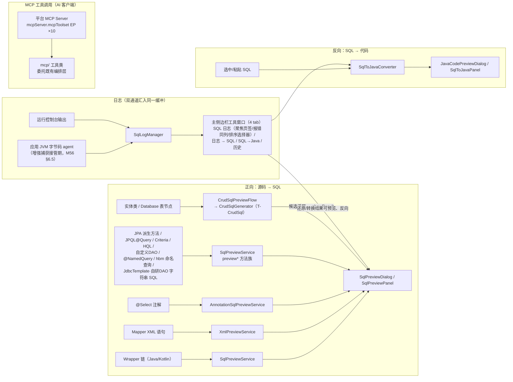

---

## 2. 正向链路：Wrapper 链 → SQL 预览（核心主线）

### 2.1 流程图

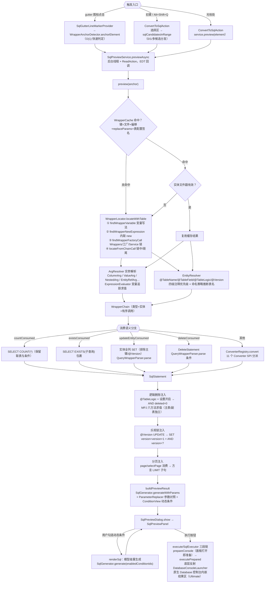

### 2.2 关键类与方法

| 环节 | 类.方法 | 说明 |
|---|---|---|
| 触发 | `ui/gutter/SqlGutterLineMarkerProvider.getLineMarkerInfo` | gutter 只做 O(1) 锚点判定，不 resolve（Kotlin 语言复用同一 Provider，经 kotlin-optional.xml 注册） |
| 触发 | `actions/ConvertToSqlAction.actionPerformed` | 选择区多 SQL → `SqlSelectionDialog`；XML 走 `previewXmlStatement/previewXmlSelection` |
| 异步 | `ui/SqlPreviewService.previewAsync` | 后台 ReadAction + EDT 回调（2025.3+ 慢操作守卫） |
| 缓存 | `psi/WrapperCache.getOrCompute` | 文件戳 + 表配置签名双维度失效 |
| 定位 | `psi/WrapperLocator.locateWithTable` | 四种定位策略按序尝试（见 2.3） |
| 实参 | `psi/ArgResolver.toWrapperCall` / `resolve` | 方法引用→列、字面量/变量→值、嵌套 lambda→WrapperChain |
| 实体 | `psi/EntityResolver.resolve` / `inferDecoratedTableName` | 注解 + 注释四级优先级 + 命名策略 |
| 分派 | `converter/ConverterRegistry.convert` | `firstOrNull { wrapperType ∈ supportedTypes }` |
| 注入 | `SqlPreviewService.evaluateLogicDeleteState` / `injectOptimisticLockCondition` / `applyPageLimit` | 按源码顺序扫描链调用维护逻辑删除三态 |
| 生成 | `sql/SqlGenerator.generateWithParams` | 纯函数：语句模型 → SQL 文本 + 未解析参数 + 回填提示 |
| 方言 | `ui/SqlPreviewService.currentDialect` → `sql/DialectRegistry.effective(project)` | 唯一事实源（T-TS-FixC）：项目级设置压过全局；`dialectAuto=true`（默认）走推断链（见 2.4），false 用手动指定方言 |
| 展示 | `ui/SqlPreviewPanel.showResult` / `renderSql` | 三渲染源统一：正向模型/批量模型/XML 模型 |

### 2.3 WrapperLocator 四种定位策略

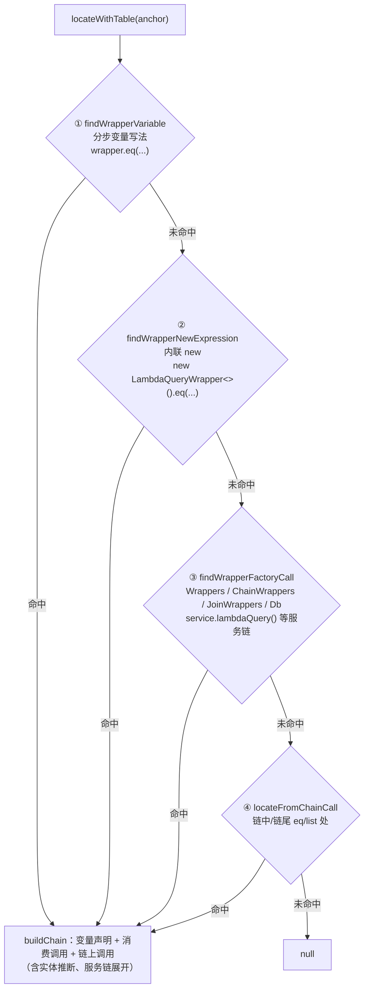

### 2.4 数据流要点

- **模型贯通**：`WrapperChain`（调用链）→ `SqlStatement`（Select/Update/Delete）→ `GeneratedSql`（文本+参数+提示）→ `PreviewResult`（展示载荷）→ `SqlPreviewModel`（面板动态条件载体）。
- **方言判定（T-DialectAutoInfer）**：所有预览链路的方言统一从 `SqlPreviewService.currentDialect()` 取——内部就是 `DialectRegistry.effective(project)` 一处收敛（项目级 `dialectAuto` 非 null 且启用项目设置时压过全局，T-TS-FixC）。`dialectAuto=true`（默认，旧用户升级即生效）时按 `sql/DialectInference.infer` 纯函数推断：**agent 最近连接 URL**（`AgentManager.lastConnectionUrl`，运行中应用的真实数据源）> **IDE 数据源 URL**（`DataSourceUrlProbe` 反射探测）> 未命中回退 MySQL；子协议→方言名由 `UrlSubprotocolDialects` 映射（必须精确对齐 `DialectRegistry.name`，未收录子协议不猜）。设置页方言下拉首项「智能推断」哨兵 + 推断状态只读行展示结果与依据 URL。
- **动态条件**：`Condition.toggle`（ConditionToggle 元数据）→ 面板左栏复选框 → 勾选集合回传 `SqlGenerator.generate(enabledConditionIds)` 模型级重生成（不是文本替换，保证语义一致）。
- **无 WHERE 警示**：UPDATE/DELETE 无条件时 `buildWarning` 红色提示全表操作。
- **批量操作第二路径**：`BatchOperationConverter.convert` 识别 `service.updateBatchById(list)` 等 → `BatchModel.renderSql(activeColumns)` 模板渲染（与 Wrapper 路径平行，共用参数回填与执行按钮）。

### 2.5 执行链路（M36：原生 Database 控制台内嵌）

```mermaid
flowchart TD
    OPEN["预览面板打开"] --> PC["SqlExecutor.prepareConsole<br/>选数据源（原生 DataSourceSelector）→ 建 session<br/>→ attachConsole → 拼合组件回调<br/>原生 Database 控制台即刻可见，不执行"]
    PC -->|"Community 无 Database 插件"| DEG["降级提示"]
    CLICK["点击执行"] --> RDY{"isPrepared？"}
    RDY -->|"是"| EP["SqlExecutor.executePrepared<br/>在已准备控制台上执行<br/>（SharedConsole 复用 + swapGeneration 防串）"]
    RDY -->|"否"| FULL["SqlExecutor.execute<br/>准备 + 执行合一<br/>（等价原生 Ctrl+Enter）"]
    EP --> CONSOLE["结果区显示原生控制台：<br/>结果表格 / Output / 错误信息真实透出"]
    FULL --> CONSOLE
    CONSOLE --> CLEAR["面板关闭/切换 → clearPrepared"]
```

要点：

- **原生组件而非自研结果面板**：执行走 IDEA Database 插件完整控制台（方言预映射、事务保护、错误展示全套平台能力），预览面板以持久 SplitPane 换底方式内嵌；跨预览共享控制台治连接挂死，`swapGeneration` + `REUSE_ACCEPT_TICKS` 治「滞后一轮」与布局闪烁（详见 `docs/MEMORY.md` 与 M36.5 系列开发计划）。
- **Community 兼容**：`SqlExecutor` 编译期零引用 database 类，运行时经反射桥 `database/DatabaseConsoleLauncher` 解析；无 Database 插件时执行按钮降级提示。
- **执行临时文件**：SQL 写 `.idea/sql-visualizer/exec/`（目录常量 `SqlLogAutoSaver.DATA_DIR_NAME`，随插件更名迁移，不考虑向前兼容），document 驱动三方同步防 File Cache Conflict；方言预映射公共编排收口在 `execute/DialectPreMapping`（读探测后台线程、`setMapping` 归位 EDT 的两段式，T-ExecSlowOps）。第四轮（T-ExecDocSync2）把 **console 侧未保存窗口清零**——`attachConsole` 挂在 exec 文件本体上（控制台编辑器文档即该文件 document，插件自有写点纪律覆盖不到）：复用/准备/换入链同步点收口 `writeVfTextViaDocument`（setText-if-differ + commit + save）、refresh 前强制收敛（正常恒 no-op）、执行文档 1.5s 防抖自动落盘（应用级 DocumentListener 覆盖用户手改这一插件拦不到的源头；插件程序性写入经 `ExecDocAutosaveGate` 计数闸门抑制、写安全上下文收口 `DocWriteContext`，不自己与自己抢）、冲突探针 `beforeFileContentReload` 落 warn 指纹取证。
- **执行超时护栏（T-ExecTimeoutGuard，O-25）**：`execute/ExecutionTimeoutGuard` 纯函数——设置项「执行超时」（`executionTimeoutSeconds`，默认 30s，0=不限）；脚本整体预算随语句数线性增长、封顶 ×8，与每语句超时两级分离（单条慢不拖垮整脚本判定）。v1 接入面 = **MCP 直连链**（`McpDbExecutor`/RemoteStatement：逐语句 `setQueryTimeout` + 先 `cancel()` 收尾再报错，不留半开连接）；共享控制台链语句生命周期由 DBN 控制台托管、插件侧无语句级句柄，**v1 如实不覆盖**（预算函数作为规格先行交付）。超时形态三路判定（SQLTimeoutException / SQLState 57014 / 消息签名，反射链逐层解包），证明不了的按普通错误呈现，绝不虚标「已超时取消」。
- **执行错误富化与定位跳转（T-ErrorLocate，N-18）**：错误不再只有驱动的一行消息——反射链 catch 点并行携带 `ExecutionErrorInfo`（SQLState / 驱动错误码 / 驱动报告的出错位置），位置由 `ErrorPositionExtractor` 从消息文本提取（PG `Position: N`、MySQL `at line N` 等；DBX 两防误指规则：位置信号**恰好一个**才归属、基建/连接类错误天然无位置不猜），越界钳制到 SQL 文本长度。结果面板错误态新增「定位到出错语句」按钮（仅出错时出现），一键跳预览源中该语句起始行，悬停提示如实注明定位口径；MCP 侧 `sqlv_explain` 失败消息附 `errorPosition: line N` 行供外部 agent 自定位。
- **MySQL 客户端 `\G` 后缀剥离**：`execute/MysqlClientGSuffix` 纯函数两态——`submitText` 进 exec 文件/控制台、`original` 留给历史链（历史记原文、提交文本剥离）；`DataSourceSelector` 两处写点前插剥离，方言判定不猜库型、走 JDBC URL 子协议（`JdbcUrlDatabase`）。
- **会话身份 fail-closed**：`DataSourceSelector.reuseIdentityAccepted` 三分量复用探测（进程存活 + 视图有效 + 数据源按 UUID 仍可解析），不复用即清 last-used 记忆（宁重配不串库）；记忆键升级 UUID 为主、旧显示名键兼容一版；`ExecConsoleContext.dataSourceUrl` 从控制台侧取回数据源 URL 供方言判定等消费。
- **DELIMITER 感知切分（T-DelimiterAware，O-39）**：`util/SqlStatementSplitter` 增界符维度——行首 `DELIMITER <token>` 指令切换语句界符（指令行本身不产出语句、无参数复位 `;`、字符串/注释内不识别）；自定义界符匹配先于注释/引号分支（`$$` 的 `$` 是标识符字符，须整词先判）；执行、EXPLAIN、格式化、切分定位四消费面同源生效。

### 2.6 CRUD SQL 生成旁路（T-CrudSql）

实体类与数据库表不经过 Wrapper 链，直接生成增删改查模板 SQL，候选选择后进统一预览窗口：

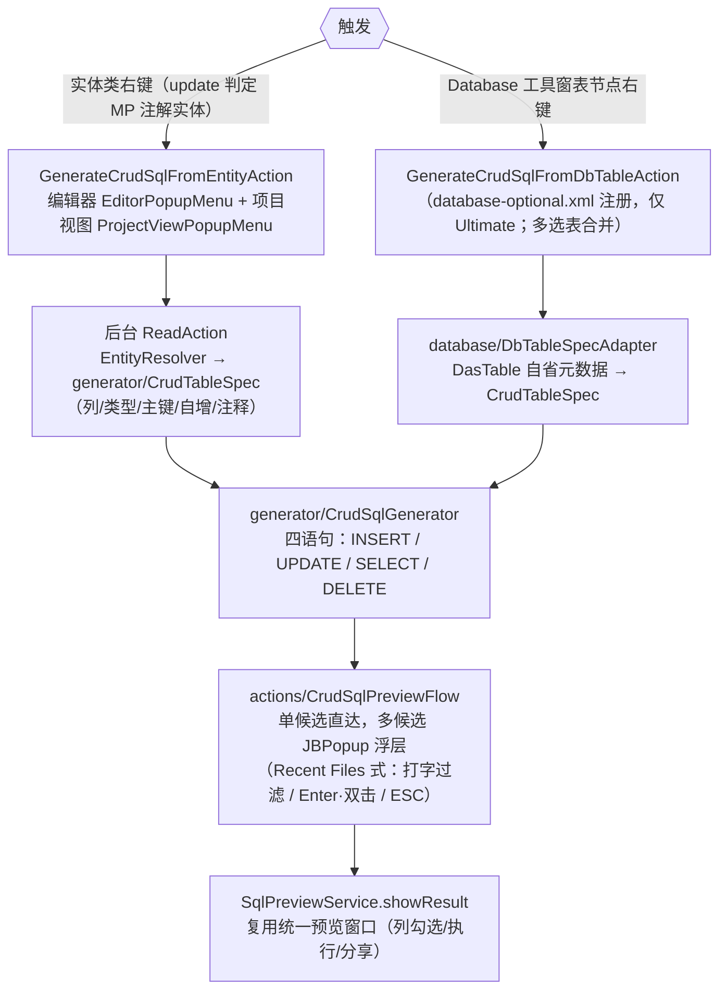

要点：

- **入口与降级**：实体侧双入口主 plugin.xml 注册，Community 版仍可用；表节点侧依赖 Database 插件（database-optional.xml），缺席时仅实体侧入口。
- **生成语义**：INSERT/UPDATE 复用 `BatchModel` 列勾选重建——自增主键默认不勾、`@Version` 列 SET 尾 `= version + 1` 且 WHERE 追加乐观锁条件、逻辑删除变体仅实体侧生成（UPDATE deleted=1）；无主键表 SELECT 降级 `WHERE 1 = 0` 占位提示；引号策略由 `DbTypeQuoteHint` 按类型启发。
- **展示零新弹窗**：候选浮层与 `SqlSelectionDialog` 行渲染同款范式（主题色双行：加粗摘要 + 等宽代码行详情），选中即走既有 `showResult`。

### 2.7 执行确认与安全护栏（第四轮竞品 O-9/O-12 + T-RollbackSql + 第五轮 N-18/O-15/O-17 + 第六轮 N-21）

DML 执行链路在「点击执行 → 控制台跑语句」前后各有一道静态护栏，全部不新增弹窗形态：

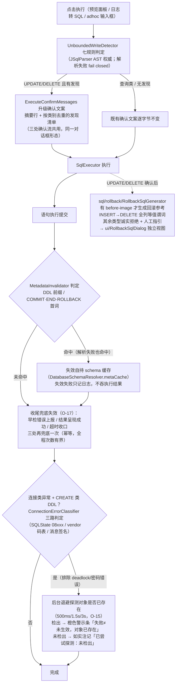

要点：

- **七规则无界写判定（O-9）**：WHERE 缺失 / 恒真 / OR 恒真 / LIKE 纯通配 / 无列引用 / 子查询提示 / 解析失败，规则集对齐 DBX `sql_risk.rs`；回滚视图对恒真与纯通配弱谓词另有全表警示（`UNABLE` 不虚标 `PARTIAL`）。
- **只读豁免二级证明（T-TxnReadOnlyProof，N-21）**：查询类语句免确认走只读豁免，豁免判定在 `SqlTypeClassifier` 用词法二级证明收窄三盲区——①可写 CTE（`WITH …` 尾随 INSERT/UPDATE/DELETE/MERGE）、②EXPLAIN ANALYZE（会真执行）、③SELECT INTO（隐式建表写）——一律 fail-closed 按可写处理进确认流，三消费方零改动。
- **元数据缓存失效（O-12 + O-17）**：插件自持 schema 面只有 `DatabaseSchemaResolver.metaCache` 一处（盘点定案），执行前预判失效挂在 `executeOnConsole` 唯一提交收口；AST 前缀判 DDL 之外保留关键字兜底（JSqlParser 5.3 把残缺 DDL 包成 UnsupportedStatement、PL/SQL 块包成 Block，首词路由会漏判）。T-DdlPostInvalidate（O-17）在执行监控三个收尾点（早检错误上报 / 结果呈现成功 / 超时收口）兜底再失效一次——执行中途才出现的 DDL、预判漏判、失败 DDL 隐式提交等窗口全部关死；失效幂等。新增 schema 缓存必须在 `MetadataInvalidator` 登记位登记（守卫注释），负命中缓存（T-MetaCheapSource）同样纳入失效联动。
- **断连后 DDL 已生效判定（T-DdlRecover，O-15）**：连接类异常（SQLState 08xxx / vendor 码族 MySQL 2002/2003/2006/2013、Oracle 17002/17008/17410/1089、ORA-3113/3114 / 消息文本签名三路互补，deadlock / access denied / password 明确排除不误判）叠加 CREATE 类语句时，「失败不等于未生效」——后台按 500ms/1.5s/3s 退避探测对象是否存在，检出即警示条如实呈现「连接已断开，但对象已存在」，未检出注记「已尝试生效性探测：未检出」，绝不把「没查到」包装成「没生效」。
- **回滚参考 SQL（T-RollbackSql）**：预览窗口里的 SQL 来自日志/静态推导，插件没有 before-image——只对能从文本诚实推导的 INSERT 产出回滚，UPDATE/DELETE 无原值可考一律拒绝；弱谓词场景叠加警示。回滚视图是独立 MODELESS 弹窗，不写进预览面板文档。
- **批量等值谓词 IN 合并（O-14）**：foreach 批删日志还原出几十条同构 `DELETE … WHERE col = k` 时，`util/BatchPredicateMerge` 生成一条 `WHERE col IN (k1, k2, …)` **参考形态**（同表同列单列等值、500 行 + 8KB 双约束、集外语句按 N/M 诚实披露）；执行文本永远是逐条原样，文案双保险「仅预览参考，执行仍逐条」。
- **UNKNOWN 参数执行前提示**：`XmlPreviewModel.unknownParamSources` 汇集解析不出来源的参数，`SqlPreviewPanel.confirmUnknownParams` 在执行/EXPLAIN 前提示一次——提示不是闸门，用户确认即继续，与既有「护栏提示不拦执行」口径一致。
- **参数契约补缺**：`ParamQuote.NUMERIC_TYPES` 增 `BigInteger`（裸渲染不加引号）；`java.util.UUID` 定案 TEXT 档（带引号字符串形态比较）；XML 路径 paramN 全或无门槛（T-PC2-03——仅当全部参数都有显式 `@Param` 才补 `param1..paramN` 位置别名，规则来源标注 `mybatis-3.5.19-paramN-全或无`）。
- **fatal 异常透传（T-FP 系列）**：`util/FatalErrors` 白名单（`VirtualMachineError`/`LinkageError`/`ThreadDeath`）——执行链 30 处 `catch (Throwable)` 按统一形态收口：先解包 `InvocationTargetException.targetException` 再判白名单，fatal 照旧上抛不吞；外层 `runCatching` 会抵消内层透传，结构性无效点已一并消除。
- **解析结果共享槽**：`MetadataInvalidator.ParseSlot` 单槽缓存上次解析（命中判据 = 待解析文本内容全等，哈希碰撞兜底），确认流与回滚链共享同一 AST 解析结果，不重复 parse。

---

## 3. XML 子链路：Mapper XML 动态 SQL 预览

### 3.1 流程图

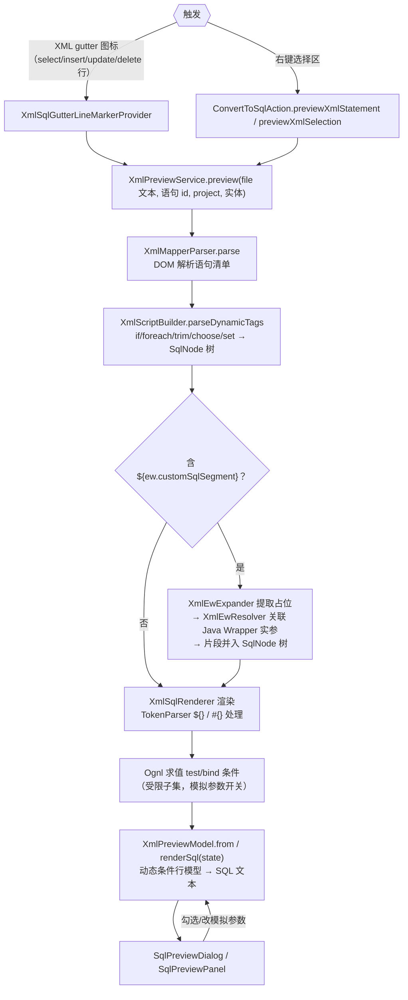

### 3.2 关键类

| 类 | 职责 |
|---|---|
| `xml/XmlMapperParser` | mapper 文件解析：语句清单 + 错误收集 |
| `xml/XmlScriptBuilder` | 复刻 MyBatis 3.5.19 `parseDynamicTags`：DOM → SqlNode 树 |
| `xml/SqlNode` 家族（If/Trim/Foreach/Text） | 节点渲染，foreach 行/次数面板交互 |
| `xml/TokenParser` | `#{}` / `${}` 通用 token 处理（GenericTokenParser 复刻） |
| `xml/Ognl` | 受限 OGNL 子集求值（test/bind/`${}` 判真，对齐 ExpressionEvaluator 两套语义） |
| `xml/XmlIncludeExpander` | `<include refid>` 内联展开 |
| `ui/XmlEwResolver` | `${ew.customSqlSegment}` → Java Wrapper 实参 → SQL 片段 |
| `ui/XmlParamTypeResolver` | mapper 方法签名 → 参数类型 → 回填引号映射 |
| `ui/XmlSqlCompletionContextResolver` | namespace → Mapper 接口 → 主实体/联表候选（补全共用） |
| `xml/XmlPreviewModel` | 动态条件行模型（复选框开关）→ renderSql |
| `xml/SecureXml` | 全仓唯一 DocumentBuilder 工厂 + 解析前预扫（实体声明/深度/展开三上限，见下） |
| `xml/CrossNamespaceFragments` / `psi/XmlCrossNsFragmentResolver` | 跨命名空间 `<include>`：多文件片段登记 + FileTypeIndex/PSI 预筛（见下） |
| `xml/ParamKind` | 参数类型六类契约（TEXT/NUMBER/TEMPORAL/COLLECTION/OBJECT/UNKNOWN），xml 层零 PSI 依赖 |

渲染链路对 `${}` 直替做**注入面标注**（O-11，T-DollarInjectMark）：引擎侧（DynamicContext / RenderedXmlSql）计数 `${}` 直替次数（转义形态与字符串内出现同口径计数，引擎忠实原则），SqlPreviewPanel 据此在 `ui/DegradationBanner`（面板内嵌非模态横幅，三级优先 DEGRADED > RENDER_WARNING > DOLLAR_INJECT）弹一条中性提示——仅信息级、带 ✕ 可关、companion 级会话记忆跨面板不重弹。横幅同载体还承载降级链与渲染警示两类消息（触发即显示、恢复即隐藏，不占高度）。

XML 解析安全收口 `xml/SecureXml`——全仓唯一 `DocumentBuilder` 工厂（两处解析器只调 `parse`，杜绝配置漂移）：解析前对文本预扫，可见实体声明 ≤64 / 引用嵌套深度 ≤16 / 单实体展开估算 ≤65536 字符，配引号/注释/PI/条件段状态机切分内部子集、参数实体经 `visibleSubset` 迭代替换可见化（JDK `entityExpansionLimit` 只数展开次数，billion laughs 形态打不穿这层）；内联 DTD 保持放行（定案 D1=A——官方 mybatis-3-mapper.dtd 实体声明数为 0，拦截误伤面近零）。

OGNL 表达式的可支持面有分类读数：`Ognl.classify` 按 `ExprSupport` 三档 + 理由码给结论，条件行据此在界面淡色标注；`IfSqlNode` 求值失败仍按 true 展开（预览容错，展开行为不变）但记入 `DynamicContext.errors`——嵌套子上下文 errors 不向上转发的静默根因已修，`DedupErrorList` 写入判重（LinkedHashSet 语义）并 foreach 逐迭代去重，失败可见。

`<include refid>` 支持跨命名空间引用：`xml/CrossNamespaceFragments` 登记多文件片段，`psi/XmlCrossNsFragmentResolver`（FileTypeIndex 全项目扫描 + PSI 预筛）解析候选，`XmlIncludeExpander` 跨文件展开（片段属另一文档，经 `Document.importNode` 落入）；接线收口 `XmlPreviewService` 单点。MCP 与注解 `<script>` 链维持纯文本现状，不展开跨文件 include。

参数类型契约收敛 `xml/ParamKind` 六类（TEXT/NUMBER/TEMPORAL/COLLECTION/OBJECT/UNKNOWN），落 xml 层零 PSI 依赖；`ui/XmlParamTypeResolver.resolveTypes` 为主判定、`resolveQuotes` 降为派生视图；空参数回填遵循 `emptyParamFill` 设置（NULL 默认 / EMPTY_STRING 两档）。

渲染保真以真引擎对照为准：测试侧 `xml/fidelity/RealEngineFidelityTest` 31 场景中 25 场景与 mybatis 3.5.19 逐字节一致；产品定案是「降级可用 + 失败可见」，不向真引擎硬失败对齐（差异面 D1/D3 我方更宽容、D2 `||X||` 是我方超集能力）。

---

## 4. 注解与 JPA/Hibernate 子链路

### 4.1 MyBatis 注解（@Select 等）

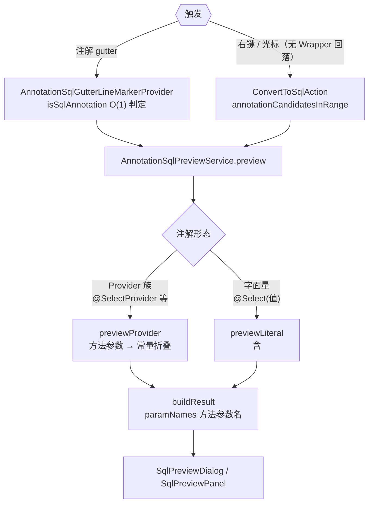

### 4.2 JPA / Hibernate（F-14/F-45 系列）

六种 gutter（均注册进 `SqlPreviewService` 方法族，实体解析由 `psi/jpa/JpaEntityResolver`（注解）与 `HbmXmlEntityResolver`（Hibernate XML 映射 .hbm.xml）承担）：

| 入口（gutter / 右键） | Locator（psi/jpa） | 转换器（converter/jpa） | 说明 |
|---|---|---|---|
| Repository 派生方法 `findByXxx` | `DerivedMethodLocator` | `DerivedQueryConverter` + `PartTreeParser` | 方法名 → 条件树（PartTree 语法），SQL 含 `?` 占位符 |
| `@Query` 注解（JPQL 或原生 SQL） | `JpqlQueryLocator` | `JpqlConverter`（IN 子句参数识别） | JPQL 转原生 SQL；named 参数 `:name` 回填 |
| CriteriaQuery 调用链（cq.from/cb.equal…） | `CriteriaQueryLocator` | `CriteriaQueryConverter` | 解析 CriteriaBuilder 链式调用 |
| HQL（session.createQuery） | `HqlQueryLocator` | `HqlConverter` | 多行/字符串拼接（PsiPolyadicExpression）均识别；**M36.7：SELECT 裸别名展开为实体列清单**（`SELECT u` → 全列，无 SELECT 自动补列清单；JOIN 副表/元数据缺失降级 `alias.*`）——修复 MySQL `Unknown column 'u'`；继承抽象类实体（T-HqlInhCols）经 `entityAlias` 参数 + `mapEntityToTable` 别名替换解析列，实体名由 `JpaMetadataReader.entityNameOf` 提取、解析失败两档降级注释（关联元数据 / 跳过） |
| 自定义 DAO（commonDao.findByQuery 等） | `CustomDaoHqlLocator` | `HqlConverter` | 自定义 DAO 方法内的 HQL 识别 |
| 命名查询 | `NamedQueryLocator` | `HqlConverter` | @NamedQuery / XML 命名查询 |

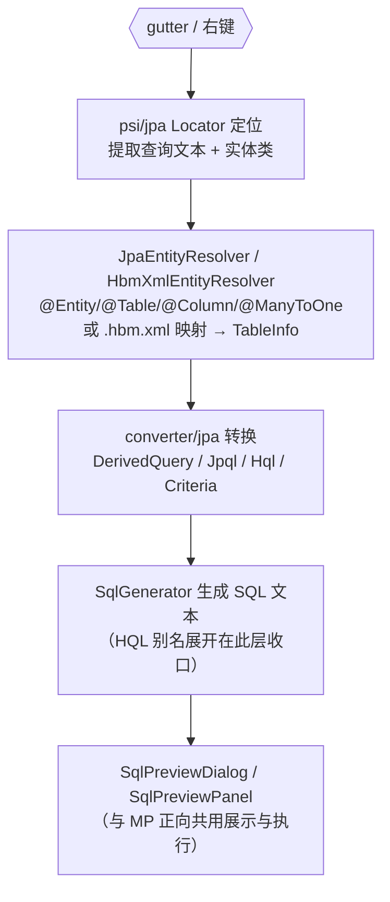

展示层完全复用 MP 正向链路的 `SqlPreviewDialog` / `SqlPreviewPanel`（动态条件勾选、参数回填、执行、Diff），差异只在「定位 + 转换」两段。

---

## 5. 反向链路：SQL → MP Java 代码

### 5.1 流程图

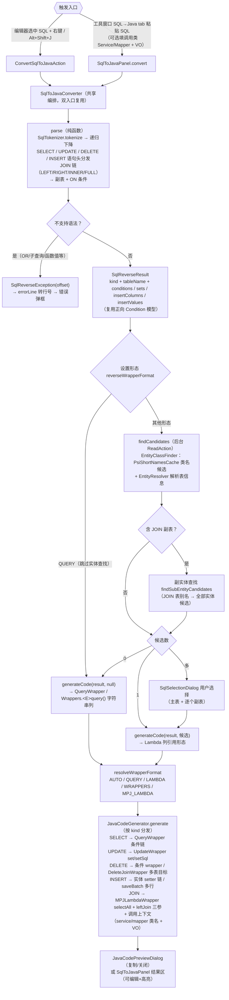

### 5.2 关键类

| 类 | 职责 |
|---|---|
| `reverse/SqlTokenizer` | SQL 词法：WORD/STRING/NUMBER/SYMBOL 四类 token |
| `reverse/SqlReverseParser` | 递归下降解析：语句头分发 SELECT/UPDATE/DELETE/INSERT（T-M36.7）；JOIN 链 → 副表 + ON 条件（T-M37）；`?` 参数占位符 → `SqlValue.Placeholder`（WHERE/SET/INSERT/LIMIT 全支持，生成 `"?"` 占位由用户替换）；不支持语法抛 `SqlReverseException` 带偏移量 |
| `reverse/JavaCodeGenerator` | 按语句 kind 分发生成：SELECT 条件链 / UPDATE set/setSql / DELETE 条件或 DeleteJoinWrapper / INSERT 实体 setter 或 saveBatch 多行；`opMethod` 算子映射、列→字段名映射（EntityTarget）、调用上下文（InvocationTarget：service/mapper + VO）、JOIN 多表 MPJ 渲染；SELECT 调用形态（方法名经 MP/MPJ jar 实证）：分页（LIMIT）→ `page/selectPage`、VO（≠ 实体名）→ `selectJoinList(Vo.class, wrapper)`（强制 MPJ wrapper——参数类型 MPJBaseJoin）、分页+VO → `selectJoinListPage/selectJoinPage(page, Vo.class, wrapper)`；调用类 → 驼峰首字母小写实例变量（`bannerService.page(...)`）；多表形态：join 可三参 lambda 化 → MPJLambdaWrapper，否则回落 MPJQueryWrapper（字符串 join 仅 StringJoin 合法）；多表删除 → `new DeleteJoinWrapper<>(主.class)` + `.delete("t", "t1")`，无法映射时报错 |
| `reverse/WrapperFormat` | 形态枚举 + `resolveWrapperFormat(format, hasEntity)` 纯函数分发 |
| `psi/EntityClassFinder` | 表名 → 实体类候选，两级查找：类名启发式（snake→Camel + `Entity` 后缀变体）快路径 → 未命中时全量扫描 `@TableName` 注解值/推断表名反查（实体命名与表名驼峰不一致时兜底，如 `AccountRoleRelEntity` ↔ `sys_account_role_rel`）；`findSubEntityCandidates` 副实体候选（JOIN 表） |
| `ui/EntitySelectionDialog` | 手动选择实体弹窗（可选开关 `reverseManualEntitySelection` 控制）：按 SQL 涉及的表逐行分组（主表 + JOIN 副表），自动候选预选第一个、行内 Goto Class 手动挑选、✕ 清除；多表 JOIN 一次多选（替代逐表弹窗）；主表 0 候选时单行弹窗兜底，取消回落字符串列名；开关关闭 → 纯自动推断（0 候选回落、多候选取第一个，不弹任何选择框） |

**多表 JOIN 支持（T-M37）**：解析层把 JOIN 链转为结构化条件（ON 等值列对 → `ColumnComparison`，多条件/非等值收集原文透传；WHERE 条件列保留表别名归属）；生成层按主实体可用性分发——主实体可用 → `MPJLambdaWrapper` + `selectAll()` + 三参 `leftJoin(副.class, 副::getX, 主::getY)`（ON 多条件回落字符串 join 形态）；主实体缺失 → `MPJQueryWrapper<>(类.class)`；副实体缺失回落带前缀字符串列名。副表多候选时面板按 JOIN 顺序逐个弹选择框。

### 5.3 形态分发矩阵（`resolveWrapperFormat`）

| 设置形态 | 有实体 | 无实体 |
|---|---|---|
| AUTO（默认） | LambdaQueryWrapper | QueryWrapper |
| QUERY | QueryWrapper（**跳过实体查找**） | QueryWrapper |
| LAMBDA | LambdaQueryWrapper | QueryWrapper |
| WRAPPERS | `Wrappers.<E>lambdaQuery()` + lambda 列 | `Wrappers.<E>query()` + 字符串列 |
| MPJ_LAMBDA | MPJLambdaWrapper | QueryWrapper |

### 5.4 双入口一致性

`SqlToJavaConverter` 是唯一编排点：`parse` / `errorLine` / `findCandidates` / `generateCode` 四个职责被 Action 与工具窗口面板完全复用；`invocationHasMpj` 按调用类名检索并遍历继承链（接口 + 父类递归）实证 MPJ 能力（`MPJBaseService`/`JoinService`/`MPJBaseMapper`/`JoinMapper`，1.5.6 实证接口），结果经 `InvocationTarget.mpj` 驱动生成器——无 MPJ 能力时 VO 回落实体查询（注释提示）、多表 JOIN/删除明确报错；面板额外做输入区补全/格式化、形态下拉（下拉写穿持久化 + tab 重选刷新，suppress 防误触发重生成）、调用类/VO 类选择器（`ClassPickerField`：Goto Class 选择器选项目 Java 类，选中/清除后自动重生成，T-M39）。

---

## 6. 日志捕获链路：运行控制台 → 还原 SQL

### 6.1 流程图

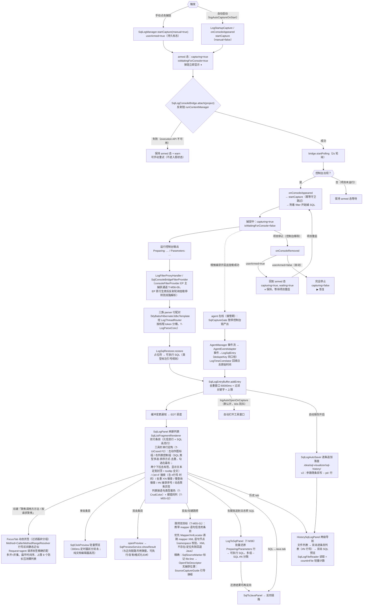

### 6.2 关键类与设置消费

| 类 | 职责 | 关联设置 |
|---|---|---|
| `log/SqlLogManager`（PROJECT 服务） | 平台壳：capturing 状态机、缓冲订阅调度、自动打开窗口 | `logAutoOpenOnCapture`、`logDedupeWindowMs`、`logFilterKeywords`、`stopOnToolWindowClose`（关闭工具窗口时停止监听） |
| `log/SqlLogConsoleBridge` | 反射桥（execution API 不在编译 classpath，`Class.forName` 显式用**平台 classloader**——插件 classloader 子类看不到父类）；attach/detach/polling；`hasMainConsole()` 检查主控制台进程存活（`ProcessHandler.isProcessTerminated()`——`getAllDescriptors()` 进程死后仍返回旧 tab，须额外检查进程状态）。M56 T-M56-09 起为**兜底通道**：consoleFilterProvider EP 主通道首行生效（`SqlCaptureGate.epActive` 会话内粘滞）后跳过 addMessageFilter 挂载防双路解析，轮询定时器保留承担控制台摘除检测；T-PerfSweep4 再封 handler 侧短路——EP 生效期桥 Filter 行处理零成本回退（双路解析 ×2 封口） | — |
| `log/SqlConsoleBridgeFilterProvider` | consoleFilterProvider EP 实现（主 plugin.xml）：平台在控制台创建时自动装配本 provider 返回的 Filter（无轮询发现面），每 Filter 实例持独立 `BridgeLineContext`，首次真正处理控制台行置 `epActive`（T-M56-09）；T-PerfSweep4 双路解析封口第二刀——timePrefix 设置读取按实例缓存，EP 逐行热路径不再逐行读设置 | — |
| `log/LogFilterProxyHandler` | ConsoleView.Filter 反射代理分发 | — |
| `log/CaptureDiagnostics` | 捕获链零产出诊断（T-CaptureTruth T-CT-03，面板空态第二行）：增强通道复用 `AgentManager.statusSummary` 五态文案、控制台通道给已挂载控制台数 + 已扫描行数，提示语按「等待控制台 / 控制台无输出 / 有输出但没匹配到 SQL」三档给可执行下一步；T-RA-03 再加「行去哪了」计数（重放守卫丢弃 / EP 短路，仅 >0 时显示）——「开着捕捉却无条目」的静默失效可诊断 | — |
| `log/MyBatisLogParser` | 行配对解析（前缀可配置；`logMixedPrefix` 兼容 `==>` 格式）；Parameters 行喂入后**立即闭合**生成条目（原等下一句 Preparing 才闭合，致第一条 SQL 延迟显示 + 同 SQL 去重时序错乱） | `logSqlPrefix`、`logParamPrefix`、`logMixedPrefix`、`logMaxParseLength` |
| `log/LogThreadRouter` | 三族解析器共享的「线程分桶」路由（T-LogParseConc 把 JdbcTemplate 的 T-JdbcThreadBucket 机制下沉）：行内提取到线程 token → 该线程独立桶（超上限淘汰空闲桶）；提取不到 token → 归属当前收集态桶（通常唯一），否则回退共享默认桶 fail-open 不丢行；`routeNoTokenToRecent=true`（Hibernate 专用，T-HibConc）追加 MRU 次选——Hibernate 多行 SQL 正文不带日志前缀，落回退桶会参数错挂。治并发请求日志交错导致的提前闭合/参数丢失 | — |
| `log/HibernateLogParser` / `log/JdbcTemplateLogParser` | Hibernate 与 JdbcTemplate 日志格式识别（与 MyBatis parser 并行的另外两族来源），三族统一经 `LogThreadRouter` 分桶；三族解析器统一接线 `LogTimestampParser`——从日志行解析原始时间随条目记录（解析失败回退捕获时间），设置页「时间来源」可切「日志时间/捕获时间」 | 对应前缀设置、时间来源 |
| `log/LogTimeCorrelator` | 增强捕获接管期（`SqlCaptureGate.paused`）控制台链不产出条目，但日志行原始时间仍可提取——本相关器暂存、agent 事件入队前按键取回回填 `logTimestamp`。键 = `logTimeKey`（占位符版 rawSql 指纹，两侧同源原材料），参数序列只作次级判别；同键排队不覆盖、超窗（WINDOW_MS）陈旧项丢弃（T-AgentLogTime 改键实证） | — |
| `log/LogDurationParser` | p6spy / druid 形态耗时解析（`|` 分隔第二段 / `executeMillis`），无耗时来源时排序耗时项降级隐藏（P-06） | — |
| `log/ExecutionTimeParser` | p6spy / MP TimeCount / 自定义前缀耗时解析 → `LogSqlEntry.executionTimeMs`（bridge 每次喂行前调用；此前从未接线，耗时恒 null——F-44-2 root fix） | `logTimePrefix` |
| `log/SlowQueryDetector` / `LogStatementClassifier` | 慢查询计数（阈值色 <100ms 灰 / ≥100ms 橙 / ≥阈值 红）与 SQL 类型分类（SELECT/UPDATE/…，驱动类型筛选弹窗） | `slowQueryThresholdMs` |
| `log/LogSqlRestorer` | `?` → 实际值还原（String 加引号、数字原样、时间格式） | — |
| `log/SqlLogEntryBuffer` | 纯逻辑缓冲（去重/暂停/上限/监听器，纯 JUnit 可测；`dedupeExisting` 勾选去重时立即裁剪既有条目，去重丢弃分支也通知——⨉N 徽章一帧同步）。变更通知单通道拆三出口（T-PerfBatch）：首条自动开窗 / 列表刷新可节流（20 条或 200ms 合批）/ 徽章即时；去重指纹累计上限 4096（T-PerfSweep） | 见上 |
| `log/SqlLogAutoSaver` / `SqlLogFileReader` | 自动保存（逐条追加 `.idea/sql-visualizer/sql-history/`，`-- source: … --` 标准注释头）与读取（兼容 2/3 横线新旧格式、`countInFile` 轻量条数统计）；v2 起（T-HistParam）参数非空时另写 `-- pd: <base64>` 行，读取自动剥离（旧版插件忽略该行）；日志原始时间随条目持久化（`logTime` 字段，旧版文件读取回退捕获时间）；`DATA_DIR_NAME` 统一目录常量 | 自动保存设置 |
| `log/ListParamRenderer` | 命名参数集合值渲染（T-ListParamCollect）：仅 SQL `IN (...)` 区间内的集合值剥方括号按元素渲染（空集合输出 `NULL`），非 IN 位置逐字节不变——治 JdbcTemplate 集合参数 `toString()` 原文落入字符串字面量 | — |
| `log/SqlSourceMarker` / `CallerSourceLocator` | F-44-6 精确跳转：解析应用侧 `SQLVIS-SOURCE|path|line` 标记行（见 §6.4）；`CallerSourceLocator` 为调用栈→用户代码帧纯函数（自 v2026.9.2 起仅 Instrumentation 方案使用） | — |
| `log/SqlListFragmentRenderer` | 列表条目渲染：双 `SimpleColoredComponent` 固定两行条目——元信息行（时间/耗时/来源/`#N` 捕获序号/去重徽章）+ SQL 高亮行（T-LogListFreeze-04 根治 EDT 冻结 16s，旧 `SqlListHtmlRenderer` HTML 通道已退役）；显示模式三态（单行/关键字换行/格式化，跨会话保留、两列表共享，T-ListMode；入口已从工具栏按钮迁设置页 SQL 日志组「列表显示」子分组，T-DisplayModeToSettings）；格式化模式的竖排管线（T-VStack：INSERT 列清单与 VALUES 逐行竖排 + 横向组展开；T-VStack·InAll：IN 列表含逗号即 ≥2 元素一律逐行展开，InThreshold 阈值经用户复议回退）；SQL 类型着色标记（T-CrudColor：默认左侧 3px 色条、可选整行淡背景，选中态保留类型色调+描边，`SqlListTypeColor` 配色混色 + `SqlListSelectionOutline` 描边纯逻辑） | — |
| `log/SqlClickPreview` | 单击轻量预览（T-ClickPreview）：300ms 定时器区分单击/双击；纯文档（无 PSI）编辑器展示 SQL，高亮与列表同源（`SqlListSyntaxHighlighter.ATTR_BY_TYPE` 唯一权威），带复制反馈按钮；预览内容跟随「预览时格式化还原 SQL」设置（T-ListPreviewCopy，默认格式化并补分号），多选（>1 行）时单击不弹预览防误触，右键「复制」可批量复制选中条目 | — |
| `log/ConsoleReplayGuard` | 四态重放守卫（watermark + docStamp，filter 幂等化）：根治控制台重放导致的双击预览闪烁（T-PreviewFlash）；T-PerfSweep 惰性化热路径 | — |
| `log/SqlErrorLineRecognizer` | 控制台异常行识别（T-M55-02 报错同列，纯函数零平台依赖）：常量词表 contains 首命中早退（MyBatis `###` 错误块 / Spring DAO 体系 / JDBC SQLException 家族 / 参数绑定异常），无正则不碰解析热路径；词表外自定义异常不识别——漏绑优于误绑。命中行反向绑定时间窗内最近条目：列表行显错误片段、预览详情含报错全文（多行堆栈聚合有行数/字符上限） | — |
| `log/FocusTab` / `log/CallerMethodRangeResolver` | 动态聚焦过滤页签（T-M55-03/04）：页签是过滤器不是分组——不碰 VisibleDiff 差分与缓冲分组模型，呈现保持扁平时间序。Method=源码位置所在 PsiMethod 行号区间静态近似（命名 `FooService#bar`，嵌套/重载/lambda 取最小包含方法；Kotlin 调用方首批不支持）；Request=agent 请求标签精确匹配（多页签去重、上限 8 个）。多开=并集；无对应维度条目隐藏并计数 | — |
| `log/MapperXmlLocator` | 条目直跳 mapper XML（T-M55-01）：`mapperStatement`（拦截器 `ms.getId()`）拆 namespace.id → FileTypeIndex 扫描项目 XML → PSI 校验 `<mapper namespace>` 匹配 → 定位同 id 语句标签起始行；自带 ReadAction EDT/后台均可调。多模块同名 mapper 取索引序首个并留痕；MP 内置语句 XML 不存在 → locate 返回 null，调用方回退 Java 跳转 | — |
| `log/EntrySourceMatcher` | M37.1 日志↔源码双向深链的纯逻辑半边：`EntrySourceMatcher` 源码→日志反查（锚点文件+行号窗口）、`SourcePathResolver` 相对路径→VirtualFile 多源根容错、`LogEntryPreviewOpener` 反查条目开预览（T-InParamRec 时三预览入口参数识别收编统一通道） | — |
| `log/FirstCaptureGuide` | 会话内首次捕获成功通知带「打开面板」动作（T-UxOnboard）：object 会话级一次性、缓冲已有条目（更早会话残留）跳过、headless 静默；与自动开窗同挂缓冲 onEntryAccepted 出口零新增监听链 | — |
| `log/SqlLogParamCodec` / `LiteralParamRecovery` / `LogEntryPreviewRecognizer` | 历史参数持久化（T-HistParam）：`-- pd:` 行编解码单点；零占位符场景字面量恢复（字符串全量识别，数值限比较/IN/BETWEEN/VALUES 谓词语境——LIMIT 与投影常量不识别防分页噪音）；实时/历史双面板参数识别统一走同一通道；MCP 执行条目的来源键（`-- pd:` 载荷短键 `s`=枚举名）也走本编解码，读端回填 `SqlSource.MCP`（§9） | `literalParamRecovery`（默认开） |
| `log/SourceCaptureGuide` | 跳转源码位置缺失时的引导编排（T-JumpCapture / O-66 T-GuideEnhancedFirst，实时/历史两面板共用）：条目无捕获位置时按全局增强捕获状态分支——未开启弹框默认按钮「开启增强捕获」（置总开关 + 发布 SETTINGS_CHANGE，提示重启应用生效）；已开启维持「打开 SQL 日志设置页 / 立即注入拦截器」两出口，文案末尾附一行增强捕获实时状态（`statusSummary`）。注入结果四类弹窗也收敛于此（原设置页硬编码文案 i18n 化迁入）。旧「按表名搜索 Wrapper」回退链整体移除（同表名 ≠ 同调用点，命中即误导） | — |
| `log/LogToSqlPanel` | 「日志 → SQL」tab（T-M38）：批量还原日志行（复用 parser + restorer；`LogSqlEntry.toLogText` 与右键发送 round-trip），多组 `-- SQL #N` 分隔、参数不足红字警告、单行/多行切换；foreach 批删等几十条同构语句经 `util/BatchPredicateMerge` 追加 `IN (…)` 合并参考（仅预览，执行仍逐条，O-14）；语句切分委托 `util/SqlStatementSplitter`（O-13 单实现）；组头附语句名（`util/SqlStatementNamer`：前导注释 `-- Name: x` 优先、回退最近行注释，块注释/尾注释/超 40 字符不误取，O-19） | `logSqlPrefix` 等（同源读设置） |
| `log/SqlLogPanel.HelpAction` | 工具栏「?」：JCEF 内嵌浏览器加载**本地** HTML（classpath 资源 `src/main/resources/html/marketplace-custom-page.html`，纯内联样式；v2026.9.11 起单源，docs/发行说明 旧副本已删除）；JCEF 不可用/资源缺失 → 系统浏览器降级（M36.5.80 定稿，HelpDialog 弹窗已移除） | — |
| `log/LogStartupCapture` | postStartupActivity：设置开启时项目打开即进入 armed 态；`suppressed=true` 时调 `startListeningOnly()`（不进入 armed）；另注册 `RunConfigurationProcessListener`（EXECUTION_TOPIC processStarted）做运行配置启动的双保险触发 | `logAutoCaptureOnStart`、`logAutoCaptureSuppressed` |
| `log/ProjectListenerRegistrar` | `object`（非 `@Service(APP)`——262 平台 @Service(APP) 默认懒加载，无代码访问则不实例化，listener 永不注册），由 `LogStartupCapture.execute()` 调用 `registerIfNeeded()` 注册 messageBus listener | `logAutoCaptureOnStart` |
| `log/CaptureAction` | 捕捉开关动作，T-CaptureBack 回迁面板工具栏首位（新/旧 UI 常驻可见）——曾迁工具窗标题栏，新 UI 下标题栏动作悬停才渲染、入口不可发现，工具窗主入口必须在面板内容区 | — |
| `log/SqlLogToolWindowFactory`（Java，`src/main/java`） | 工具窗口工厂（四 tab：SQL 日志 / 日志转 SQL / SQL→Java / 历史 + 工具栏帮助；Kotlin 实现触发 Verifier 误报故用 Java） | — |

### 6.3 监听生命周期设计（Project 级，非模块级）

`SqlLogManager` 是 `@Service(Service.Level.PROJECT)`，整个 Project **只有一个 capturing 状态位**，不区分模块：

#### 状态机（4 个核心标志）

| 标志 | 含义 | 持久化 | 按钮 |
|---|---|---|---|
| `capturing` | 是否开启监听（armed 或捕捉中） | 内存 | true=⏸ / false=▶ |
| `isWaitingForConsole` | 是否等待控制台出现 | 内存 | tooltip 提示 |
| `userArmed` | 手动开启（跨项目生命周期持久） | 内存 | 决定项目停止后行为 |
| `logAutoCaptureSuppressed` | 用户显式停止自动启动（跨重启持久） | **XML** | 阻止项目打开时 armed 态 |

#### 状态转换

```
[空闲] --点击捕捉(manual=true)--> [armed: capturing=true, waiting=true, userArmed=true, suppressed=false]
[armed] --项目启动(console出现)--> [捕捉中: capturing=true, waiting=false]
[捕捉中] --项目停止(console移除)--> [armed: waiting=true]（userArmed=true && !autoStart 持久）
                                     [完全停止: capturing=false]（其他情况）
[armed] --项目启动--> [捕捉中]
[任意] --点击停止--> [空闲]（autoStart 开启时置 suppressed=true）
```

#### 手动 vs 自动（`userArmed` + `logAutoCaptureSuppressed`）

- **手动开启**（点击「捕捉」按钮）：`startCapture(manual=true)` → `userArmed=true` + 清 `suppressed`。项目停止后回到 armed 态（⏸ 保持），项目重启自动恢复捕捉。
- **自动开启**（`logAutoCaptureOnStart=true`）：`startCapture(manual=false)` → `userArmed=false`。项目停止后完全停止（▶ 恢复），项目重启再次自动捕捉。
- **手动+自动同时开启**：自动启动优先——项目停止后完全停止。守卫：`userArmed=true && !autoStart` → armed 态；否则完全停止。
- **用户显式停止 + autoStart 开启**：`suppressed=true`（持久化到 XML）。
- **发现 SQL 自动开窗（v2026.9.9 复活定稿）**：`logAutoOpenOnCapture` 默认改为 true——首条 SQL 自动展开工具窗口（60s 防抖、不抢编辑器焦点）；手动关窗后本会话不再自动展开，重启或重新开启设置恢复。「关闭工具窗口时停止监听」（`stopOnToolWindowClose`）配套开关由 `ToolWindowVisibilityListener`（订阅 `ToolWindowManagerListener`）落地。

#### `suppressed` 标志规则（设置优先）

| 操作 | suppressed |
|------|------------|
| 用户点"停止" + autoStart 开启 | → `true` |
| 项目启动（onConsoleAppeared）+ autoStart | → `false`（设置优先） |
| 用户手动点捕捉 | → `false` |
| 设置里关→开 autoStart | → `false` |

#### `startListeningOnly()`（suppressed 模式）

当 `suppressed=true` 时 `LogStartupCapture` 不进入 armed 态，但仍需检测项目启动（项目启动时 `onConsoleAppeared` 自动捕捉）。故 `startListeningOnly()` 挂载桥 + 启动轮询，但不设 `capturing=true`（不显示 armed）。轮询检测控制台出现 → `onConsoleAppeared` → `autoStart=true` 时清 `suppressed` + 自动捕捉。

#### 项目级语义

- **按钮状态 = `manager.capturing`**：`CaptureAction.update()` 仅读这一标志位决定图标/文案。
- **监听对象 = 本 Project 的 RunContentManager**：`bridge.attach(project)` 反射挂载到本项目的运行控制台，2s 轮询扫描 `getAllDescriptors()` 所有 console。
- **多模块场景**：单 Project 多模块运行时，bridge 自动扫描全部 console 输出；某个模块停止 → console 消失，但 `capturing` 不变 → 按钮保持 ⏸，剩余模块继续被监听，新启动模块 2s 内自动挂载。
- **多项目场景**：每个 Project 独立一个 `SqlLogManager` + 一个 bridge，各项目监听生命周期互不干扰；`logAutoCaptureOnStart` 是 APP 级设置，值共享但触发独立。
- **设置页行为**：勾选「项目启动时自动开始监听」后由 `LogStartupCapture`（postStartupActivity）触发进入 armed 态，项目启动运行后自动开始捕捉。`SectionConfigurable.apply()`（设置子页基类，SQL 日志等子页共用）检测"关→开"变更时立即进入 armed 态（`suppressed=false` 时）——项目已打开后才开启设置由此入口生效（20260907-1617 自未注册的 PluginSettingsConfigurable 迁入）。
- **项目停止检测**：`scanAll()` 每 2s 检测主控制台（`ConsoleViewImpl`）进程是否存活——`getAllDescriptors()` 在进程死后仍返回旧 tab（tab 保留），故须额外检查 `ProcessHandler.isProcessTerminated()` + `isProcessTerminating()`；进程死 → `hasMainConsole()` 返回 false → `onConsoleRemoved()`。
- **回调作用域陷阱**：bridge 构造时 `.apply { onConsoleRemoved = { this@SqlLogManager.onConsoleRemoved() } }` 必须用 `this@SqlLogManager` 显式指定 receiver——`.apply` 的 receiver 是 bridge，省略则 `onConsoleRemoved()` 解析为 bridge 自己的字段（默认空实现），导致项目停止时回调永不触发。
- **图标刷新方案**：不用 `ActionToolbar.updateActionsAsync()`（沙盒中 `MyUpdateRunnable.run()` 检查 `!isShowing` 跳过更新），改用 `UIUtil.uiTraverser()` 遍历组件树 + 反射 `getAction()` 匹配 `CaptureAction` 直接 `setIcon()` + `repaint()`（详见 `pitfall-actiontoolbar-refresh-api`）。

### 6.4 跳转源码链路（F-44-6，v2026.9.2）

控制台 SQL 日志本身不含调用位置，旧方案「按表名猜实体」常跳不准，且旧 `extractSourceLocation` 在 **IDE 控制台线程**取调用栈（只有 JDK/IntelliJ/插件帧），`sourceFile/sourceLine` 恒空。现行方案**只信拦截器捕获的真实调用点**（T-JumpCapture 定稿——表名回退链整体移除）：

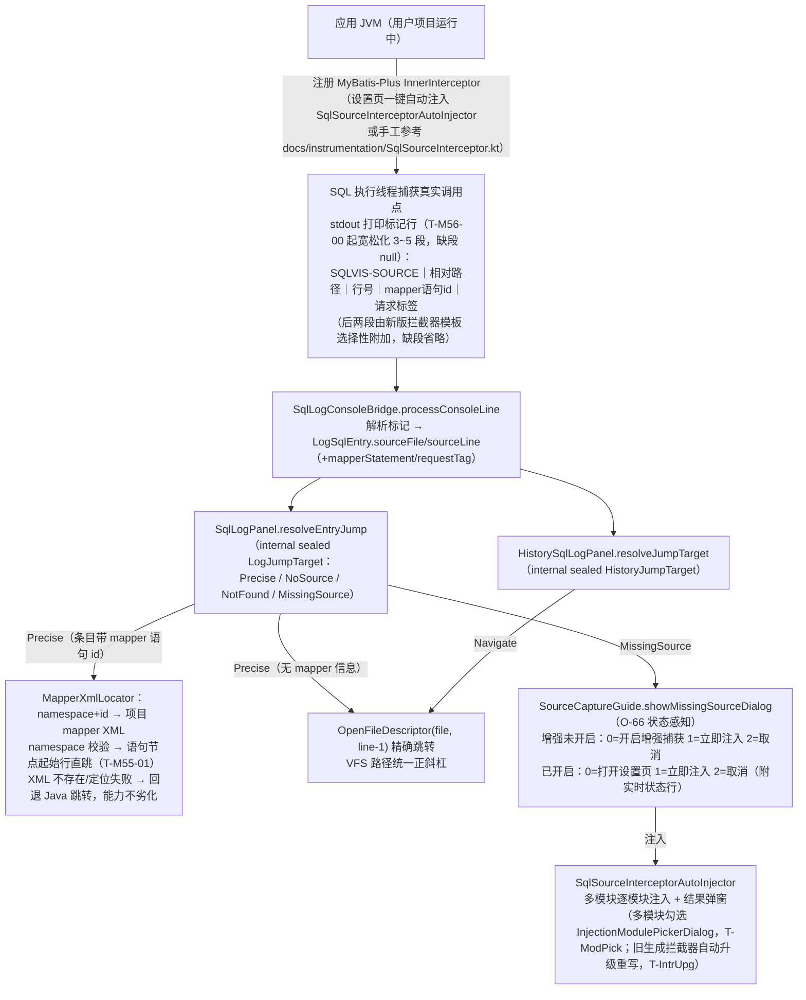

- **无捕获位置不再猜**：应用未注册拦截器时条目没有位置，跳转弹引导框（原因说明 + 两个出口），不再按表名搜索实体回退——同表名 ≠ 同调用点，命中即误导。
- **历史条目同享**：`sourceFile/sourceLine` 随 `SqlLogAutoSaver` 落盘、`SqlLogFileReader` 读回，历史面板跳转与实时面板同一套精确逻辑。
- **跳转双目标（T-M55-01）**：携带 mapper 语句信息的条目（拦截器 `ms.getId()` / agent 事件同名字段）优先直跳 mapper XML 语句节点——真实 XML 命中才跳、否则回退 Java 跳转，能力不劣化；日志页与历史页同套入口。
- **跳转判定单点（T-SourceJumpFunnel）**：实时/历史两面板的跳转目标解析收敛 `log/EntryJumpResolver`（sealed `JumpTarget` 四态同一实现）——历史条目经落盘读回的持久化往返后走同套解析，跳转能力不因重启丢档。
- **位置两段式校验（T-PsiCaptureProtocol）**：源码位置经 `psi/PsiSnapshot` 两段式捕获——读权限线程捕获 `VirtualFile` + `Document` + offset + `modificationStamp`，消费时在读权限内三项校验（文件有效 / 文档未变 / 偏移未漂）再跳；`SqlGutterLineMarkerProvider` 与 `StringSqlMethodGutterLineMarkerProvider` 两个 gutter 已接入同一校验。完整协议见《PSI跨线程读取协议.md》。

### 6.5 增强捕获链路（M56 字节码 agent，默认通道）

字节码增强是日志捕获的第二通道（beta.3 起为默认）：IDE 侧把一个纯 Java agent 挂进用户应用 JVM，在 JDBC 接口层直接捕获 SQL 执行事件，免注入拦截器即得源码位置、耗时、影响行数与请求标签。

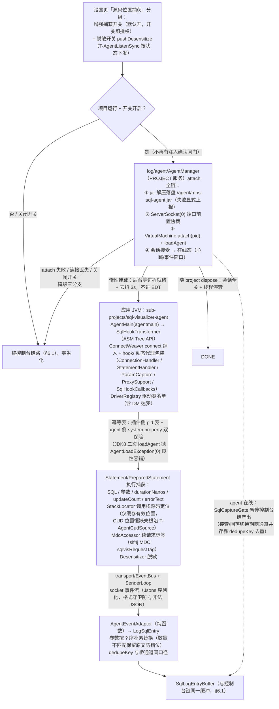

要点：

- **挂载与生命周期**：`AgentManager` 是唯一编排点——attach 四步全链、惰性挂载（不拖慢项目启动）、pid 幂等表双保险、三分支降级（任何失败都回落控制台链，捕获能力退化为无源码位置的解析模式而非不可用）、随 project dispose 摘除。T-PerfSweep4 attach 治理：pendingPids 去抖落地（防同进程重复挂载探测）、agent jar 提取复用（不每次执行全量重扫）、死会话清 pid 表；首挂确认触发面收窄——同进程已确认静默跳过（不再每次进程启动挨一次模态弹窗）+ 用户拒绝后 24h 冷却（`enhancedCaptureConsentCooldownUntil`，设置 off→on 沿重置；冷却只作用于弹窗频率，不改变同意门槛）。
- **agent 侧结构**（`sub-projects/sql-visualizer-agent`，纯 Java，构建期内嵌进插件 jar）：`AgentMain`（agentmain 入口）→ `SqlHookTransformer`（ASM Tree API 改字节码）+ `ConnectWeaver`（Driver.connect 织入）+ `hook/` 动态代理包装族；`model/SqlEvent` 字段含 sql / timestamp / durationNanos / updateCount / errorText / sourceFile+sourceLine+sourceCandidates / methodKey / requestTag / params / threadName / url（`JdbcUrlDialects` 按 url 定目标库供列表角标；connect 时 `AgentSession.lastConnectionUrl` 会话内记忆，供方言智能推断作最高优先级候选——T-DialectAutoInfer；旧版 agent 无此键按 null 容错）。
- **采集面 = JDBC 接口级**：对插件全部方言一视同仁（含 DM 达梦），唯一耦合点是 `DriverRegistry` 驱动类名单——「在线但零捕获」三类诱因：应用驱动类名不在名单 / agent 加载时序晚于驱动类加载（retransform 错过）/ 某些容器 loader 隐藏降级。
- **源码位置**：`StackLocator` 调用栈定位，T-AgentCudSource 定稿「仅缓存有效位置」——主位置为 null 时候选挑非 null 顶上、全 null 本次不产出不缓存（下次重试），修复 CUD 语句经 MP 默认方法/代理中间帧时位置恒缺失且不自愈的缓存污染。
- **请求标签**：一期经 `MdcAccessor` 反射读应用 slf4j MDC 的 `sqlvisRequestTag`（无 sl4j/无标签静默 null）；Web 过滤器 hook 织入留二期（T-M56-07）。
- **与拦截器方案的分工**：增强捕获默认开（免改用户项目）；拦截器注入（§6.4）是无 agent 场景的备选（关闭增强/attach 失败/极老 JDK），两者标记行与位置字段同构，消费端（跳转/聚焦/参数识别）一套逻辑。
- **premain 启动即捕获（T-M56Phase2-Premain）**：`PremainRunConfigurationExtension`（平台 `runConfigurationExtension` EP，plugin.xml 硬依赖本就在位）在用户运行配置准备期注入 `-javaagent`，项目一启动即捕获、不等控制台输出；判定与 VM 选项拼装收口 `PremainInjection` 纯函数决策表（增强开关 / agent jar 可用 / 端口协商三道闸门按序求值，任一失败不碰用户 Run）；注入 jar 落盘 CRC32 定名、不 deleteOnExit；端口前置协商不复用 attach 实现；agent 走 premain 回连后 30s 窗口内跳过 attach（`PREMAIN_SKIP_ATTACH_WINDOW_MS`，窗口收窄防 premain 失效时长期压制 attach 主路径）；回连去重判据 = 同 pid 是否有活动会话（不查 pid 幂等表）；premain 回连建会话点补 `clockMs` 同源注入（心跳窗口判定与主时钟同源）。
- **心跳窗口实义化（T-ReachAudit）**：`AgentProtocol.ONLINE_WINDOW_MS`（30s）落为 `AgentManager.heartbeatWindowMs` 可注入判定——会话摘除面由「socket 断开」扩为 `isSessionHealthy`（socket 在、心跳停的半死会话窗口过期即摘除回落），控制台桥不再永久回不来。
- **方言推断输入链（T-PS5 系列）**：`AgentUrlRegistry` 应用级轻量持有 + `AgentSession.lastConnectionUrl` 会话内记忆承接连接 URL（会话生命周期点写入，读端零服务实例化）；`sql/Dialect` 推断优先级 agent URL > 数据源 URL——无数据源场景也能定列表角标方言，会话全摘完回落数据源 URL。
- **捕获状态行五态（T-CaptureTruth）**：`AgentManager.agentStatusText` 纯函数产出状态文案（含 heartbeatLost 态），输入快照零平台依赖可单测——「开关开着但未授权」等真相摆到状态行上。

---

## 7. JOIN 关系图渲染链路（原生 Diagrams 优先，T-Dgm）

JOIN 图是正向结果的旁路展示：各预览链路产出语句模型后，`sql/JoinDiagramGenerator` 借 `sql/extract` 的表·JOIN·子查询提取生成图结构，再按双引擎渲染——IDEA 原生 Diagrams 框架优先，Community（无 Diagrams 插件）或框架异常时降级回自绘。

### 7.1 流程图

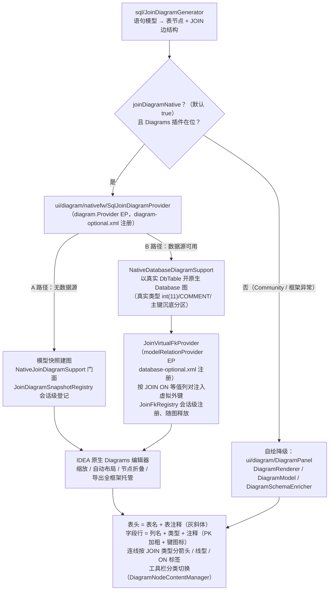

### 7.2 关键类与要点

| 类 | 职责 |
|---|---|
| `ui/diagram/nativefw/SqlJoinDiagramProvider` | `diagram.Provider` EP 实现（diagram-optional.xml 注册；插件缺席时整套注册不加载，编译期零依赖） |
| `ui/diagram/nativefw/NativeJoinDiagramSupport` | 原生建图门面：探测 `com.intellij.diagram` 可用性，缺席/异常降级回自绘 `DiagramPanel` |
| `ui/diagram/nativefw/NativeJoinDiagramOpener` / `JoinDiagramSnapshotRegistry` | A 路径：模型快照建图与会话级登记，随图释放 |
| `ui/diagram/nativefw/db/NativeDatabaseDiagramSupport` | B 路径：数据源可用时直接以真实 DbTable 开原生 Database 图 |
| `ui/diagram/nativefw/db/JoinVirtualFkProvider` / `JoinFkRegistry` | `modelRelationProvider` EP 注入 JOIN 虚拟外键；会话级注册表防泄漏 |
| `ui/diagram/DiagramPanel` / `DiagramRenderer` / `DiagramModel` / `DiagramSchemaEnricher` | 自绘降级渲染器（Community 兜底）；`DiagramSchemaEnricher` 数据源富化（列注释/类型与数据源独有列追加，追加后超 `DIAGRAM_MAX_COLUMNS` 整体放弃追加——宁少不撑爆画布） |
| `sql/JoinDiagramGenerator` | 语句模型 → 图结构（表节点/JOIN 边），双引擎共用；JOIN 表列口径 = **整实体列 + 被引用列追加 + 数据源独有列入图**（T-DgmFullCols），总列数超 `DIAGRAM_MAX_COLUMNS`（50）仅显示主键列（数据源独有列同受上限约束） |

要点：

- **降级链三级**：B 路径定位不到真实 DbTable（子查询/表名解析失败）→ 回落 A 路径快照建图 → Diagrams 整体缺席再回落自绘，功能不缺失。
- **设置键 `joinDiagramNative` 默认 true**；Community 下无论开关均走自绘。
- **JOIN 表整表列口径与字段注释来源（T-DgmFullCols / T-DbSchemaCompletion）**：JOIN 图表节点不再只画 ON 引用列——整实体列 + 被引用列追加 + 数据源独有列（实体没有、库里有的列）一并入图，总列数超 `DIAGRAM_MAX_COLUMNS`（50）仅显示主键列。字段注释/类型经 `ui/highlight/DatabaseSchemaResolver` 读数据源 schema——DBN 的 `ObjectKind` 是手写 type-safe enum（非 `java.lang.Enum`，`enumConstants` 恒 null），必须按具名静态字段 `getField("COLUMN").get(null)` 取；按枚举反射取值曾致 schema 列遍历一次都没执行且静默无日志（真机潜伏数周）。查不了（数据源模型未加载 / ObjectKind 取不到）**不写负缓存**、下次调用重试，日志如实记 scan-bail 原因；伴随修复 B 路径建图重试窗口（此前注释富化偶发空窗）。
- 适配层（快照/虚拟外键/降级门面）为纯逻辑，适配层测试纯 JUnit 可跑（`NativeJoinDiagramAdapterTest` / `NativeJoinDiagramScenariosTest` / `JoinFkRegistryTest`）。
- **预热生命周期门（T-StabilityTail）**：`SqlPreviewPanel.prewarmLifecycleGate` 挂 `ProjectEx.getEarlyDisposable()`（`Disposer.tryRegister`）——项目开始销毁即置 `previewDisposed`（`prewarmAbandoned` 判据，ReadAction 内部再判），构造期/`clear()` 派发的池线程在下一个检查点放弃而非 join，关闭路径不加重耗时。
- 无 project 上下文的同步建图分支已摘除加载态。

---

## 8. 启动与自更新链路

### 8.1 启动链路

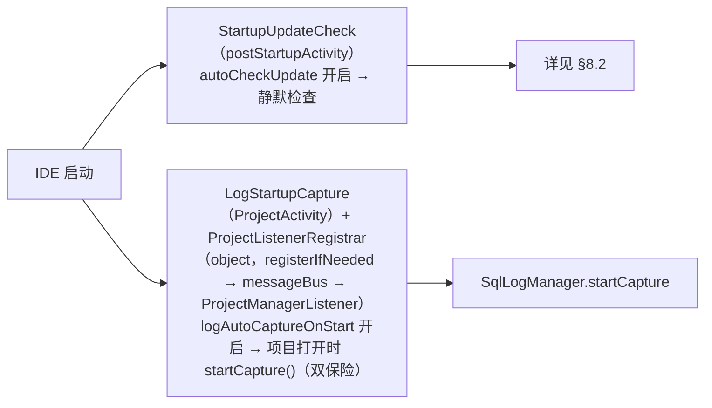

### 8.2 自更新链路（M28 → Gitee 抢先体验通道 → 免重启热替换 T-DynUpdate）

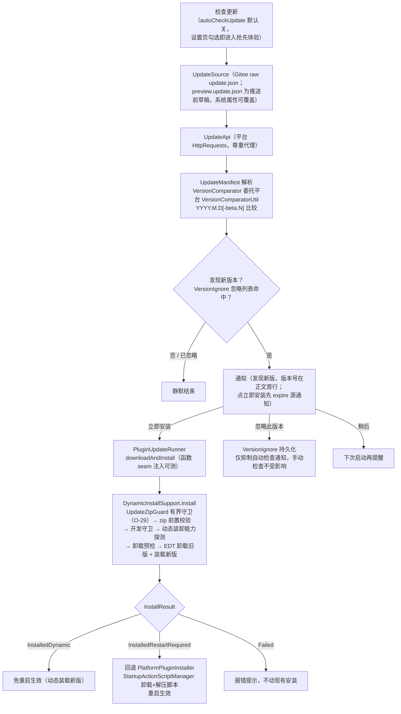

- **双通道分工**：稳定版由 JetBrains Marketplace 推送；Gitee 通道（`update/update.json`）是**内测抢先体验**，`autoCheckUpdate` 默认 false，用户主动勾选才开启。
- **免重启热替换（T-DynUpdate）**：`DynamicInstallSupport` 反射门面手工编排平台动态安装五入口（`loadDescriptorFromArtifact` / `findPlugin` / `allowLoadUnloadWithoutRestart` / `unloadPlugin` / `installAndLoadDynamicPlugin`），动态装卸能力探测通过才走免重启；任一环节探测失败自动回退 `PlatformPluginInstaller` 重启脚本通道（`InstallResult` 三分支驱动启动通知与设置页 UX 分叉）。
- **更新包有界守卫（T-UpdateZipBounds，O-29）**：`downloadAndInstall` 在平台解压器之前经 `update/UpdateZipGuard` 拦截 zip bomb 与头谎报——条目 64 / 单条目解压 64MB / 累计解压 128MB 三重上限（按 beta.4 实测 5 条目/最大 3.4MB/共 7.3MB 各 ×10 余量），恶意包最坏代价 = 有界的读取与探测内存；按中央目录声明值 +1 截断读取，size/CRC 异常双路检出「声明小、实际大」的谎报头；超限**拒绝不触安装**。`validateArtifact` 的 plugin.xml 读取同步有界 1MB。
- **弹性签名匹配**：262 平台 `unloadPlugin` 首参从 `IdeaPluginDescriptorImpl` 漂移为 `PluginMainDescriptor`——反射入口按 `resolveMethodByFirstParam` 弹性匹配而非精确签名；三平台签名回归由 `PlatformSignatureCrossVersionTest`（登记六项：动态安装五入口 + `ObjectKind.COLUMN` 静态字段可读性（DBN 未捆绑发行版自动跳过）；243/253/262，自动发现本机发行版+自带 JBR 运行纯 Java 检查器，缺失版本 Assume 跳过）护栏锁定。
- **本地清单测试**：`runIdeHotSwap` 专用 Gradle 任务（03 篇 §2）——本地清单服务 `dev-support/hotswap-local-server.py` 随任务生命周期自动起停（端口被占则报错），可在推送 Gitee 前全链离线验证「检查 → 通知 → 免重启安装」。

---

## 9. MCP 工具集链路（T-McpToolset / T-McpToolset2）

插件把 10 个只读工具注册进 IDEA 内置 MCP Server（`com.intellij.mcpServer` 插件，IDEA 2025.2+ 内置；更早版本可从 Marketplace 装 253 分支包），AI 客户端（Agent 等）经 MCP 协议调用——本质是给既有能力开了一个 AI 代理入口，工具实现全部委托既有编排层，MCP 侧只做协议适配与门控。

### 9.1 流程图

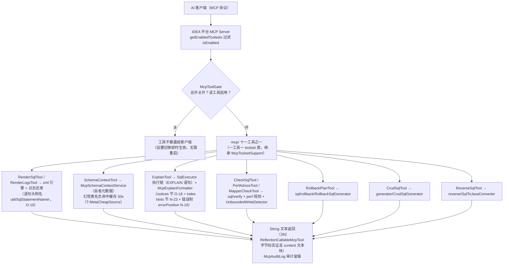

### 9.2 要点

- **注册面**：T-McpDynamicToolset 起 XML 声明退役，改 `McpToolsetDynamicRegistrar` 运行期探测 + ASM 生成壳类 + `registerExtension` 动态注册（`McpToolGate.TOOL_NAMES` / `TOOL_CLASSES` 双清单驱动，R14 T-HistorySearch 增至十一）；仅 mcpServer 插件在场时注册，243/251 旧形态静默跳过；编译期平台类型来自 mcpStub 桩源集（见 01 篇 §3 特殊点三）。十一个工具：render_sql / schema_context / explain / render_logs / check_sql / rollback_plan / perf_advice / crud_sql / reverse_sql / mapper_check / history_search（检索历史落盘文件，只读不执行）。
- **门控单点**：平台 per-tool 门控只有 toolset 粒度 `isEnabled`，故「总开关 + 工具级启用/禁用」收敛在 `McpToolGate` 读插件设置（`config/McpConfigurable` 门控页）；`getEnabledToolsets` 每次工具列表/调用重新求值，切换即时生效（262 mcpserver.jar 字节码实证）。`McpToolGate` 零 mcpserver 依赖，设置页与守卫测试共用其 `TOOL_NAMES` 单一清单。T-McpToolNaming 收敛：toolset 类名统一 `SqlVisualizer` 前缀、工具名统一 `sqlv_` 前缀（`@McpTool` name 与门控设置键同源）——平台「暴露工具」页按插件名分组、同类名字典序相邻聚合。
- **只读红线**：全部工具无写库副作用（isExperimental=false 稳定集）；涉及执行的 explain 走 `McpDbExecutor`（SELECT-only 守卫 `McpSelectGuard`，凭证不出 IDE；超时受 `ExecutionTimeoutGuard` 护栏——逐语句 `setQueryTimeout` + `cancel` 收尾，O-25）；mapper_check 的 simulate 模式对渲染产物做写风险/性能分析，不触库。
- **输出预算统一（T-McpOutputBudget，O-20）**：各工具输出预算在 `McpToolsetSupport` 基类注释集中登记（新增工具必须对齐）——perf_advice 补齐全链最后一个无上限输出：建议 ≤30 条（超限按 ERROR > WARN > INFO 裁剪保高危，尾部「showing 30 of N」计数恒可见）、单条文案 200 字符截断；未超限时输出与此前逐字节一致。
- **describe 叙事统一（T-McpNarrative，N-19）**：工具描述是 agent 选择工具的依据——统一「校验器给的是置信度评分，这里给的是确定性证据」定位句；`sqlv_render_sql` 如实口径（一次一条、多候选取首个并注明，多语句日志走 `sqlv_render_logs`）。
- **explain 输出增强（T-NoticeChannel O-16 / T-ExplainIndex N-23 / T-ErrorLocate N-18）**：执行前取尽语句级与连接级 warnings（防连接复用串扰）、成功后采集驱动 NOTICE/WARNING 附 `notices:` 节逐条透出；输出尾附 `index hints` 建议（MySQL 表格式 type=ALL/key=NULL/Using filesort·temporary、PG 文本树 Seq Scan 两方言先行，行数阈值防小表噪音，只提示不执行不改 SQL）；执行失败错误消息附 `errorPosition: line N`。两节均「空清单零追加、无命中逐字节不变」防回归硬门禁；个别驱动不支持 warnings 接口静默降级。
- **schema 负命中缓存（T-MetaCheapSource，O-21）**：查询不存在的表名（AI 生成幻觉表名是高频来源）按数据源负缓存 30 秒（时间戳惰性判定，TTL 判定边界为 `<`——TTL=0 语义即立即过期，同毫秒内复位重扫不触发），DDL/事务提交后与正缓存一起失效——长会话同一幻觉表名不再反复全库扫描，命中真实表行为不变。schema 查询侧「查不了」（模型未加载/ObjectKind 取不到）不写负缓存、下次重试（T-DbSchemaCompletion），与「查了确实没有」严格区分。
- **协议口径**：工具返回 String——T-McpGuard 字节码实证平台 `ReflectionCallableMcpTool.call` 对 String 走 `Companion.text` content 文本块（structuredContent 仅可序列化兜底分支填充），零改码即合规。
- **explain 行预算（maxRows）**：`sqlv_explain` 可选第 4 参 `maxRows`——`McpExplainFormatter` 默认 200、硬上限 1000，越界 clamp 不报错；`McpDbExecutor` 通道层取 clamp 值再钳一次。
- **执行落历史（T-McpAuditTrail）**：explain 执行经 `McpDbExecutor.onExecuted` 回调（执行链唯一出口钩子，成功/失败两路）写既有日志历史链——入库落原始 `selectSql` 不落 EXPLAIN 包装句（包装句首 token 会判 OTHER 丢类型染色）；`SqlSource.MCP` 来源标记随 `-- pd:` 载荷短键 `s` 持久化、读端回填（编解码见 §6.2）。
- **ACP 会话传输绕行（T-AcpMcpTransport）**：claude-acp agent 看不到本插件 `sqlv_*` 工具的上游根因在 `@agentclientprotocol/claude-agent-acp`——stdio 分支条件写 `!("type" in server)`，而 AI Assistant 序列化的 stdio server 必带 `type`，server 被静默丢弃（codex-acp 带 `type` 能解析，对照实验证明是 claude-acp 特有）。对策是 `acp/AcpIdeaMcpTransportProviderImpl` 注册 `ml.llm.agents.acp.ideaMcpTransportProvider` EP：仅对 `acp.registry.claude-acp` 返回 SSE 传输、其余返回 null 让位（EP 首个非 null 胜出，不把其他 agent 切到未实证通道）；注册收在 `acp-transport-optional.xml`（optional depends `com.intellij.ml.llm`，AI Assistant 缺席整文件不加载），编译期类型来自 mcpStub 桩源集、桩产物不进插件 jar。
- **旧前缀不设迁移（T-McpToolNaming 定案）**：工具级门控设置键随改名统一走 `sqlv_` 前缀，改名前的旧前缀不设迁移——MCP 未随任何发行 tag 交付过，迁移是死代码，落地后整体移除。

---

## 10. 常见问题速查（链路定位）

| 现象/需求 | 定位方向 |
|---|---|
| 某 Wrapper 方法转换不对 | `converter/QueryWrapperParser` 方法级映射（`eqOrIsNull`/`like`/`inList`/`parseGroup`…）或对应类型 Converter |
| JPA/JPQL/HQL 预览不对 | `psi/jpa/` Locator（定位/提取）+ `converter/jpa/`（PartTree/JPQL/HQL/Criteria）；HQL 列展开在 `HqlConverter`（M36.7） |
| 执行按钮无反应/控制台空白 | `execute/SqlExecutor` 三段链（prepareConsole → executePrepared）；反射桥 `database/DatabaseConsoleLauncher`；布局塌缩史见 M36.5 系列开发计划 |
| SQL 渲染格式不对 | `sql/SqlGenerator`（多行/单行、缩进、关键字引用） |
| 方言差异 | `sql/Dialect` + `DialectRegistry`（renderLimit/引号/upsert）；方言**来源**统一走 `DialectRegistry.effective(project)`——auto 模式推断链查 `DialectInference`（agent URL > 数据源 URL > MySQL 兜底），设置页可切手动指定（§2.4） |
| 表名/列名推断不对 | `psi/EntityResolver.inferDecoratedTableName` + `config` 表映射设置；JPA 实体走 `psi/jpa/JpaEntityResolver` / `HbmXmlEntityResolver` |
| 反向解析报错 | `reverse/SqlReverseParser` 的明确不支持清单（OR/子查询/函数值等；`?` 占位符与 JOIN、增删改查已支持） |
| 日志条目不出现 | `log/SqlLogConsoleBridge.attach` 失败路径 + `MyBatisLogParser` 前缀配置（Hibernate/JdbcTemplate 走各自 parser）；增强捕获接管期控制台链暂停（`SqlCaptureGate`），条目改由 agent 事件产出（§6.5）——agent「在线但零捕获」查 `DriverRegistry` 名单 / 加载时序 / loader 隐藏三类诱因 |
| 耗时/影响行数显示缺失 | agent 接管期由事件 `durationNanos`/`updateCount` 直供；控制台链查 `ExecutionTimeParser` 前缀接线（F-44-2）与 `LogDurationParser`（p6spy/druid 形态） |
| 聚焦页签不生效 / 条目被隐藏 | `FocusTab` 是过滤器非分组：Method 需条目带源码位置、Request 需 agent 请求标签（MDC），无对应维度条目在聚焦下隐藏并计数（§6.2） |
| 执行报错想定位到语句 | `execute/ExecutionErrorInfo` 富化 + `ErrorPositionExtractor` 位置提取（marker 单一性门控，不虚标精确行）→ 结果面板「定位到出错语句」按钮，仅出错时出现（§2.5） |
| 耗时显示 `—` | `log/ExecutionTimeParser` 前缀配置 + `SqlLogConsoleBridge` 喂行接线（F-44-2） |
| 跳转源码不准/没反应 | 先查应用是否注册 `SqlSourceInterceptor`（标记行）；无标记弹 `SourceCaptureGuide` 引导——增强捕获未开启时默认「开启增强捕获」，已开启时开设置页/立即注入（表名搜索回退已移除，见 §6.4） |
| 历史 SQL 不显示 | `.idea/sql-visualizer/sql-history/` 目录（更名后旧目录不读）+ `SqlLogFileReader` 格式兼容（2/3 横线） |
| 动态条件面板不对 | `model/Condition.toggle` 元数据 + `SqlPreviewPanel.renderSql` 重生成 |
| JOIN 图不渲染 / 想回自绘 | `ui/diagram/nativefw/NativeJoinDiagramSupport` 降级门面 + 设置键 `joinDiagramNative`；降级链见 §7 |
| JOIN 图缺列/缺注释 | 列口径=整实体列+被引用列+数据源独有列，超 `DIAGRAM_MAX_COLUMNS`（50）仅显示主键列；注释/类型靠数据源富化（`DatabaseSchemaResolver`，ObjectKind 静态字段读法），数据源不可用即无注释（§7） |
| 补全候选缺库里的列 | `SqlCompletionContributor` 列候选 = 实体列 ∪ 数据源 schema 列（预览预热写入 `SqlCompletionContext`）；数据源「查不了」不写负缓存下次重试，查了没有才是真没有 |
| 更新安装后没生效 | `update/DynamicInstallSupport` 能力探测失败会回退重启脚本（`InstallResult` 三分支）；签名漂移查 `PlatformSignatureCrossVersionTest`，详见 §8.2 |
| 更新包被拒绝安装 / 提示解压超限 | `UpdateZipGuard` 三重上限（条目 64/单条 64MB/累计 128MB）或头谎报检出——有界守卫拒绝、不触安装（§8.2） |
| 执行一直跑不到超时 | 超时护栏 v1 只接 MCP 直连链（`ExecutionTimeoutGuard`：setQueryTimeout + cancel）；共享控制台链由 DBN 控制台托管、插件无语句级句柄，v1 如实不覆盖（§2.5） |
| 历史条目双击没带参数 | `log/SqlLogParamCodec`（`-- pd:` 行，旧版本保存的历史文件无参数）+ `LiteralParamRecovery` 字面量兜底 |
| 日志列表卡顿 / 预览闪烁 | `SqlListFragmentRenderer` 增量刷新 + 通知节流（T-LogListFreeze-04 / T-PerfBatch）；闪烁查 `ConsoleReplayGuard`（T-PreviewFlash） |
| MCP 工具不出现 / 调用被拒 | `com.intellij.mcpServer` 插件在场性（mcp-optional.xml 整文件不加载）→ `McpToolGate` 门控（设置页总开关/工具级）→ 平台侧 McpServerSettings disallow list（独立维度），排查顺序见 §9 |
| MCP explain 没有 notices / 索引建议 | notices 仅成功路径采集且需驱动支持 warnings 接口（不支持静默降级）；index hints 两方言先行（MySQL 表格式 / PG 文本树）、无命中零追加——空节不占输出（§9） |
| MCP 输出被裁剪 | 输出预算统一（O-20）：perf_advice ≤30 条按严重级别裁剪、单条 200 字符，尾部计数恒可见；预算登记在 `McpToolsetSupport` 基类注释 |
| 语句末尾带 `\G` 执行报错 / 历史想保留 `\G` | `execute/MysqlClientGSuffix` 两态剥离——提交文本剥、历史留原文，方言按 JDBC URL 子协议判定（§2.5） |
| 自定义界符脚本（DELIMITER $$）切分/执行不对 | `util/SqlStatementSplitter` DELIMITER 指令感知：行首指令切界符、字符串/注释内不识别（§2.5） |
| XML 参数解析不出来源还想执行 | `SqlPreviewPanel.confirmUnknownParams` 执行/EXPLAIN 前提示一次，确认即继续（§2.7） |
| `<include>` 引用别的 mapper 片段没展开 | 跨命名空间 include：`XmlCrossNsFragmentResolver` + `XmlIncludeExpander`（`XmlPreviewService` 接线；MCP 与 `<script>` 链不展开，§3） |
| 日志列表方言角标不对 | 方言推断读 agent URL 优先于数据源 URL（`AgentUrlRegistry`，§6.5） |
| 项目一启动就想捕获（不等控制台输出） | premain 注入：`PremainRunConfigurationExtension` 运行配置准备期挂 agent（§6.5） |
| MCP explain 输出太长 | `sqlv_explain` 第 4 参 `maxRows`：默认 200 / 硬上限 1000，越界 clamp（§9） |
| claude-acp 会话里看不到本插件工具 | ACP SSE 传输绕行，需 AI Assistant 插件在场（`acp-transport-optional.xml`，§9） |
