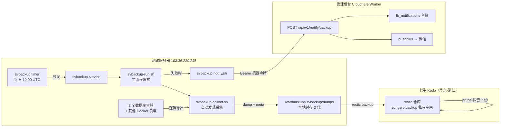
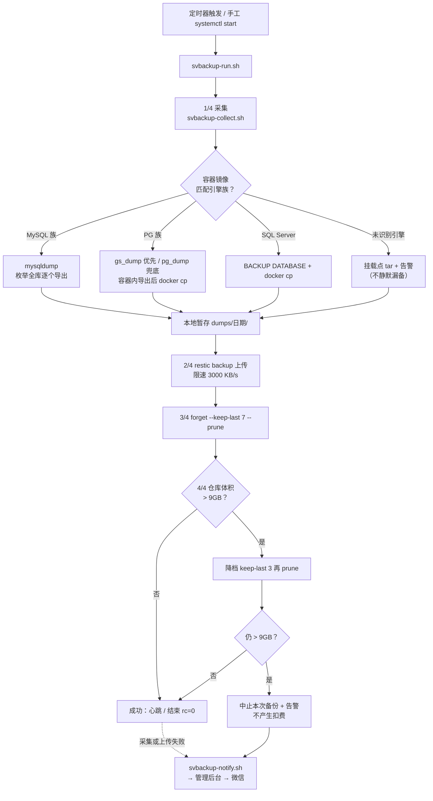
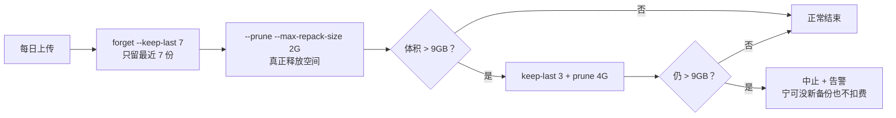
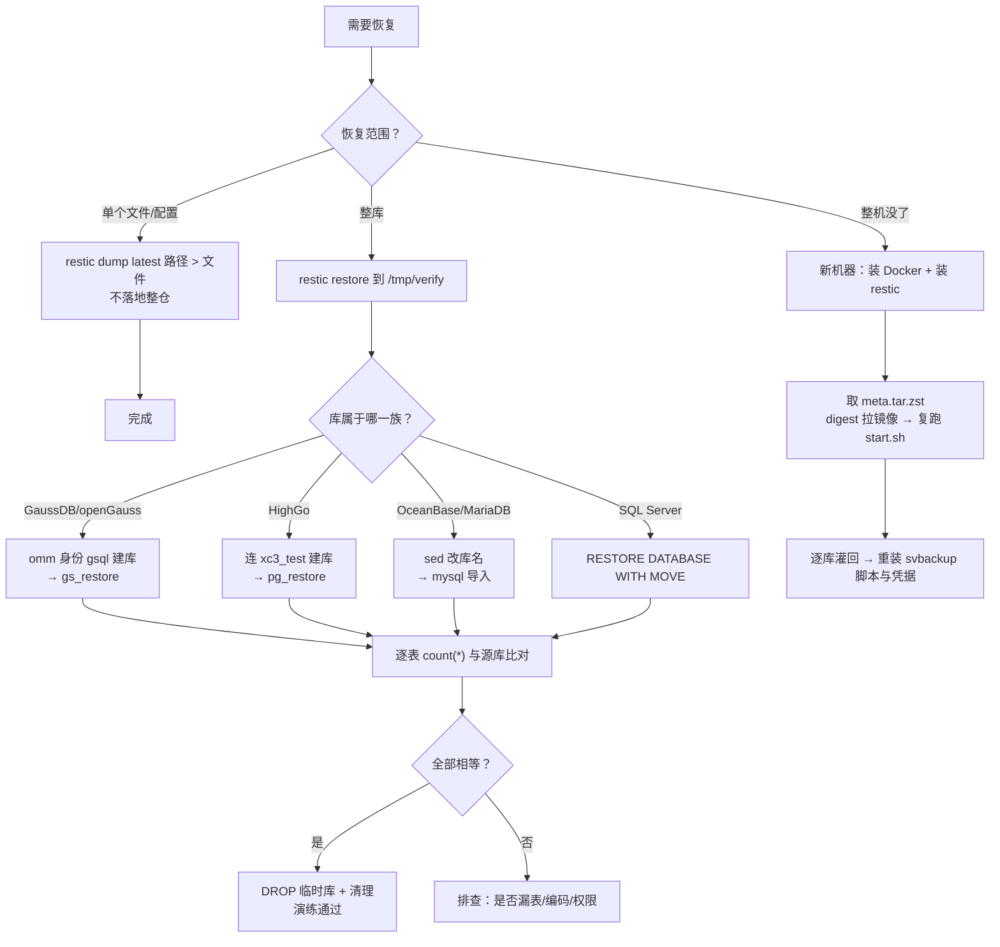
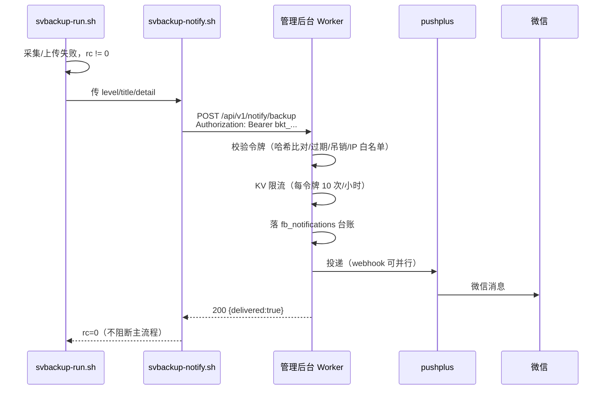

# 测试服务器备份与恢复体系-说明文档

测试服务器「不大-北京-16G」（`103.36.220.245`）的备份体系说明。这台机器跑着 8 个数据库容器与各类实验环境，是方言真机验证与 MCP 实测的靶机。

**为什么需要这套东西**：该服务器**没有任何控制台快照能力**，账号是**永久使用、无到期回收**（2026-10-31 用户确认）。也就是说，没有「装坏了点一下回滚」这条退路——一旦数据毁掉，异地备份是唯一的恢复手段。这不是「多一层保险」，是唯一保险。

配套作业手册见 `.agents/skills/srv-backup-restore/SKILL.md`（照抄可执行），本文讲的是体系怎么设计、为什么这么设计。

---

## 一、体系全貌

各组件职责：

| 组件 | 路径 | 作用 |
|---|---|---|
| 定时器 | `svbackup.timer` | 每天 UTC 19:00（北京 03:00），`RandomizedDelaySec=300` 错峰，`Persistent=true` 关机补跑 |
| 主流程 | `/usr/local/bin/svbackup-run.sh` | 编排：采集 → 上传 → 滚动保留 → 容量闸门 → 告警 |
| 采集器 | `/usr/local/bin/svbackup-collect.sh` | 枚举运行中的容器、按镜像族做逻辑导出、打元数据快照 |
| 告警器 | `/usr/local/bin/svbackup-notify.sh` | 失败时推管理后台，无令牌则静默跳过（不阻断主流程） |
| 失败兜底 | `svbackup-alert@.service` | service 的 `OnFailure=` 目标 |
| 本地暂存 | `/var/backups/svbackup/{dumps,logs}` | dump 目录本地只留 2 代，防吃盘 |
| 异地仓库 | 七牛 `songsrv-backup`（私有） | restic 仓库，S3 兼容端点 `s3.cn-east-1.qiniucs.com` |
| 凭据 | `/etc/svbackup/*` | 目录 700、文件 600 |

---

## 二、每日备份主流程

### 采集策略：为什么是逻辑导出而不是整机快照

两个硬理由，都跟「免费额度 10GB」直接相关：

1. **体积**：整机打进去，光 Docker 镜像就 8GB（镜像本身已压缩，restic 再压也没用），加上 OceanBase 那个 12GB 集群目录，整机仓库必然落在 12~18GB，超免费额度是确定事件，不是可能。
2. **一致性**：restic 备的是文件，运行中拷贝数据库数据目录得到的是「崩溃一致」而非「事务一致」。PostgreSQL 系多数能靠 WAL 起来，但 OceanBase、SQL Server 经常拷出来就起不来。真要走整机，得停容器——那就变成有停机窗口的方案。

所以走逻辑导出：8 个库导出完目前只有 **800KB 左右**，去重压缩后仓库 **1.7MB**，离 10GB 差三个数量级。

| 库 | 容器内工具 | 备注 |
|---|---|---|
| MariaDB | `/usr/bin/mysqldump` | 宿主机连发布端口 |
| HighGo | `/opt/HighGo6.0.1-cluster/bin/pg_dump` | 容器内端口是 **5866**，不是 5432 |
| Vastbase A/B | `.../vastbase/bin/gs_dump` | 该分叉的 `pg_dump` 不认 `PGPASSWORD`，必须用 `gs_dump -W` |
| openGauss | `/usr/local/opengauss/bin/gs_dump` | 需 `LD_LIBRARY_PATH=/usr/local/opengauss/lib` |
| GaussDB | `/opt/gaussdb/app/bin/gs_dump` | 需 `LD_LIBRARY_PATH=/opt/gaussdb/app/lib`，以 `omm` 身份 |
| SQL Server | `/opt/mssql-tools18/bin/sqlcmd` | **数据在容器写层无挂载**，只能 BACKUP 再 `docker cp` |
| OceanBase | 宿主 `mysqldump` 连 25881 | 必须写 `-u'xc3@test'` 带租户名 |

除数据外还打三类元数据：容器清单与镜像 digest、`docker inspect` 全量 JSON、各 `start.sh` 与 `daemon.json`——重建时比数据更救命。

---

## 三、容量与滚动策略

七牛免费额度是**标准存储 0–10GB**（超出 0.115 元/GB/月，次月初扣费），且**没有容量硬上限开关**——容量会一直涨，只能自己在客户端拦。

三个关键点：

- **`forget` 不释放空间**，必须 `--prune`。只 forget 的话 pack 文件还在，云上一分钱不会少。
- **不能给 restic 仓库配生命周期规则**。七牛的生命周期按「上传时间 + N 天」删对象，不理解 restic 的引用关系，会删掉仍被快照引用的 pack，直接毁仓。该前缀最多只允许配「未完成分片清理」。
- **不能用欠费当保险丝**。余额为 0 时超额仍会计费累积，欠费会冻结服务，长期欠费还会清数据且不可恢复。

---

## 四、恢复流程

### 恢复演练基线（2026-10-31 实测）

用真实备份还原到临时库、逐表比对行数：

| 库 | 恢复方式 | 表数 | 结果 |
|---|---|---|---|
| GaussDB Kernel 503 | `gs_restore`（omm peer 认证） | 12 | 12/12 全等 |
| OceanBase CE | 改库名后 `mysql` 导入 | 11 | 11/11 全等 |
| HighGo 6.0.1 | `pg_restore` | 5 | 5/5 全等 |
| MariaDB | 同 OceanBase | 0 | 源库本身空，跳过 |

另 `restic check --read-data-subset=5%` → `no errors were found`。

**三个必须记住的坑**：① `docker cp` 进容器的文件是 `root:600`，`omm` 读不到，要先 `chown`；② GaussDB 的 `gs_restore` **不接受 stdin**，必须给 dump 路径；③ HighGo 容器**没有 `postgres` 库**，建临时库得连 `xc3_test`。

---

## 五、告警链路

设计要点：

- **令牌是「只写」的**：只能打这一个接口，读不到任何业务数据，也换不到后台会话。它绑在一个 `permission=0` 的机器账号下（`svbackup-bot`），账号可登录但所有业务接口一律 403。
- **为什么要复用管理后台**：后台已有 `services/admin-notify.ts` 这个统一调度层（pushplus + webhook 双渠道、失败台账、失败计入 `push_fail` 预警）。复用比另起一套 Telegram/Bark 更省事，且告警有台账可追溯。
- **限流取 10 次/小时**而不是 30：每次请求写一次 KV 计数，30×24=720 次/天会吃掉 Worker 每日 1000 次 KV 写配额的七成（该配额与反馈限流共用）；10 次最坏 240 次/天。
- **`workers.dev` 域名在国内服务器不可达**，接口地址必须用站内代理 `https://sql-visualizer.jvtools.cn/api/v1/notify/backup`。

---

## 六、扩展新环境

**同类引擎零改动**：脚本按镜像名匹配族——MySQL 族含 `mysql`/`mariadb`/`oceanbase`/`tidb`/`percona`；PG 族含 `postgres`/`opengauss`/`gaussdb`/`vastbase`/`highgo`/`kingbase`/`dameng`/`dm8`；`mssql` 单列。库名靠 `SHOW DATABASES` / `pg_database` / `sys.databases` 自动枚举，不写死。

**要改的三种情况**：

1. **全新引擎**（Oracle/Redis/Mongo…）——当前落到「未知族」分支，只做挂载点文件级 tar 并告警。要做逻辑导出，在 `svbackup-collect.sh` 的 `case` 里加族函数（Redis 用 `BGSAVE` 后拷 RDB，Mongo 用 `mongodump`）。
2. **容器 env 里没有标准密码变量**、`db.env` 也没有对应条目——补 `/etc/svbackup/db.env`（600）。
3. **端口非标**——脚本已按 `docker port` 取容器内端口，一般不用动。

---

## 七、排障速查

| 现象 | 根因 | 处置 |
|---|---|---|
| `Access Denied` / `SignatureDoesNotMatch` | AK/SK 不对；写操作 region 没传 | 七牛控制台**已存在的 SK 只显示星号**，拿不到明文，只能新建一对；region 已含在端点里，读操作不带也能跑，但统一带上 |
| `invalid option -- 'd'` | 老版 pg_dump/gs_dump 不认 `-d` | 用位置参数写库名 |
| `must be used with -f/--file` | 该版 `-Fc` 不允许写 stdout | 容器内 `-f /tmp/x.dump` 再 `docker cp` |
| `error while loading shared libraries: libcjson/libpq_ce` | 缺 `LD_LIBRARY_PATH` | 按库补对应 lib 目录 |
| 卡住不动、日志停在 `Password:` | 工具在等交互式口令 | 加 `-w`（pg_dump）或 `-W`（gs_dump），stdin 接 `/dev/null`；脚本已有超时 + 每库最多 2 次尝试 |
| `cache lookup failed for index N` | 源库有悬挂索引 | 脚本会自动重试一次，通常第二遍就过 |
| `unable to locate cache directory` | systemd 下无 `HOME` | service 里 `Environment="HOME=/root"` + `XDG_CACHE_HOME` |
| 告警发不出、`http=000` | 用了 `workers.dev` 域名 | 改用站内代理地址 |

---

## 八、关键决策记录

| 决策 | 选择 | 理由 |
|---|---|---|
| 存储后端 | 七牛 Kodo，非阿里 OSS / 腾讯 COS | 后两家免费额度是限时的（3 个月 / 180 天），到期自动转按量、不提醒；七牛是无到期日的长期额度 |
| 备份粒度 | 逻辑导出，非整机快照 | 整机必然超 10GB 且数据库热拷不保证可启动（见 §二） |
| 工具 | restic 0.19.1 | 单二进制、原生 S3、CDC 去重 + 压缩、对象存储上无需额外依赖；borg 需要 POSIX/SSH 仓库，不适配对象存储 |
| 调度 | systemd timer，非 crontab | 能看上次结果、`OnFailure` 挂告警、`Persistent` 补跑 |
| 告警 | 复用管理后台，不引第三方 | 后台已有统一通知调度层与台账；只需加一个令牌鉴权的只写入口 |
| 令牌模型 | 独立机器账号 + `permission=0` | 拿不到任何读权限；比把 admin 账号密码放上高危主机安全得多 |

---

## 九、相关文档

- 作业手册（照抄可执行）：`.agents/skills/srv-backup-restore/SKILL.md`
- 选型调研：[`docs/调研报告/20261031-2020-测试服务器免费自动备份方案-调研报告.md`](../调研报告/20261031-2020-测试服务器免费自动备份方案-调研报告.md)
- 实施计划与实测记录：[`docs/开发计划/20261031-2020-T-SrvBackup-测试服务器免费自动备份落地-开发计划.md`](../开发计划/20261031-2020-T-SrvBackup-测试服务器免费自动备份落地-开发计划.md)
- 告警令牌（管理后台仓）：`sql-visualizer-admin/docs/开发计划/20261031-2200-T-BackupAlertToken-备份告警令牌与账号令牌管理-开发计划.md`
- 云资源额度（管理后台仓）：`sql-visualizer-admin/docs/云端资源与免费额度-说明文档.md` §4.10