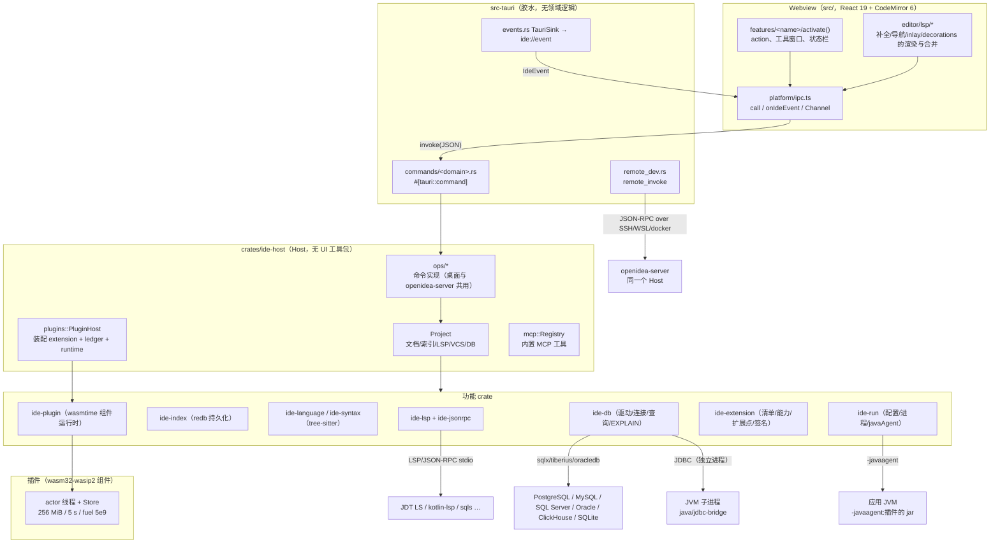

# 09 宿主架构、能力实现位置与上游演进成本

> 调研对象：`F:\code\Java\Github\other\openidea`（main @ `a7b67347c`，2026-11-25 拉取；产品版本 0.1.51）。
> 引用路径除特别注明外均相对该仓根，行号以本次读取的源文件为准。
> 结论档位沿用《00-README》：现成可做 / 变通可做 / 需上游 / 不可行。
> 插件 API 语法面（各 interface 的参数与语义）见 01 分册，本文只回答「它落在哪个 crate、成熟到什么程度、改它要多大代价」。

## 0 结论摘要

| 问题 | 结论 | 关键证据 |
| --- | --- | --- |
| 宿主是什么 | Tauri 2 桌面壳 + 无 UI 工具包的 `ide-host` 后端 + 47 个功能 crate；插件是 wasmtime 组件，跑在每个插件一个的 actor 线程上 | `docs/zh/contribute/architecture/overview.mdx`、`crates/ide-plugin/src/actor.rs:1-13`、`crates/ide-plugin/Cargo.toml:20-21` |
| 语义从哪来 | 没有 IntelliJ 意义的 PSI，也没有跨语言语义模型；语义来自各语言 LSP，IDE 自有索引与 tree-sitter 只到语法层 | `docs/zh/contribute/architecture/code-intelligence.mdx`（"为什么是 LSP 而不是类 PSI 模型"节） |
| SQL 能力在哪 | 在 IDE 里齐全（`ide-db` 自研驱动 + sqlx/tiberius/oracledb + EXPLAIN 计划模型），在插件 API 里只开了「数据源/凭据/连接」 | `Cargo.toml:117-121`、`crates/ide-db/src/lib.rs:1-4`、`crates/ide-db/src/plan.rs:1-4`、`wit/database.wit:24-33` |
| 我方最要紧的两条通道 | 跨文件关联有专用 `document-indexer`（含 alias 继承，正为 mapper extends 设计）；JVM 内有 `javaAgents` 贡献点，上游明确以「收集 SQL」为动机引入 | `wit/indexing.wit:9-60`、`crates/ide-host/src/plugins/java_agents.rs:1-14`、PR #3830 |
| 最大缺口 | 插件执行 SQL / 读结果集、读运行控制台输出、Java 类型推断（无 PSI/LSP 查询面）、插件侧持久索引 | 见 §7 |
| 上游加接口的成本 | 一次 API 增项是「wit + host + sdk + mock + released 快照 + 官方插件与夹具重建 + 文档 + 语义版本」的成套改动，历史样本 28~173 文件、+700~2800 行 | `docs/zh/plugins/versioning.mdx`、§6.3 表格 |

## 1 范围与证据口径

本文覆盖 `docs/zh/contribute/` 全部 17 篇（§8 逐篇列表）、`wit/` 30 个文件 57 个 interface 与宿主实现的对应关系、`crates/ide-plugin` 与 `crates/ide-host` 的运行时细节。核实手段：本地源码直读 + GitHub API（PR 元数据）+ 与 01/02 分册交叉。

不确定处标「待验证（推断）」。版本基线（main 1.16.0 / 已发布 1.15.0 / 本机 0.1.51 随附 1.15）已由 01 与主控实测锁定，本文不重复推导，只按 `wit/plugin.wit:11`、`sdk/rust/openidea-plugin/tests/api/released/plugin.wit:11` 引用。

## 2 分层与 crate 图

### 2.1 全景

### 2.2 关键入口

| 关注点 | 位置 | 说明 |
| --- | --- | --- |
| 后端装配 | `crates/ide-host/src/lib.rs:84`（`pub struct Host`） | 桌面壳持有一个 `Host`，`openidea-server` 也持有一个 |
| 命令声明 | `crates/ide-host/src/ops/*.rs` 的 `#[command(trust = …)]` + `ide_command::domain!` | 一处声明生成 Tauri 适配、`bindings.ts` 条目与 `openidea-server` 的 JSON-RPC 处理 |
| 流式结果 | `tauri::ipc::Channel<T>` | 搜索命中、进程输出、终端字节、进度 |
| 主动通知 | `IdeEvent` → `TauriSink` → `ide://event` | 诊断、索引状态、调试暂停等 |
| 插件宿主 | `crates/ide-host/src/plugins/mod.rs:1-17` | 生命周期：清单解析 → 每条声明由扩展点校验 → 授权账本 → 全有或全无提交 → 激活事件才实例化 |
| wasm 运行时 | `crates/ide-plugin/src/runtime.rs:507-534`（引擎与 epoch 线程）、`:982-1029`（Store 与限额） | 组件模型 + WASI p2 + fuel + epoch interruption |
| 插件 actor | `crates/ide-plugin/src/actor.rs:1-13` | 一个活跃插件一个线程；调用排队、串行、可取消 |
| WIT 宿主端实现 | `crates/ide-plugin/src/wit_host.rs`（见 §4 表） | 所有 import 函数的实现都在这里，按 interface 分 `impl` 块 |
| 扩展点与贡献 | `crates/ide-extension/src/*` | `capability.rs`、`manifest.rs`、`registry.rs`、`point.rs`、`ui.rs`，与 wasm 无关 |
| 插件 CLI | `crates/ide-host/src/bin/openidea-plugin/main.rs:40-63` | `new/build/check/link/unlink/links/keygen/endorse/pack/index/merge` |
| 远程 | `crates/ide-host/src/rpc.rs`、`bin/server.rs`、`src-tauri/src/remote_dev.rs` | 同一个 `Host`，前面换成 JSON-RPC |

### 2.3 目录与依赖规则

`Cargo.toml:3-5`：workspace 成员是 `crates/*` 与 `src-tauri`，`sdk/` 与 `plugins/` 是独立 workspace（各自面向 `wasm32-wasip2` 构建）。依赖方向 `ide-core ← ide-extension ← 功能 crate` 与 `ide-plugin ← ide-host`（`docs/zh/contribute/architecture/plugin-host.mdx`「三个 crate」节）。

47 个 crate 里对我方有意义的是：`ide-db`（SQL 执行与 EXPLAIN）、`ide-index`（redb 持久符号索引）、`ide-lsp`（JDT LS 集成）、`ide-run`（进程与 javaAgent）、`ide-extension`/`ide-plugin`/`ide-host::plugins`（插件三件套）、`ide-mcp`（外部 agent 的 MCP 服务）。

## 3 三条典型链路

### 3.1 编辑器 provider（我方补全/定义/行标记/内联提示都走这条）

1. UI 侧 `src/editor/lsp/*` 发请求（例如 `src/editor/lsp/inlay.ts:1-6` 说明 inlay 是「按可见范围、编辑与滚动后刷新，用 CodeMirror 装饰渲染」）。
2. `ide-host::ops::lsp` 把请求分发给语言服务器，同时把「声明了匹配语言的插件 provider」的结果合并进去（补全项追加在服务器结果之后，位置与高亮去重——`docs/zh/contribute/architecture/code-intelligence.mdx`「结果如何合并」表）。
3. 插件侧是一次同步 wasm 调用，受 50 ms 软 / 500 ms 硬预算约束（`wit/providers.wit:4-6`）。
4. 结果回 UI 渲染成 CodeMirror 装饰/控件。

要点：这条链路**没有缓存**，每次调用都要重新算；插件必须自建缓存（官方 mybatis 插件的做法是 `INDEX_TTL = 30s` + `MAX_INDEXED = 1024` 的进程内表，`plugins/official/mybatis/src/lib.rs:17-24`）。

### 3.2 文档索引器（我方 Mapper↔XML 关联与 gutter 箭头的主通道）

1. 项目打开后，宿主把 `[[contributes.documentIndexers]]` 声明扩展名的文件**分批**喂给插件（`crates/ide-host/src/plugins/navigation.rs:200-215` 注释："No directory traversal or parsing happens in navigation_at. Call off the UI thread, in small cancellable batches."）。
2. 插件返回 `edges{definitions, references, aliases, markers}`；宿主校验后存入**项目级内存图**（`navigation.rs:38-48` 的 `Graph`）。
3. 之后 Go to Declaration / Ctrl+click / gutter 图标全部由宿主直接读图回答，**不再回调插件**（`wit/indexing.wit:3-7`）。
4. 上限：单文档 2 MiB（`navigation.rs:14` → `ide-lsp/src/injections.rs:19`）、每文档 4096 条定义+引用（`navigation.rs:16`、`:281`）、全项目 20000 文件（`navigation.rs:15`）、alias 256 条（`navigation.rs:274`）。
5. `alias` 的语义就是为继承设计的：`keys starting with prefix also resolve as if target`（`wit/indexing.wit:40-46`），官方注释写着 "A mapper that extends another finds the inherited statements this way"。

要点：这个图**只在内存**，重启/重开项目要重建（见 §7 第 6 项）。

### 3.3 数据库（我方 EXPLAIN / 结果集预览想走但走不通的一条）

1. IDE 自己的数据库子系统：`ide-db` 直连驱动，`conn::execute` 执行、`plan::explain_statement` 按方言拼 EXPLAIN 并解析成扁平计划树（`crates/ide-db/src/conn.rs:1226`、`crates/ide-db/src/plan.rs:1-40`）。
2. 驱动栈是自研 + 托管 crate：`sqlx`（SQLite/PG/MySQL）、`tiberius`（SQL Server/TDS）、`oracledb`（纯 Rust thin）、`bb8` 池，ClickHouse 走 HTTP、Snowflake 走 HTTPS（`Cargo.toml:117-121`、`docs/zh/guide/database.mdx`）。
3. 没有预设的库走 JDBC：`java/jdbc-bridge/openidea-jdbc-bridge.jar` 由 IDE 在**独立 JVM 进程**里加载厂商驱动（`docs/zh/guide/database.mdx`「JDBC 驱动」节）。
4. 插件侧只有 `database` interface 的五个函数：`upsert-source / remove-source / sources / set-credential / connect`（`wit/database.wit:5-33`），宿主实现在 `crates/ide-host/src/plugins/database.rs`（`:32-40` 校验驱动名，`:123-136` `connect_database` 只是「请求该项目的窗口去连」）。
5. 连接与密码留在宿主：密码进 OS 钥匙串/`db-passwords.json`，`connect` 只是在 UI 里触发一次连接（`database.rs:123-136`）。

结论：**SQL 执行能力在 IDE 里存在，在插件 API 里没有暴露**。这条不是「能力缺口」而是「暴露缺口」，见 §6.5 的提案建议。

## 4 WIT → 宿主实现映射与成熟度

「宿主实现」列给 `crates/ide-plugin/src/wit_host.rs` 的 `impl` 行号（import 类接口）与 `ide-host::plugins` 的文件（导出类/扩展点类）。成熟度判据：有集成测试或官方插件在用、且边界校验齐全 = 生产可用；有实现但覆盖面窄 = 雏形；只有声明或只有校验 = 仅声明。

| WIT interface | 文件:行 | 宿主实现 | 成熟度 | 备注 |
| --- | --- | --- | --- | --- |
| `lifecycle` / `commands` / `event-handler` | `wit/exports.wit:3-34` | `ide-plugin/src/runtime.rs`（`call` 系列） | 生产可用 | 三个必备导出 |
| `document-indexer` | `wit/indexing.wit:9` | `ide-host/src/plugins/navigation.rs:200+`、`index_ops.rs` | 生产可用 | 官方 mybatis 之外，Duo/SqlToy 都在用 |
| `providers`（补全/定义/行标记/代码操作/内联） | `wit/providers.wit:7`（`line-marker` 在 `:62-83`） | `ide-plugin/src/runtime.rs:1395-1401`（调用入口）+ `ide-host/src/plugins/providers.rs` | 生产可用 | 50/500 ms 预算 |
| `inlay-hints-provider` | `wit/inlay.wit:7` | `crates/ide-host/src/plugins/inlay_hints.rs`（96 行） | 生产可用 | 与 LSP hint 并列显示 |
| `semantic-tokens-provider` | `wit/semantic.wit:7` | `plugins/semantic_tokens.rs` | 生产可用 | 重叠时插件胜 |
| `decorations` | `wit/decorations.wit:8` | `wit_host.rs:2876` | 生产可用 | 编辑器/项目树/文件图标，上限明确 |
| `hover-provider` | `wit/hover.wit:7` | `plugins/hover.rs` | 生产可用 | |
| `diagnostics` | `wit/io.wit:4`、`plugins/diagnostics.rs` | `wit_host.rs:1727` | 生产可用 | 也能读 IDE 记录的所有 producer 的问题 |
| `workspace` / `editor` / `invocation` | `wit/workspace.wit:3,112,170` | `wit_host.rs:889,914,1101,1241,1320` | 生产可用 | 文件读、glob、正则搜索、符号模糊搜索 |
| `search-provider` | `wit/search.wit:4` | `plugins/search.rs` | 雏形 | API 1.13，Search Everywhere 自定义分类 |
| `database` | `wit/database.wit:5` | `ide-host/src/plugins/database.rs` + `ide-db/src/plugin.rs` | 雏形 | 只能建源/设密码/请求连接，无查询 |
| `mcp.stdio-command` + `mcp-provider` | `wit/mcp.wit:4,10` | `plugins/mcp.rs`（工具名空间 `{plugin}__{name}`）、`ide-mcp` | 生产可用 | 需 `contributes.mcpTools` + `inputSchema` 文件 |
| `run` / `run-configurations` / `launch-configurations` / `test-results` | `wit/run.wit:4-68` | `plugins/execution.rs`、`run_detectors.rs`、`test-results` 解析 | 生产可用 | 我方若做「在库上跑 SQL」可用 run 配置包装外部客户端 |
| `run-targets` | `wit/run-targets.wit:4` | `plugins/run_targets.rs` | 生产可用 | argv 包装、容器根、命令覆盖 |
| `process` | `wit/io.wit:129` | `wit_host.rs:1963` | 生产可用 | 程序名+哈希固定，最多 8 个常驻 |
| `net` | `wit/io.wit:47` | `wit_host.rs:1771,1863` | 生产可用 | HTTPS+回环 HTTP；WebSocket 最多 8 |
| `ipc` | `wit/io.wit:221` | `wit_host.rs:2718,2736` | 生产可用 | 只 connect，不能 listen |
| `auth`（回环监听） | `wit/io.wit:238` | `wit_host.rs:2791,2802` | 雏形 | 一次性 OAuth 回调，最多 2 个，不能当通用服务器 |
| `storage` | `wit/host.wit:202` | `ide-host/src/plugins/api.rs:25`（`MAX_STORAGE = 64 << 20`）、`:2361` | 生产可用 | 64 MiB 计入键+值 |
| `fs`（含 `plugin_dir`） | `wit/fs.wit:13` | `wit_host.rs:2296` | 生产可用 | 私有目录免能力；项目外读写是高危授权 |
| `views` / `view-provider` / `settings` | `wit/views.wit:10,124,199,206` | `wit_host.rs:2098,2252`、`plugins/views.rs`、`ui_points.rs` | 生产可用 | Web 视图是沙箱 iframe + CSP |
| `commit` / `commit-checker` | `wit/commit.wit:6,57` | `plugins/commit.rs` | 生产可用 | |
| `vcs` | `wit/workspace.wit:188` | `wit_host.rs:1346` | 生产可用 | 读用 gitoxide，写用 git CLI |
| `build`（依赖图） | `wit/workspace.wit:249` | `plugins/dependencies.rs`、`build_graph.rs` | 生产可用 | API 1.10 |
| `language-servers` | `wit/host.wit:222` | `wit_host.rs:3105` | 雏形 | 只放行服务器自有方法，见 §7.1 |
| `syntax-provider` | `wit/exports.wit:37` | `runtime.rs:1294-1349` | 生产可用 | 语言自有语法的着色/大纲/折叠 |
| `file-actions` / `injections` / `language-features` / `completion-list` | 各自 wit | `plugins/*.rs` | 生产可用 | |
| `extensions`（读别人的贡献） | `wit/extensions.wit:6` | `plugins/points.rs`、`registry.rs` | 雏形 | API 1.5，插件间扩展点 |
| `java.agent`（不是 interface，是贡献点） | — | `ide-host/src/plugins/java_agents.rs:1-14`、`ide-run/src/java_agent.rs:1-14` | 雏形 | 只 Application/Spring Boot/JAR，远程不加载 |
| `secrets` | `wit/io.wit:116` | `wit_host.rs:1894` | 生产可用 | 只在 `net` 的 `{{secret:x}}` 里用，不回读 |
| `output`（插件自己的 Output 通道） | `wit/host.wit:249` | `wit_host.rs:2824` | 生产可用 | 1 MiB 环形缓冲；**不是** Run 控制台 |
| `ui.set-console-rules` | `wit/host.wit`（`ui` 段） | `plugins/console_rules.rs` | 雏形 | 能改 Run/Debug 控制台着色，**看不到输出** |
| `tasks` | `wit/events.wit:63` | `wit_host.rs:1630,1641` | 生产可用 | 开任务后预算 60 s，可续期 |
| `events` | `wit/events.wit:4` | `wit_host.rs:1573`、`event_paths.rs`、`files_changed.rs` | 生产可用 | `caret-moved` 等 1.15 事件 |

## 5 wasm 运行时限制（源码证据）

### 5.1 硬限额

出处 `crates/ide-plugin/src/types.rs:459-496`（`Limits` 与其 `Default`），与 `docs/zh/contribute/architecture/plugin-host.mdx`「限制」表一致：

| 限额 | 默认值 | 源码行 |
| --- | --- | --- |
| 每次 host→plugin 调用的 fuel（≈ wasm 指令数） | 5·10⁹ | `types.rs:485` |
| 命令/事件/activate/deactivate 墙钟 | 5 s | `types.rs:486` |
| 调用过 `tasks.begin` 后的墙钟（每次 `report`/`is-cancelled` 续期） | 60 s | `types.rs:487` |
| 编辑器 provider 软时限（超时结果丢弃，实例保留） | 50 ms | `types.rs:488` |
| 编辑器 provider 硬时限（中断，实例重建） | 500 ms | `types.rs:489` |
| 线性内存上限 | 256 MiB | `types.rs:490` |
| 重启退避 / 连续崩溃上限 | 1 s 起、每次翻倍 / 3 次 | `types.rs:491-492` |
| 空闲回收 | 300 s | `types.rs:493` |
| 单 Store 的 instances/tables/memories | 32 / 64 / 8，`trap_on_grow_failure` | `runtime.rs:985-990` |
| epoch tick | 10 ms | `runtime.rs:63` |
| 单次文本类返回上限（`MAX_TEXT`） | 1 MiB | `runtime.rs:64` |
| 剪贴板 / 文件读写 | 16 MiB | `runtime.rs:66`、`sandbox.rs:12-14` |
| storage 总量 | 64 MiB（键+值 UTF-8） | `ide-host/src/plugins/api.rs:25,2361` |

### 5.2 线程、并发、长连接、持久化、隔离

| 维度 | 事实 | 证据 |
| --- | --- | --- |
| 线程 | 插件拿不到线程能力。wasmtime 只启用了 `runtime/cranelift/component-model/std/parallel-compilation/async`，没有 `threads`；组件目标固定 `wasm32-wasip2` | `crates/ide-plugin/Cargo.toml:20-21`、`openidea-plugin/main.rs:300` |
| 并发 | 一个插件一个 `Actor` 线程；同一实例**一次只跑一个任务、从不并发** | `actor.rs:1-13`、`plugin-host.mdx`「每个插件一个 actor」 |
| 取消 | 任意线程可取消；编辑路径调用方可在软时限先返回 | `runtime.rs:1018-1029`（epoch 回调检查 cancel 与 deadline） |
| 长连接 | 没有「插件自己监听」的能力：`net` 只有 `fetch` / `websocket-connect`（客户端），`ipc` 只有 `connect`，`auth` 的回环监听是一次性 OAuth 回调（最多 2 个） | `wit/io.wit:47-114,221-237,238+` |
| 常驻子进程 | 最多 8 个，`child` 句柄掉落即杀；插件停止/回收时全杀 | `wit/io.wit:129-220` |
| 持久化 | 只有 `storage`（64 MiB KV）与 `fs.plugin_dir()`（免能力、随卸载删除）；`storage` 之外的进程内状态在空闲回收后丢失 | `wit/host.wit:202-212`、`wit/fs.wit`、`plugin-host.mdx` |
| 隔离 | 每插件独立 `Store`；无预打开目录、无环境变量、无继承 stdio、WASI 只给时钟与随机数 | `runtime.rs:982-983` 注释 + `WasiCtx::builder()` 只设 stderr |
| 授权 | 每个触及文件/进程/网络/DB 的宿主函数先查授权，缺了返回 `denied`，插件继续运行 | `wit/types.wit`（`error.denied`）、`capability.rs:14-66` |
| 远程 | 远程项目里插件跑在 `openidea-server` 侧，`process:` 在远程机解析固定，密钥留桌面端；**javaAgent 在远程不加载** | `plugin-host.mdx`「远程项目」节、`ide-run/src/java_agent.rs:8` |

### 5.3 量级估算（对我方两类热路径）

估算口径：wasm 相对原生约 1.5~3 倍慢（Cranelift 编译、无 SIMD 使用），内存按 DOM + 索引表占原文 5~15 倍估。以下为**推断**，待真实夹具实测。

| 场景 | 估算 | 与限额的关系 |
| --- | --- | --- |
| 解析一个 200 KB / 6 千行 mapper XML（roxmltree 级 DOM + 语句/resultMap/`#{}` 索引） | 原生 ~15-30 ms、内存 ~3-6 MB；wasm 估 40-90 ms、内存 10-20 MB | 5 s / 256 MiB 有 50 倍以上余量；但**编辑路径 50 ms** 会踩线 → 必须走 `documentIndexer` 或自建 30 s 级缓存 |
| 解析 2 MiB 上限的大 mapper（宿主允许的最大文档） | 原生 ~150-300 ms；wasm 估 0.4-1 s、内存 30-60 MB | 索引器调用给的是后台 60 s 档，够；但注意宿主对 indexer 也是 `actor.call` 同步等待，`MAX_DOCUMENT_BYTES = 2 MiB`（`navigation.rs:14`）是硬天花板 |
| 渲染一条 30 个链式调用的 MP Wrapper（自写 Java 词法/迷你解析 + 字符串拼装） | 单文件 5 千行 Java 的 tokenize 估 3-10 ms（wasm），链式分析 ~1 ms | 50 ms 软预算下**能做**，前提是实体字段表已在缓存里；每次重扫整个项目则不行 |
| 全项目实体字段索引（3000 个 Java 文件、每文件 8 KB） | 单文件解析 1-3 ms → 全量 3-9 s（分批可接受）；若把每文件派生结果持久化，约 1-3 KB/文件 → 3-9 MB | 64 MiB storage 够存；20000 文件上限（`navigation.rs:15`）也够 |
| 全项目 mapper 图（5000 个 XML × 每 200 条边） | 边数上限 4096/文档，内存图由宿主持有，不在插件内存 | 宿主内存而非插件 256 MiB；插件只承受单文档峰值 |

结论：**256 MiB 与 5 s 对「逐文档解析 + 缓存」绰绰有余；真正的约束是 50 ms 编辑路径与「没有跨文件类型信息」**，不是内存。

## 6 上游演进路径与成本

### 6.1 API 版本规则

`docs/zh/plugins/versioning.mdx` 给出六条硬规则，摘其要：

1. 已发布的类型与签名永不改变：不加字段、不加 variant 分支、不改名、不加参数；会长大的集合用字符串，会长大的 variant 必须有 `other(extension)` 兜底。
2. 宿主 interface（导入）**可以**加函数与 interface；旧组件不导入即可。
3. 插件 interface（导出）一旦发布**不再加函数**；插件侧新能力放进新 interface + 新可选 world。
4. 一个版本号贯穿 `wit/`、宿主（`runtime.rs:62` 的 `API_VERSION`）、SDK。
5. 1.x 全同步、文档整体传递；异步组件留到 2.0，届时用适配层让 1.x 继续跑。
6. 自动检查：`sdk/rust/openidea-plugin/tests/api_frozen.rs` 对 `tests/api/released/` 快照逐项比对；`crates/ide-plugin/tests/api_compat.rs` 检查各处版本一致与「模拟下一小版本宿主仍能链接所有已发布组件」；`wit/` 版本没有对应快照时**发布流程拒绝发布**。

另外两条实际约束（不在 versioning.mdx 里，但决定改法）：

- 组件构建时所用 API 版本会被记录并校验：主版本不同、或次版本高于 IDE 实现，安装与 `openidea-plugin check` 都拒绝（`versioning.mdx`「组件本身的版本」节）。
- 每个清单功能都有最低 API 版本门槛（`manifest.needs_api(...)`，例：`crates/ide-host/src/plugins/mcp.rs:28` 要求 `contributes.mcpTools` ≥ 1.4）——加贡献点必须同时抬 `engines.openidea`。

### 6.2 加一个 WIT 接口的改动清单

| 步骤 | 位置 | 说明 |
| --- | --- | --- |
| 1 抬版本 | `wit/plugin.wit:11`（package 行）、`sdk/rust/openidea-plugin/wit/*` 副本 | 两份必须逐字一致 |
| 2 写 WIT | `wit/<name>.wit` + 在 `wit/plugin.wit` 的 world 里 `import`；若是导出，再加 `plugin-*` 与 `*-provider` 两个 world | 导出型还要在 `providers.kind` 或贡献点里声明 |
| 3 宿主实现 | `crates/ide-plugin/src/wit_host.rs`（import）或 `crates/ide-host/src/plugins/*.rs`（扩展点/导出） | 业务逻辑按 boundaries 规则放对应领域 crate |
| 4 SDK 与 mock | `sdk/rust/openidea-plugin/src/*.rs`（类型化封装）、`mock.rs` | mock 决定第三方能否 `cargo test` |
| 5 快照 | `sdk/rust/openidea-plugin/tests/api/released/<name>.wit` | 新版本要新增整份快照，否则发布会拒绝 |
| 6 常量 | `crates/ide-plugin/src/runtime.rs:62`、`ide-extension` 的 `ENGINE_VERSION`、SDK 的 `API_VERSION` | 三处同值 |
| 7 重建产物 | `plugins/official/*/dist/plugin.wasm`、`crates/ide-plugin/tests/fixtures/*/` 的组件、`sdk/rust/openidea-plugin/tests/api/*` | `plugins/build.sh --check` 在 CI 上验证「没有过期产物」 |
| 8 测试 | `crates/ide-host/tests/plugin_*.rs`、`ide-plugin/tests/api_compat.rs`、`p0_probe.rs` | 集成测试加载真实组件 |
| 9 文档 | `plugins/README.md`（API x.y 段）、`docs/zh/plugins/versioning.mdx` 版本历史、`docs/zh/plugins/capabilities.mdx`（若加能力）、对应 `docs/zh/contribute/architecture/*` | 文档滞后是常态，但发布检查看快照 |
| 10 官方插件示范 | 通常要求至少一个官方插件或夹具真正用它 | PR #2040 的说明："the SDK, mock and a real definition-provider component demonstrate the API" |

### 6.3 历史 PR 规模（GitHub API 实测）

| PR | 标题 | 规模 | 对「加接口成本」的含义 |
| --- | --- | --- | --- |
| #1654 | 打开 plugin API 1.2 | 51 文件 / +43 −43 | 纯版本抬升与快照同步，改动很小但**必须**做 |
| #1366 | 加 `vcs.remotes`、`ui.copy-to-clipboard`、`ui.open-url` | 63 文件 / +348 −54 | 三个小函数 = 一个次版本；大头是 SDK 与官方插件重建 |
| #2040 | 暴露索引符号搜索 `workspace.symbols` | 71 文件 / +1157 −40 | 一个查询函数 + SDK + mock + 示范组件 |
| #3830 | 受授权插件的 Java agent 加入 Java 运行配置（API 1.10） | 28 文件 / +1023 −12 | 一个**贡献点**（不是 interface）也要协议、授权、哈希钉、run 集成、文档 |
| #5119 | `caret-moved` 事件（API 1.15） | 173 文件 / +703 −183 | 事件类改动波及面最大（171 个官方插件/夹具重建） |
| #3641 | MyBatis mapper XML 里的 SQL（IDE 内部，不是插件 API） | 7 文件 / +501 −20 | IDE 侧 SQL 能力靠内部 TS/前端就能落，**不经过插件 API** |
| #3638 | SQL resolution scopes | 17 文件 / +406 −15 | 同上，数据库子系统内部 |
| #1300 | MyBatis 导航/生成/@Param/SQL 日志转换（社区作者 qtvbwfn 提的宿主侧 PR） | 36 文件 / +2825 −5，**未合并（closed）** | 社区想在**宿主**里加 MyBatis 能力被拒；同一作者随后以插件形式发布 MyBatis Duo |
| #1496 | 执行时警告不安全查询（无 WHERE 的 UPDATE/DELETE 等） | 19 文件 / +1843 −41，**仍 open** | 我方「写安全预检」在 IDE 侧尚无落地 |

注：#1300 的 `merged: false` 与它被关闭的事实说明：**宿主侧直加语言特性不是可行路线**，机制类能力应以插件形式做；这条对我方战略选择有直接含义（不要去给上游加「MyBatis 支持」，而是用现有接口组合）。

### 6.4 落点判定：用 boundaries 规则

`docs/zh/contribute/architecture/boundaries.mdx` 的判定规则（"满足下面任意一条，就放到 Rust"）：读写文件、起进程或访问网络；必须远程可用；扫描范围超出打开文档或超过一帧；承担安全职责；插件/MCP/其他 crate 需要它的结果。

按这条规则推我方潜在上游提案：

| 提案 | 该落在哪 | 理由 |
| --- | --- | --- |
| `database.query(project, source, sql, max_rows)` | `wit/database.wit` + `crates/ide-db`（逻辑）+ `crates/ide-plugin`（宿主实现）+ `crates/ide-host/src/plugins/database.rs`（owner/trust 校验收口） | 查询要连接池、凭据、远程机可用——全部是 Rust 侧职责 |
| `database.explain(...)` 或复用 `query` 执行 EXPLAIN 文本 | 同上，`ide-db/src/plan.rs` 已有方言与解析，可直接复用 | 免得每个插件各写一遍方言 EXPLAIN |
| 读 Run/Debug 控制台输出（`console.read` / `consoleCommands` 反向通道） | `wit/` 新 interface + `ide-run`（输出流模型）+ `ide-host/src/plugins/`（按插件归属过滤） | 控制台在 Rust 侧；牵涉「谁能看到谁的输出」的安全决策 |
| Java agent ↔ 插件的 IPC | `ide-run/src/java_agent.rs` 建议注入 `-javaagent:…=<host 提供的 socket/port>` + `wit/ipc` 增加 listen 或 `net` 增加 loopback server | 现在插件无法监听；这是「捕获运行时 SQL」的结构性缺口 |
| 插件侧持久索引（跨会话的项目图） | `ide-host/src/plugins/navigation.rs` 把内存 `Graph` 落到 `ide-index` 的 redb | 扫描与持久化都属于 Rust；插件只管产出 edges |

一条反向经验：**纯呈现与业内计算的不要提上游**。#5565（Spring 注解串里的 SQL/JPQL 高亮）与 #3641 都是 IDE 内部改动，说明上游愿意做「编辑体验」类，但插件作者拿不到；我方若只差「高亮样式」可以自绘 decorations，不必等上游。

### 6.5 有利于我方的既有上游动向（可直接引用）

- PR #3641（已合并）：mapper XML 里的 `<select|insert|update|delete|sql>` 已获得方言着色、表/列补全、`Unable to resolve` 检查与 Go to Declaration；并且它把 `<where>/<set>/<trim>/<foreach>` 按「它们加什么」折算成 SQL 文本（`#{}` 当参数、`<selectKey>` 与注释当空）。**但它不渲染最终 SQL、不绑参数、不校验方言与性能、不向插件暴露这段文本**——这正是我方「SQL 预览」与「Wrapper 渲染」的差异空间。
- PR #5565（已合并）：Spring Data `@Query` 的 JPQL/SQL 高亮（`nativeQuery=true`、文本块、`+` 拼接都覆盖），属于「只高亮不渲染」。
- PR #1496（open）：IDE 侧「执行前警告不安全查询」，覆盖 DELETE/UPDATE 无 WHERE、恒真条件、MERGE 恒真 ON、TRUNCATE、DROP、ALTER … DROP COLUMN，并含 `EXPLAIN ANALYZE` 与括号内子查询的识别。**未合并**，我方「写安全预检 + 回滚计划」在生态里仍是空白。
- PR #5718/#5727 等（已合并主干提交）显示插件 API 仍在按周增项（`vcs.repository-at` 进 1.16），上游对**通用**能力持开放态度。

## 7 缺口清单（我方六项）

判定口径：现成 = 接口直接够；变通 = 缺直接接口但可用现有接口组合；上游 = 必须改 WIT/host；不可行 = 模型上做不到或代价远超收益。

| 我方需求 | 判定 | 现成可用 | 缺什么 / 怎么绕 |
| --- | --- | --- | --- |
| (1) 解析 Java/Kotlin 源码结构并做类型推断 | **变通（重）** | `project.read_file`、`find_files`、`search_text`、`symbols`（tree-sitter 标签：名字/种类/容器/位置）、`document-indexer`、`providers.definition/code-actions/completion` | 无 PSI/AST、无类型系统、无跨语言模型（`code-intelligence.mdx` 明写做不到）；`language-servers.request` 只放行服务器自有方法，`textDocument/*`、`workspace/*` 一律 `invalid`（`wit/host.wit:231-242`），所以拿不到 jdtls 的 hover/definition。可行路线：① 自写 Java 词法+迷你结构解析（够 Wrapper 链/实体字段/`@Select` 注解，不够泛型与重载解析）；② 随包带 Java 解析 sidecar（`process:java`，同 JPA Power Tools 的 `resources/JdbcBridge.java` 路线）；③ 只用 `symbols` 做模糊定位，语义精度有限 |
| (2) 读取运行控制台输出 | **上游**（部分变通） | `ui.set-console-rules` 只能**改颜色**且明写 "the plugin never sees the output"；`output` 只是插件自己的通道；`process` 只能读自己起的进程 | 读 Run/Debug 控制台没有接口；社区 MyBatis Duo 0.3.8 的 `[[contributes.consoleCommands]]` 自述「needs a host that knows the point」，对应 PR #5361 **仍 open**。绕法：① Java agent 收集（不走控制台）；② 让用户把日志写到文件，插件 `fs.read` 读（要求用户配置）；③ 自起 `process`（会脱离 IDE 的 Run 窗口） |
| (3) 执行 SQL 并读结果集 | **上游**（变通可行但成本高） | `database.*` 五个函数只到「请求 IDE 连接」；IDE 内部 `ide-db::conn::execute` 齐全 | `wit/database.wit` 无查询函数；方言只有 sqlite/postgres/mysql/sqlServer/clickhouse/oracle。绕法：① `process:<psql|mysql|sqlite3>`（用户须把程序加入 PATH 并批准，输出是文本不是结果集）；② 随包 JDBC sidecar + `process:java` + 驱动下载需 `net:repo1.maven.org`（JPA Power Tools 的实证路线）；③ ClickHouse 走 `net` HTTP。**最干净的是给上游加 `database.query`** |
| (4) 注册 MCP 工具 | **现成** | `contributes.mcpTools`（API 1.4）+ 导出 `mcp-provider.call` + `inputSchema` 文件；工具名被命名空间化为 `{plugin}__{name}`，插件名 40 字节、整名 64 字节（`plugins/mcp.rs:18-23,26`） | 我方 11 个工具会变成 `mybatis_plus_sql_visualizer__sqlv_render_sql` 一类长名（推断：需实测截断行为）；工具在「内置 MCP server」下暴露，客户端仍需开启 IDE 的 MCP server |
| (5) 画 gutter 图标 / inlay | **现成** | 三条路：`document-indexer.markers`（gutter 图标，宿主回答）、`providers.line-markers`（含 `icon`/tooltip/点击目标，`wit/providers.wit:62-83`）、`inlay-hints-provider`（`wit/inlay.wit`）、`decorations`（行内样式/after 文本/Markdown hover） | gutter 图标只能选宿主预置 glyph（`navigate/implemented/implementing/run`）或 `[[contributes.markerIcons]]` 自带 SVG（Duo 用过，`icons/mapper.svg`）；不能自定义交互 |
| (6) 持久索引 | **变通** | `document-indexer` 的图**只在内存**；`ide-index`（redb）只以 `project.symbols` 的**查询**形式开放（名字/种类/容器/位置），存储与写入不开放；另有 `storage` 64 MiB + `fs.plugin_dir()` | 跨会话保留「实体字段表/语句表」只能自己序列化进 storage 或私有目录，并在启动/项目打开时校验失效；全项目图每次重开重建（20000 文件上限） |

补充两项我方一定会碰到的边界：

- **Java agent 的结构性限制**：只进 Application / Spring Boot / JAR Application 配置的 JVM，**测试、Maven/Gradle 目标、应用服务器、远程项目都不加载**（`capabilities.mdx`「Java 代理」节、`ide-run/src/java_agent.rs:8`）；且宿主**不提供**身份/端口注入，`args` 只有插件自己写死在清单里的字符串（`java_agents.rs` 的 `Decl.args`）。因此 agent→插件的数据回传必须自建：agent 起 loopback HTTP 服务（插件用 `net:127.0.0.1` 当客户端）或 agent 追加写文件（插件 `fs.read` 轮询）。插件**无法**自己做服务端（`ipc` 只有 connect，`auth` 的回环是一次性回调）。
- **远程项目**：插件在远端跑，`process:` 在远端解析固定，`java.agent` 不加载，密钥留桌面端。我方若宣称「支持远程项目」，Java agent 线与本地 DB 直连都要另行设计（远程机跑 sidecar，插件用 `net`/`ipc` 找它）。

## 8 contribute 文档覆盖

`docs/zh/contribute/` 共 17 篇（原以为 18，实测 17）。逐篇要点与对我方含义：

| 文件 | 要点 | 对我方含义 |
| --- | --- | --- |
| `architecture/overview.mdx` | 分层表；进程模型（应用进程承载 webview 与整个后端；LS/DAP 是子进程；插件是进程内 wasm 组件、每插件一线程） | 我方没有任何「独立后端进程」可用，除非用 `process` 自起 |
| `architecture/crates.mdx` | 47 crate 职责表；`ide-index` redb、`ide-db` 驱动与查询、`ide-run` 进程、`ide-mcp` 服务 | 查「能力在哪」的第一张地图 |
| `architecture/boundaries.mdx` | 前端只呈现；文件/进程/网络/远程/超一帧/安全 → Rust；功能拆两侧的例子（Spring 路由：Rust 只做廉价扫描，UI 做注解解析与索引） | 我方要给上游提能力时的落点判据（§6.4）；也是「插件里能做什么」的心态校准 |
| `architecture/ipc.mdx` | 命令/Channel/事件三机制；`#[command]` + `ide_command::domain!` 一处声明三处生成；文本坐标 UTF-16 | 插件不参与这套，但读它可判断「IDE 哪里已有现成命令可借」（如 `search_text`） |
| `architecture/frontend.mdx` | features/`activate()`、action 注册表、CodeMirror 6、lazy | 插件的 Web 视图是独立 iframe+CSP，不复用工作台组件（`plugin-host.mdx`「贡献如何到达 UI」） |
| `architecture/code-intelligence.mdx` | 四层来源；**无 PSI、无跨语言语义模型**；tree-sitter 兜底会标 `certain:false` | 一级约束：类型推断只能自建（§7.1） |
| `architecture/plugin-host.mdx` | 三 crate 分工；生命周期五步；actor 串行；沙箱四无；限额表；贡献到 UI 的两条路（UiStore 声明式 / PluginEvent 运行时）；远程 | 本文 §5 的主要来源；注意正文写 `openidea:plugin@1.7.0` 是**文档滞后**，以 `wit/plugin.wit:11` 的 1.16.0 为准 |
| `architecture/remote.mdx` | `openidea-server` 与 `ide-remote`（SFTP 部署）不是一回事；传输 SSH/WSL/docker exec；daemon 与 `--attach` | 远程项目下插件在服务端，我方 UI 假设要分开 |
| `setup.mdx` | Tauri 2 双工具链（Rust ≥1.96 + pnpm）；worktree；首次构建坑 | 插件仓只用 `openidea-plugin` CLI，不必全量起主仓（`cargo build --target wasm32-wasip2`） |
| `workflow.mdx` | issue 先要 `planned` 标签；PR 必带验证说明；评审与合并规则 | 提 WIT PR 必须先 issue 拿 planned，否则白做 |
| `security.mdx` | 私密漏洞报告；安全模型：项目信任、插件沙箱、本地服务只听 127.0.0.1 | 我方 `net:127.0.0.1`/`ipc` 的审查会按「本地服务」标准看 |
| `testing/unit-e2e.mdx` | nextest / Vitest / Playwright 三层 | 插件侧不在其中；插件用 SDK 的 mock host + `openidea-plugin check` |
| `testing/smoke.mdx` | 语言冒烟跑真实服务器与 fixtures；`openidea-server` 冒烟 | 我方 DB/Java 相关只能自建夹具，别指望这套 |
| `testing/perf.mdx` | `pnpm perf`（UI 预算）、`pnpm perf:rust`（含插件运行时基准：`plugins/load_50`、`plugins/cold_activation`）、`pnpm eval` | 插件有官方基准口径，可对标 |
| `guidelines/ui.mdx` | 设计 token、CSS Modules、图标、无障碍、WebKit | 我方 Web 视图要自成体系（iframe 内拿不到 token，推断） |
| `guidelines/i18n.mdx` | 源文本目录 + 键目录；必须英/中；插件用 `locales/<tag>.json` | 我方 40 项设置双语的落法：`contributes.settings` 的 schema + locales |
| `guidelines/code-style.mdx` | rustfmt/clippy、oxlint、pre-commit、提交标题 | 插件仓沿用同风格即可 |

## 9 需上游确认

1. **`database.query` 是否有计划**：`ide-db` 已有查询与 EXPLAIN 全套，但 `wit/database.wit` 未暴露。是否有意留给插件（若有 issue/plan，我方直接跟）？
2. **Run/Debug 控制台的插件读取**：#5361（console commands）是「插件收选区文本」的单向口，是否有 `console.read` 一类的常驻读取计划？这决定我方日志还原能否「一键从运行窗口取日志」。
3. **Java agent 的宿主通道**：会不会给 `javaAgents` 注入 host 提供的端口/socket（现在只有静态 `args`）？若不注入，官方是否认可「插件约定 loopback HTTP + `net:127.0.0.1`」这一形态？
4. **`language-servers.request` 的放行范围**：`textDocument/*` 与 `workspace/*` 一律拒绝是安全选择还是暂时限制？若未来放行只读方法，Java 类型推断成本会骤降。
5. **插件侧持久索引**：`document-indexer` 的图只存内存；是否计划落 redb（跨会话）。这决定我方「全项目 Mapper 图」能否秒开。
6. **MCP 工具名的长度与命名空间**：`{plugin}__{name}` 在长插件 id 下是否有截断规则（`mcp.rs:18-23` 只校验总长 64），需实测。
7. **#1496（不安全查询警告）的归属**：它会以 IDE 内置能力落地还是只做前端提示？若落地，我方「写安全预检 + 回滚计划」的差异化要重新定位（回滚计划与 `sqlv_check_sql` 仍是我方独有）。

## 附：本文引用的 GitHub 证据（PR）

`#1654`、`#1366`、`#2040`、`#3830`、`#5119`、`#3641`、`#3638`、`#5565`、`#1496`（open）、`#1300`（closed/未合并）、`#5361`（open），均在 `l0ng-ai/openidea`，用 `GET /repos/l0ng-ai/openidea/pulls/<n>` 复核。